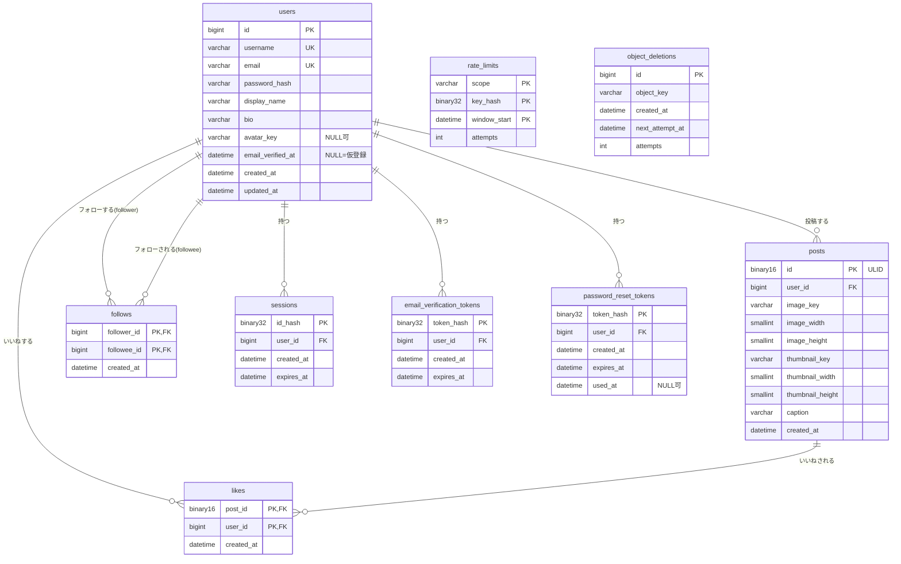

# DB 設計

[要件定義書](../requirements.md) の 4 章・6 章・7 章と [ADR 001](../adr/001_delivery-architecture.md) をもとにした MySQL のスキーマ設計である。実装（`db/migrations`、sqlc のクエリ）はこの文書にもとづいて別途作る。

## 1. 方針

| 項目 | 方針 |
| --- | --- |
| MySQL | 8.4 LTS。`CHECK` 制約の強制、`SKIP LOCKED`、降順インデックスなど 8.0 以降の機能を前提にする |
| 文字コード | `utf8mb4`。テーブル既定の照合順序は `utf8mb4_0900_ai_ci` |
| 照合順序の例外 | `username` は `ascii_bin`（大文字小文字を区別。入力規則で英小文字のみ）。`email` は `utf8mb4_0900_as_ci`（大文字小文字は区別せず、アクセント記号は区別する）。オブジェクトキーは `ascii_bin` |
| ストレージエンジン | InnoDB |
| ID（投稿） | **ULID** を `BINARY(16)` で保存する。アプリ側（Go）で生成する。API・URL では 26 文字の Crockford Base32 文字列で表す。理由は 8 章の D-1 を参照 |
| ID（ユーザー等） | `BIGINT UNSIGNED AUTO_INCREMENT`。ユーザーは URL にユーザー名（`/users/{username}`）が出るため、内部 ID は API に出さない |
| ID（トークン・セッション） | 推測困難な乱数（32 バイト）の SHA-256 を `BINARY(32)` で持つ。生の値は保存しない |
| 日時 | `DATETIME(3)`（ミリ秒）で **UTC** を保存する。MySQL は `default-time-zone='+00:00'`、接続は `parseTime=true&loc=UTC`。`TIMESTAMP` は 2038 年問題とセッションのタイムゾーン依存があるため使わない。表示用のタイムゾーン変換はフロントエンドで行う |
| 現在時刻 | **DB の `NOW()` / `CURRENT_TIMESTAMP` は一切使わない。** 期限判定のクエリはアプリが `now` を引数で渡す。`created_at`・`updated_at`・`next_attempt_at` など、行に書き込む日時もすべて `Create*` / `Update*` の引数としてアプリが渡す（テストで時刻を固定し、7 日・24 時間・1 時間・30 日の期限を制御するため）。そのため日時カラムには既定値を付けず、渡し忘れは `NOT NULL` 違反で検知する。`posts.created_at` は ULID の時刻部（ミリ秒）と同じ値にする（3.5） |
| 論理削除 | **使わない**。投稿の削除は物理削除（PST-06 で画像も消すため）。ユーザーの削除は MVP では未本登録の破棄（ACC-05）のみ |
| 外部キー | 張る。`ON DELETE` は各テーブルで理由を書く |
| sqlc | 非認証時の「閲覧者 ID」は `0` を渡す（`users.id` は 1 始まりのため 0 は存在しない）。`COUNT` は `BIGINT` で返る |

## 2. ER 図



`rate_limits` と `object_deletions` は他のテーブルと外部キーで結ばない独立したテーブルである（8 章の D-4、D-5 を参照）。

## 3. テーブル定義

### 3.1 users

用途: アカウントとプロフィール。`email_verified_at` が `NULL` のものは仮登録（ACC-01・ACC-02）、値があるものは本登録済みである。

| カラム | 型 | NULL | 既定値 | 説明 |
| --- | --- | --- | --- | --- |
| id | BIGINT UNSIGNED AUTO_INCREMENT | NO | - | 内部 ID。API には出さない |
| username | VARCHAR(20) ascii_bin | NO | - | ユーザー名。3〜20 文字、`[a-z0-9_]`。登録後は変更しない |
| email | VARCHAR(254) utf8mb4_0900_as_ci | NO | - | メールアドレス。アプリで前後の空白除去と小文字化をしてから保存する |
| password_hash | VARCHAR(255) | NO | - | bcrypt のハッシュ（60 文字）。他のアルゴリズムへ移行できるよう余裕を持たせる |
| display_name | VARCHAR(30) | NO | - | 表示名（1〜30 文字）。登録時はユーザー名と同じ値を入れる |
| bio | VARCHAR(160) | NO | `''` | 自己紹介（0〜160 文字） |
| avatar_key | VARCHAR(255) ascii_bin | YES | `NULL` | アイコンのオブジェクトキー。`NULL` は未設定（既定アイコンを表示）。**サーバーが長辺 256px（縦横比保持）に縮小して保存した画像**のキーで、元画像は保存しない（確定事項）。形式（案）は `avatars/{UUIDv4}.{拡張子}`。変更のたびに新しい UUID を使い、同じキーを上書きしない（ADR 001）。ユーザー ID やユーザー名をキーに含めない。出力形式（拡張子）はサムネイルと同じで、9 章 Q-1 に従う |
| email_verified_at | DATETIME(3) | YES | `NULL` | 本登録日時。`NULL` は仮登録 |
| created_at | DATETIME(3) | NO | -（アプリが渡す） | 作成（仮登録）日時 |
| updated_at | DATETIME(3) | NO | -（アプリが渡す） | 更新日時。`Update*` クエリが `updated_at = :now` を設定する |

- 主キー: `id`
- 一意制約: `uq_users_username (username)`、`uq_users_email (email)`
- `CHECK`: `username` が `^[a-z0-9_]{3,20}$` に一致すること（アプリの検証をすり抜けた場合の防御。主たる検証はアプリで行う）
- 外部キー: なし（参照される側）
- インデックス:

| 名前 | 列 | 使うクエリ・理由 |
| --- | --- | --- |
| uq_users_username | username | プロフィール表示（`/users/{username}`）、フォロー・解除、一覧の対象ユーザーの解決、ログイン、登録時の重複検査。`email_verified_at IS NOT NULL` などの追加条件は、一意索引で 1 行を引いた後に、その行（クラスタ化インデックス）の値で判定するだけなので、インデックスの追加・変更は要らない（3.1 末尾の「仮登録のユーザーの扱い」を参照） |
| uq_users_email | email | ログイン（メールアドレス）、再設定の申請、登録時の重複検査 |
| idx_users_unverified | email_verified_at, created_at | 期限切れ仮登録の削除（`WHERE email_verified_at IS NULL AND created_at < ?`）。5 章を参照 |

#### 一意制約と ACC-05（再登録）の関係

仮登録も `users` に入れるので、仮登録のユーザー名・メールアドレスは一意制約によって予約される。ACC-05 は「7 日たった仮登録は破棄し、同じ値で再登録できる」ことを求めるので、次の二段構えにする。

1. 定期削除（5 章）が、作成から 7 日を過ぎた仮登録を削除する。これで通常は解放される。
2. 定期削除の実行間隔の隙間を埋めるため、**登録処理の中で、同じユーザー名またはメールアドレスの期限切れ仮登録を先に削除してから `INSERT` する**（同一トランザクション）。これにより、7 日を過ぎた時点で、削除ジョブの実行を待たずに再登録できる。

```sql
-- 登録トランザクション（クエリ名: DeleteExpiredUnverifiedUsersByIdentity）
DELETE FROM users
 WHERE email_verified_at IS NULL
   AND created_at < sqlc.arg(now) - INTERVAL 7 DAY
   AND (username = sqlc.arg(username) OR email = sqlc.arg(email));
-- 続けて CreateUser
```

#### 登録処理の流れ（API-03）

メールアドレスの重複は画面に出さない（ACC-09 の考え方を登録にも適用する。確定事項）。ユーザー名の重複だけが 409 `USERNAME_TAKEN` になる。7 日以内の仮登録または本登録済みのユーザーと同じ値で登録しようとすると一意制約違反（MySQL エラー 1062）になるので、次の流れで分岐する。**この流れが [API-03](api/paths/API-03_signup.yaml) の処理順の正である**（api/README.md はこれに合わせる）。

1. 入力の検証とレート制限（`signup_mail_*`）の後、**メール送信キューの空きを 1 つ確保する**（api/README.md 1.11）。確保できなければ 503 `SERVICE_UNAVAILABLE`（ユーザーは作らない）。キューの状態はアドレスの登録の有無と無関係なので ACC-09 に反しない。確保した枠は、以降の手順で 409 や失敗になった場合は戻す。
2. **パスワードの bcrypt ハッシュを計算する**。成功経路と重複経路で処理時間に差が出ないよう、ハッシュは分岐の前に必ず計算する。
3. トランザクションを開始し、`DeleteExpiredUnverifiedUsersByIdentity`（上記）を実行する。
4. `CreateUser` を実行する。
   - 成功: 確認トークンを `CreateEmailVerificationToken` で発行してコミットし、確保した枠で確認メールの送信ジョブをキューに積む。
   - 1062: トランザクションをロールバックし、**どちらの制約かは、エラーメッセージのキー名ではなく、検索で判定する**。ユーザー名とメールアドレスの両方が重複した場合に MySQL がどちらを報告するかは、インデックスの検査順に依存するため。新しいトランザクションで、次の順に引く（どちらも「有効な仮登録を含む」条件。4.5）。
     1. `GetUserByUsername` で引く。見つかった: 409 `USERNAME_TAKEN`（枠を戻す）。メールアドレスが重複していても、応答はこれだけで、メールの有無は漏れない（攻撃者が既存のユーザー名を指定しても、メールアドレスの登録の有無と無関係に常に 409 になる）。
     2. 見つからなければ `GetUserByEmail` で引く。見つかった: 原因はメールアドレスの重複である。ユーザーは作らず、**通常の成功と同じ応答（201。本文も同じ `{email, username}`）を返し**、「登録済みメールの処理ジョブ」（手順 5）を確保した枠でキューに積む。
     3. 両方とも 0 行（引いた直後に削除ジョブなどで行が消えた競合）: 手順 3 からやり直す（1 回だけ）。bcrypt の再計算と枠の再確保は要らない。やり直しでも 1062 になり、なお両方 0 行のときは 503 `SERVICE_UNAVAILABLE` を返して枠を戻す。
5. 「登録済みメールの処理ジョブ」（非同期。API-05 のジョブと同じ仕組み。メール重複の処理はすべてこのワーカーが行う）は `GetUserByEmail`（「有効な仮登録を含む」条件）で相手を引き、次のとおり分ける。
   - 本登録済み（`email_verified_at IS NOT NULL`）: 「登録済みの案内メール」を送る。トークンは発行しない。
   - 7 日以内の有効な仮登録: `DeleteEmailVerificationTokensByUser` で古いトークンを削除し、新しいトークンを `CreateEmailVerificationToken` で発行して確認メールを再送する（API-05 と同じ）。
   - 見つからない（ジョブの実行前に破棄された）: 何もしない。

- 同期部分で DB に触れる回数と応答は、新規登録とメール重複で同一に見えるようにする（応答のステータス・本文・ヘッダー、パスワードのハッシュ計算）。トランザクションの内側で差が出る部分（トークンの `INSERT` の有無）は、数ミリ秒の差であり、ネットワークの揺らぎに埋もれる。完全な同時間性は求めない。
- 失敗した `INSERT` でも `AUTO_INCREMENT` は進むが、`users.id` は連番であることを保証しておらず、API にも出さない（D-2）ので影響はない。
- スキーマの変更は要らない。メールアドレスの一意制約（`uq_users_email`）は、ユーザーを作らないために使う（重複の検出源）。
- API 設計への影響: `EMAIL_TAKEN`（409）は API-03 から返さない。
- **既知の問題（ユーザー判断で受け入れ）**: メールアドレス重複の経路ではユーザー名を確保しない。そのため、同じ入力で 2 回登録操作をすると、1 回目で新規作成されたユーザー名が 2 回目は 409 になる一方、既存メールの場合は 2 回とも 201 になり、2 回の操作の結果の違いからメールアドレスの登録の有無を推測できる。完全には防げないため、`signup_mail_ip` などの IP 単位のレート制限で大量の調査だけを抑える。

#### 仮登録のユーザーの扱い（参照時の判定）

仮登録の行は削除ジョブの実行まで物理的に残るので、クエリ側で次の 2 種類の条件を使い分ける。api/README.md の D-30（作成から 7 日超の仮登録は、削除ジョブの前でも存在しないものとして扱う）と D-16（仮登録は 404）にもとづく。

| 呼び名 | 条件 | 使うクエリ |
| --- | --- | --- |
| 本登録済みのみ | `u.email_verified_at IS NOT NULL` | プロフィール、投稿一覧・フォロー一覧・フォロワー一覧の対象ユーザーの解決、フォロー・解除の対象の解決（4.3、4.4）。仮登録中のユーザーは 404 とし、一覧にも出さない |
| 有効な仮登録を含む | `(u.email_verified_at IS NOT NULL OR u.created_at > sqlc.arg(now) - INTERVAL 7 DAY)` | ログイン（`GetUserByUsername` / `GetUserByEmail`）、確認メールの再送対象の検索、確認トークンの検証、`MarkUserVerified`（4.5）。作成から 7 日超の仮登録は存在しないものとして扱う |

どちらも `uq_users_username` / `uq_users_email` の一意索引で 1 行を引いた後の行フィルタであり、追加のインデックスは要らない。`idx_users_unverified` は削除ジョブ専用のままである。

別案として、仮登録を別テーブル（`pending_registrations`）に分け、本登録時に `users` へ移す構成も検討した。一意制約は本登録済みの行にだけ掛かり再登録の問題は消えるが、7 章のエンティティ（`users` に「本登録日時」がある）から外れる。また、本登録時の移行処理と、2 つのテーブルをまたぐ一意性の検査（仮登録側に同じ値がある場合の扱い）が必要になる。単純さを優先して採用しない。

### 3.2 email_verification_tokens

用途: メール確認トークン（ACC-02・ACC-03）。有効期限は 24 時間。

| カラム | 型 | NULL | 既定値 | 説明 |
| --- | --- | --- | --- | --- |
| token_hash | BINARY(32) | NO | - | トークン（32 バイトの乱数）の SHA-256。生のトークンは保存しない |
| user_id | BIGINT UNSIGNED | NO | - | 対象ユーザー |
| created_at | DATETIME(3) | NO | -（アプリが渡す） | 発行日時 |
| expires_at | DATETIME(3) | NO | - | 有効期限（`created_at` + 24 時間。アプリが計算して渡す） |

- 主キー: `token_hash`（トークンの検索キーであり、一意性も兼ねる）
- 外部キー: `user_id → users(id) ON DELETE CASCADE`。仮登録が破棄されたときにトークンも一緒に消すため
- インデックス:

| 名前 | 列 | 使うクエリ・理由 |
| --- | --- | --- |
| PRIMARY | token_hash | 確認リンクの検証（`GetEmailVerificationToken`） |
| idx_evt_user_id | user_id | 再送時に同じユーザーの古いトークンを削除する。外部キーにも必要 |
| idx_evt_expires_at | expires_at | 期限切れトークンの一括削除 |

トークンは 256 ビットの乱数なので、ソルトなしの SHA-256 で十分である（総当たりで元の値を推測できない）。パスワードと違い、bcrypt のような遅いハッシュは不要で、検索キーとして直接引けることを優先する。

- **確認が完了してもトークンは削除しない。** 期限（24 時間）が来るまで行を残し、5 章の期限切れ削除ジョブに任せる（api/README.md D-8 で確定）。確認済みのユーザーが同じリンクをもう一度開いたとき、`GetEmailVerificationToken` が `users.email_verified_at` を一緒に返すので、API は `ALREADY_VERIFIED`（409）と `TOKEN_INVALID`（400）を区別できる。期限（24 時間）を過ぎて行が消えた後は `TOKEN_INVALID` になる。
- 安全性は変わらない。トークンはハッシュで保存されており、本登録の更新は `email_verified_at IS NULL` の条件付きなので、残っていても再利用で状態は変わらない。
- 再送時は、そのユーザーの古いトークンを削除してから新しいトークンを発行する（有効なリンクは常に 1 つ）。再送は仮登録のユーザーにだけ行うので、確認済みユーザーのトークンはこの削除の対象にならない。

### 3.3 password_reset_tokens

用途: パスワード再設定トークン（ACC-08）。有効期限は 1 時間で、一度使うと無効になる。

| カラム | 型 | NULL | 既定値 | 説明 |
| --- | --- | --- | --- | --- |
| token_hash | BINARY(32) | NO | - | トークンの SHA-256 |
| user_id | BIGINT UNSIGNED | NO | - | 対象ユーザー |
| created_at | DATETIME(3) | NO | -（アプリが渡す） | 発行日時 |
| expires_at | DATETIME(3) | NO | - | 有効期限（`created_at` + 1 時間。アプリが計算して渡す） |
| used_at | DATETIME(3) | YES | `NULL` | 使用済み日時。`NULL` は未使用 |

- 主キー: `token_hash`
- 外部キー: `user_id → users(id) ON DELETE CASCADE`
- インデックス: `idx_prt_user_id (user_id)`（新規発行時に同じユーザーの未使用トークンを無効化する。外部キーにも必要）、`idx_prt_expires_at (expires_at)`（期限切れの一括削除）
- 「一度使うと無効」は `UPDATE password_reset_tokens SET used_at = sqlc.arg(now) WHERE token_hash = sqlc.arg(token_hash) AND used_at IS NULL AND expires_at > sqlc.arg(now)` の影響行数が 1 であることで保証する（並行して 2 回使われても片方だけ成功する）。
- 要件では「使用済み日時」を持つので、使用後も期限が来るまで行は残す（5 章で削除）。

### 3.4 sessions

用途: ログインセッション（6.2）。有効期限は 30 日。

| カラム | 型 | NULL | 既定値 | 説明 |
| --- | --- | --- | --- | --- |
| id_hash | BINARY(32) | NO | - | セッション ID（Cookie の値。32 バイトの乱数）の SHA-256 |
| user_id | BIGINT UNSIGNED | NO | - | ログイン中のユーザー |
| created_at | DATETIME(3) | NO | -（アプリが渡す） | 作成日時 |
| expires_at | DATETIME(3) | NO | - | 有効期限（`created_at` + 30 日。アプリが計算して渡す） |

- 主キー: `id_hash`
- 外部キー: `user_id → users(id) ON DELETE CASCADE`
- インデックス: `idx_sessions_user_id (user_id)`（パスワード再設定時にそのユーザーの全セッションを破棄する）、`idx_sessions_expires_at (expires_at)`（期限切れの一括削除）
- **セッション ID もハッシュ化して保存する。** セッション ID は Cookie に入れる持ち主の証明であり、DB にそのまま保存すると、DB のバックアップやダンプの漏えい、SQL インジェクションによる読み取りだけで、全ユーザーのセッションを乗っ取れてしまう。ハッシュにしておけば漏えいしても Cookie の値は復元できない。コストは、リクエストごとの SHA-256 1 回だけである（無視できる）。トークンと同じ扱いに統一でき、実装も単純になる。
- 有効期限は作成から 30 日の固定とし、アクセスごとの延長（スライディング）は行わない（`last_seen` などの更新で書き込みが増えるのを避ける）。要件 6.2 は「有効期限は 30 日」とのみ書いており、固定として解釈した。
- 有効かどうかは、検索時に `expires_at > :now` で判定する（削除ジョブの実行を待たない）。
- CSRF トークンはこのテーブルに持たない。API 設計（api/README.md 1.4）で、セッション ID（Cookie の値）から HMAC で導出すると決まった。DB の変更は要らない。

### 3.5 posts

用途: 投稿（PST-01〜PST-08）。作成後は変更しない（PST-06）ため、`updated_at` は持たない。

| カラム | 型 | NULL | 既定値 | 説明 |
| --- | --- | --- | --- | --- |
| id | BINARY(16) | NO | - | ULID。時刻順に並ぶ（ソートキーにも使う）。URL の `/posts/{投稿ID}` に使う |
| user_id | BIGINT UNSIGNED | NO | - | 投稿者 |
| image_key | VARCHAR(255) ascii_bin | NO | - | 元画像のオブジェクトキー |
| image_width | SMALLINT UNSIGNED | NO | - | 元画像の幅（px、1 以上）。サーバーが保存した画像から読み取った値 |
| image_height | SMALLINT UNSIGNED | NO | - | 元画像の高さ（px、1 以上） |
| thumbnail_key | VARCHAR(255) ascii_bin | NO | - | サムネイルのオブジェクトキー（TML-06） |
| thumbnail_width | SMALLINT UNSIGNED | NO | - | サムネイルの幅（px、1 以上）。サーバーが生成したサムネイルの実寸 |
| thumbnail_height | SMALLINT UNSIGNED | NO | - | サムネイルの高さ（px、1 以上） |
| caption | VARCHAR(500) | NO | `''` | キャプション（0〜500 文字）。未入力は空文字 |
| created_at | DATETIME(3) | NO | -（アプリが渡す） | 投稿日時（表示用。並び順には使わない）。**ULID の時刻部（ミリ秒）と同じ値**を渡す |

- 主キー: `id`
- `created_at` の出どころ: アプリは `now` を 1 回だけ取得し、その `now` から ULID を生成し（`ulid.Timestamp(now)`）、同じ `now`（ミリ秒に切り捨て）を `created_at` に渡す。これで ID の時刻と表示の投稿日時がずれず、テストでも `now` を固定すれば両方が決まる。ULID を単調増加で生成する際に同じミリ秒の内部カウンタが進んでも、時刻部は変わらない。
- `CHECK`: `image_width`・`image_height`・`thumbnail_width`・`thumbnail_height` はいずれも 1 以上（`chk_posts_dimensions`）。0 の寸法は `aspect-ratio` を壊す（0 除算）ため、DB でも防ぐ。上限は `SMALLINT UNSIGNED` の 65535 までである。
- **サーバー側の解像度の安全弁（確定事項）**: アップロードされた画像は、**復号の前**にヘッダーから寸法を読み、**各辺 65535px 以下かつ総画素数 1 億以下**でなければ 400 `IMAGE_RESOLUTION_TOO_LARGE` で拒否する。これにより、DB に入る `image_width` / `image_height` は常に 1〜65535 に収まり、`SMALLINT UNSIGNED` への `INSERT` 失敗（500）は起きない。サムネイルは元画像を縮小するので、その寸法も収まる。この値は実装上の固定の安全弁（メモリ消費の上限でもある）であり、要件 8 章の「最大解像度」の確定ではない（要件側は未決のまま。9 章 Q-2b）。検査はアプリが行い、DB の列・型・`CHECK` は要件側の上限がどう決まっても変わらない。
- 寸法の意味: 画面設計（screens/README.md の C-02、SCR-09）が、読み込み前に `aspect-ratio` を確保してレイアウトのずれを防ぐために使う。API は `image_width` / `image_height` / `thumbnail_width` / `thumbnail_height` として返す。サムネイルの寸法は元画像の縦横比を保つ（切り抜きなし。画面設計 U-03）。アイコンの寸法は持たない（8 章 D-14）。
- 外部キー: `user_id → users(id) ON DELETE RESTRICT`。投稿を持つユーザーは本登録済みで、MVP では削除しない。将来「退会」を作るときに、投稿を `CASCADE` で道連れにすると MinIO の画像が残るため、アプリが先に画像の削除予約（`object_deletions`）を作ってから投稿を消す手順を強制する意味で `RESTRICT` とする。
- オブジェクトキーの形式（案）: `posts/{UUIDv4}.{拡張子}`、`thumbs/{UUIDv4}.{拡張子}`。投稿 ID とは別の UUID v4 を使い、キーから投稿 ID を推測できないようにする（ADR 001）。拡張子は 8 章の未決事項（出力形式）に従う。
- インデックス:

| 名前 | 列 | 使うクエリ・理由 |
| --- | --- | --- |
| PRIMARY | id | 全体タイムライン（`id` の降順スキャン）、投稿詳細 |
| idx_posts_user_id_id | user_id, id | プロフィールの投稿一覧と投稿数、フォロー中タイムライン（フォロー先ごとの新着取得）。外部キーにも必要 |

### 3.6 likes

用途: いいね（LIK-01〜LIK-03）。

| カラム | 型 | NULL | 既定値 | 説明 |
| --- | --- | --- | --- | --- |
| post_id | BINARY(16) | NO | - | 対象の投稿 |
| user_id | BIGINT UNSIGNED | NO | - | いいねしたユーザー |
| created_at | DATETIME(3) | NO | -（アプリが渡す） | いいねした日時 |

- 主キー: `(post_id, user_id)`。**これが LIK-01（1 ユーザー 1 投稿 1 回）の保証である。** 自分の投稿へのいいねも許す（LIK-01）ので、他の制約は付けない。
- 外部キー: `post_id → posts(id) ON DELETE CASCADE`（投稿を削除したらいいねも消す）、`user_id → users(id) ON DELETE CASCADE`
- インデックス:

| 名前 | 列 | 使うクエリ・理由 |
| --- | --- | --- |
| PRIMARY | post_id, user_id | 投稿のいいね数（`post_id` の範囲をインデックスだけで数える）、閲覧者がいいね済みかの判定（`post_id` と `user_id` の一点検索）、いいねの重複防止 |
| idx_likes_user_id | user_id | 外部キーの検査と、ユーザー削除時のカスケード。将来の「いいねした投稿一覧」にも使える |

### 3.7 follows

用途: フォロー（FOL-01〜FOL-03）。承認は不要なので状態カラムは持たない。

| カラム | 型 | NULL | 既定値 | 説明 |
| --- | --- | --- | --- | --- |
| follower_id | BIGINT UNSIGNED | NO | - | フォローする側 |
| followee_id | BIGINT UNSIGNED | NO | - | フォローされる側 |
| created_at | DATETIME(3) | NO | -（アプリが渡す） | フォローした日時 |

- 主キー: `(follower_id, followee_id)`（組の一意。重複したフォローを防ぐ）
- `CHECK (follower_id <> followee_id)`: **FOL-01（自分自身はフォローできない）を DB でも保証する。** アプリでも先に検査して 400 を返す。
- 外部キー: `follower_id → users(id) ON DELETE RESTRICT`、`followee_id → users(id) ON DELETE RESTRICT`。MySQL では、`CASCADE` などの参照アクションを持つ外部キーの列に `CHECK` を付けられない。フォローは本登録済みのユーザーだけが行い、MVP ではそのユーザーを削除しないため、`RESTRICT` で支障はない。将来の退会では、先にフォローを削除してからユーザーを削除する。
- インデックス:

| 名前 | 列 | 使うクエリ・理由 |
| --- | --- | --- |
| PRIMARY | follower_id, followee_id | フォロー済みかの判定（一点検索）、フォロー中タイムラインの「フォロー先 ID の取得」、フォロー数 |
| idx_follows_follower_created | follower_id, created_at, followee_id | フォロー一覧（`created_at` の降順）。ソートを省くため |
| idx_follows_followee_created | followee_id, created_at, follower_id | フォロワー一覧とフォロワー数。外部キーにも必要 |

### 3.8 rate_limits（追加）

用途: ログインとメール送信の試行回数制限（6.2）。要件 7 章にはないテーブルで、理由は 8 章の D-4 に書く。固定ウィンドウ方式のカウンターである。

| カラム | 型 | NULL | 既定値 | 説明 |
| --- | --- | --- | --- | --- |
| scope | VARCHAR(32) ascii_bin | NO | - | 制限の種類。api/README.md 1.8 の 9 スコープと名前を一致させる（下表）。スキーマは自由な文字列なので、スコープの追加で変更は要らない |
| key_hash | BINARY(32) | NO | - | 制限の対象（下表の「キー」）の SHA-256。メールアドレスなどの個人情報を平文で持たず、また ACC-09 のためにアカウントの有無と無関係に数えるための値 |
| window_start | DATETIME(0) | NO | - | ウィンドウの開始時刻（例: 現在時刻を 15 分単位に切り捨てた値） |
| attempts | INT UNSIGNED | NO | 1 | ウィンドウ内の試行回数 |

| scope | キー（SHA-256 の入力） | 適用する API |
| --- | --- | --- |
| `login_ip` | クライアント IP | API-06 |
| `login_account` | `identifier` の前後の空白を除き、小文字にした値 | API-06 |
| `signup_mail_ip` | クライアント IP | API-03、API-05 |
| `signup_mail_addr` | 正規化したメールアドレス（前後の空白除去・小文字化。3.1） | API-03、API-05 |
| `reset_mail_ip` | クライアント IP | API-08 |
| `reset_mail_addr` | 正規化したメールアドレス | API-08 |
| `token_ip` | クライアント IP | API-04、09、10 |
| `post_user` | ログイン中のユーザーの内部 ID（10 進文字列） | API-13 |
| `profile_user` | ログイン中のユーザーの内部 ID（10 進文字列） | API-24 |

- `signup_mail_*` は仮登録（API-03）と確認メールの再送（API-05）で**共有する**。どちらも確認メールの送信であり、片方を使い分けて上限を倍にできないようにするため。
- IPv4 は 4 バイトのまま、**IPv6 は上位 64 ビット**（/64）をキーにする。1 つの利用者が /64 内のアドレスを自由に使えるため、アドレス単位では制限を回避できてしまう。
- `key_hash` は `SHA-256(キー)` とする。スコープの区別は主キーの `scope` が担うので、スコープ名をハッシュに混ぜる必要はない。

- 主キー: `(scope, key_hash, window_start)`
- インデックス: `idx_rate_limits_window (window_start)`（古いウィンドウの削除）
- 使い方: 試行のたびに `INSERT ... ON DUPLICATE KEY UPDATE attempts = attempts + 1` を実行し、返った回数が上限を超えたら 429 を返す。上限値とウィンドウ幅は環境変数で与える。

### 3.9 object_deletions（追加）

用途: MinIO から削除すべきオブジェクトの予約（削除キュー）。投稿の削除（PST-06）、アイコンの変更・削除（PRF-04）で参照されなくなった画像を確実に消すためのテーブルである。理由は 8 章の D-5 に書く。

| カラム | 型 | NULL | 既定値 | 説明 |
| --- | --- | --- | --- | --- |
| id | BIGINT UNSIGNED AUTO_INCREMENT | NO | - | 主キー |
| object_key | VARCHAR(255) ascii_bin | NO | - | 削除するオブジェクトのキー |
| created_at | DATETIME(3) | NO | -（アプリが渡す） | 予約日時 |
| next_attempt_at | DATETIME(3) | NO | -（アプリが渡す） | 次に削除を試みる日時。予約時は `created_at` と同じ値（すぐ対象になる）。失敗時に後ろへずらす |
| attempts | INT UNSIGNED | NO | 0 | 試行回数 |

- 主キー: `id`
- インデックス: `idx_object_deletions_next (next_attempt_at)`（実行時刻が来た予約の取得）
- 外部キーは張らない（参照元の行が既に消えているのが通常の状態のため）。

## 4. 主要なクエリ

sqlc のクエリ名（案）。対応する API のパスは [api/README.md](api/README.md) で確定したものである。`:viewer` は閲覧者のユーザー ID（未ログインは 0）、`:cursor` は後述のカーソル、`:limit` は 21（1 ページ 20 件 + 次ページの有無の判定用 1 件。SQL 例では `sqlc.arg(row_limit)`）。SQL 例と各表の「SQL の要点」では、sqlc が扱えるよう、位置指定の `?` や `:名前` を使わず、すべて `sqlc.arg(名前)` に統一する（時刻は `sqlc.arg(now)`）。同じ名前を複数回使うと、sqlc は同じ値を渡す複数のパラメータに展開する。本文中の説明文にある `:now`・`:cursor` などは、`sqlc.arg(...)` を略した記法である。

### 4.1 タイムライン（TML-05）

#### 並び順とカーソル

- 並び順は **`posts.id` の降順だけ**で決める（`created_at` は使わない）。ULID は上位 48 ビットがミリ秒の時刻なので、`id` の降順は投稿の新しい順になる。同じミリ秒の投稿は、アプリが ULID を単調増加（monotonic entropy）で生成して順序を一意にし、そもそも `id` は主キーなので同値はなく、必ず全順序が決まる。
- カーソルは「直前のページの最後の投稿の `id`」である。次のページは `WHERE id < :cursor ORDER BY id DESC LIMIT :limit`。
- 重複・欠落しない理由: 並びのキーが一意で不変なため、読み込み中に新しい投稿が追加されても（それらは先頭側 = `cursor` より大きい側に入る）、すでに読んだ範囲とこれから読む範囲の境界は動かない。読み込み中に投稿が削除されても、他の投稿の順序は変わらない。`OFFSET` 方式は新着で全体がずれるため使わない。
- 先頭ページは `:cursor` に最大値（`0xFF` × 16 バイト）を渡す。クエリを 2 種類に分けなくてよい。
- 次ページの有無は `:limit` 件目（21 件目）が存在するかで判定し、21 件目は返さない。
- 残るリスク: ULID の生成から `INSERT` の完了までの短い間に別の投稿が先に完了すると、後から完了した投稿が「すでに通過した位置」に入り、読み込み中のクライアントには見えない（再読み込みすれば見える）。生成から `INSERT` までは数ミリ秒で、体感できない欠落にとどまるため許容する。`AUTO_INCREMENT` でも同じ現象は起きる。
- クエリが受け取る `:cursor` は、直前のページの最後の投稿の `id`（`BINARY(16)`）だけである。クライアントに返す `next_cursor`（一覧の種類や対象ユーザーを含み、AES-GCM で暗号化した不透明な文字列）は、**API が封入・検証する**（api/README.md 1.7）。DB 層は暗号化を知らず、API が復号して取り出した ULID のバイト列を渡す。

#### ListGlobalTimeline

- 用途: 全体タイムライン（TML-02）。API-11 `GET /api/timelines/global`
- 使うインデックス: PRIMARY（`id` の降順範囲スキャンで `LIMIT` 件に達したら止まる）

```sql
-- name: ListGlobalTimeline :many
SELECT p.id, p.image_key, p.image_width, p.image_height,
       p.thumbnail_key, p.thumbnail_width, p.thumbnail_height,
       p.caption, p.created_at,
       u.username, u.display_name, u.avatar_key,
       (SELECT COUNT(*) FROM likes l WHERE l.post_id = p.id) AS like_count,
       EXISTS (SELECT 1 FROM likes l
                WHERE l.post_id = p.id AND l.user_id = sqlc.arg(viewer_id)) AS liked_by_me
  FROM posts p
  JOIN users u ON u.id = p.user_id
 WHERE p.id < sqlc.arg(cursor)
 ORDER BY p.id DESC
 LIMIT sqlc.arg(row_limit);
```

#### ListFollowingTimeline

- 用途: フォロー中タイムライン（TML-03。フォロー先と自分の投稿）。API-12 `GET /api/timelines/following`。要ログイン
- 使うインデックス: `follows` の PRIMARY（フォロー先の取得）と `idx_posts_user_id_id`（フォロー先ごとの新着取得。`user_id` の等値 + `id` の降順範囲で、`id` はセカンダリインデックスに主キーとして含まれるのでカバリング）。

**決定: `JOIN LATERAL` で、フォロー先（と自分）ごとに上位 `row_limit` 件だけを取り、外側で併合して上位 `row_limit` 件に絞る。**

```sql
-- name: ListFollowingTimeline :many
SELECT p.id, p.image_key, p.image_width, p.image_height,
       p.thumbnail_key, p.thumbnail_width, p.thumbnail_height,
       p.caption, p.created_at,
       u.username, u.display_name, u.avatar_key,
       (SELECT COUNT(*) FROM likes l WHERE l.post_id = p.id) AS like_count,
       EXISTS (SELECT 1 FROM likes l
                WHERE l.post_id = p.id AND l.user_id = sqlc.arg(viewer_id)) AS liked_by_me
  FROM (
        -- フォロー先と自分ごとの新着 row_limit 件（id だけ。カバリングインデックス）を併合し、上位 row_limit 件に絞る
        SELECT x.id
          FROM (SELECT f.followee_id AS uid FROM follows f
                 WHERE f.follower_id = sqlc.arg(viewer_id)
                UNION ALL
                SELECT sqlc.arg(viewer_id)) t
          JOIN LATERAL (SELECT q.id FROM posts q
                         WHERE q.user_id = t.uid
                           AND q.id < sqlc.arg(cursor)
                         ORDER BY q.id DESC
                         LIMIT sqlc.arg(row_limit)) x
         ORDER BY x.id DESC
         LIMIT sqlc.arg(row_limit)
       ) page
  JOIN posts p ON p.id = page.id
  JOIN users u ON u.id = p.user_id
 ORDER BY p.id DESC;
```

- **なぜ `OR ... IN (サブクエリ)` の形にしないか**: `p.user_id = :viewer OR p.user_id IN (SELECT ...)` は、`OR` の下の `IN` が semijoin に変換されず、`posts` の主キーを降順に走査して**行ごとにサブクエリで判定する**形になる。条件に合う投稿がまばらな利用者（フォロー 0 人・投稿 0 件の新規ユーザーなど）では、全件を走査してから 0 件を返すことになり、投稿が増えると 6.3（500ms）を満たせない。
- **コストの見積もり**: フォロー数を F とすると、LATERAL は F + 1 回、`idx_posts_user_id_id` の範囲を `id` 降順に先頭から最大 `row_limit`（21）件だけ読んで止まる。読む行数は最大 `(F + 1) × 21`、フォロー先が少なければ小さい。ソートは最大 `(F + 1) × 21` 件の `id`（16 バイト）の filesort で、F = 500 でも約 1 万件、メモリ上で数ミリ秒である。全体の投稿数（100 万件でも 1000 万件でも）には依存しない。ページが確定したあとで、20 件ぶんだけ `posts` の本体・`users`・`likes` を引く。F = 0（自分の投稿のみ）なら、`follows` の空の範囲 + 自分の 1 回の範囲読みで、投稿が 0 件でも 100 万件でも同じ時間で終わる。
- **別案（採用しない）: 派生表との JOIN + filesort**。`posts p JOIN (フォロー先 ∪ 自分) t ON p.user_id = t.uid WHERE p.id < :cursor ORDER BY p.id DESC LIMIT 21` の形で、sqlc の静的クエリとして素直に書ける。しかしこの形では `LIMIT` がフォロー先ごとに効かないため、`cursor` より古い**フォロー先の全投稿**（先頭ページなら全件）を読んでから filesort する。フォロー先が合計 10 万件の投稿を持つなら、読む行数も 10 万件になる。フォロー数が多く投稿の多い利用者で 500ms を超えうるので採用しない。フォロー先ごとの上位 N 件を静的に書く別案（`UNION ALL` でフォロー先ごとに `SELECT`）は、フォロー先の数が可変で、静的な sqlc クエリでは書けない。
- **要件**: `JOIN LATERAL` は MySQL 8.0.14 以降で使え、8.4 では問題ない。派生表の内側の `LIMIT` と相関（`t.uid`）が使える。
- **sqlc で解析できない場合のフォールバック**: sqlc の MySQL パーサ（TiDB ベース）が `JOIN LATERAL` を解析できるかは未確認である。**実装の最初に、このクエリだけを `queries` に置いて `sqlc generate` を実行し、解析できるかを確かめる**。解析できなければ、このクエリだけ sqlc の外（手書きの `database/sql`）で書く。
  - **置き場所**: 解析できないクエリが sqlc の `queries` に入っていると `sqlc generate` 全体が失敗する。そのため手書き用の SQL は、sqlc の `queries` に指定したディレクトリ・ファイルの**外**（Go のソース内の定数、または `queries` 対象外のディレクトリ）に置く。`ListFollowingTimeline` を呼ぶリポジトリのメソッドの形（引数・戻り値の型）は sqlc 生成コードと揃える。ほかのクエリは sqlc のままにする。
  - **手書き用の SQL**: `database/sql` では `sqlc.arg(...)` を使えないので、位置指定の `?` で書く。select 句の `?` は型が決まらない（`UNION ALL` の列の型が文字列になりうる）ため、`CAST(? AS UNSIGNED)` で型を明示する。
    ```sql
    SELECT p.id, p.image_key, p.image_width, p.image_height,
           p.thumbnail_key, p.thumbnail_width, p.thumbnail_height,
           p.caption, p.created_at,
           u.username, u.display_name, u.avatar_key,
           (SELECT COUNT(*) FROM likes l WHERE l.post_id = p.id) AS like_count,
           EXISTS (SELECT 1 FROM likes l
                    WHERE l.post_id = p.id AND l.user_id = ?) AS liked_by_me          -- (1) viewer_id
      FROM (
            SELECT x.id
              FROM (SELECT f.followee_id AS uid FROM follows f
                     WHERE f.follower_id = ?                                         -- (2) viewer_id
                    UNION ALL
                    SELECT CAST(? AS UNSIGNED)) t                                    -- (3) viewer_id
              JOIN LATERAL (SELECT q.id FROM posts q
                             WHERE q.user_id = t.uid
                               AND q.id < ?                                          -- (4) cursor
                             ORDER BY q.id DESC
                             LIMIT ?) x                                              -- (5) row_limit
             ORDER BY x.id DESC
             LIMIT ?                                                                 -- (6) row_limit
           ) page
      JOIN posts p ON p.id = page.id
      JOIN users u ON u.id = p.user_id
     ORDER BY p.id DESC;
    ```
  - **引数の順序**（`?` の出現順）: `viewer_id`, `viewer_id`, `viewer_id`, `cursor`, `row_limit`, `row_limit`。つまり `viewer_id` を 3 回、`cursor` を 1 回、`row_limit` を 2 回渡す。`cursor` は `[]byte`（16 バイト）、`viewer_id` は `uint64`、`row_limit` は整数（21）。SQL を変更したら、この順序の表も同時に直す。
  - **失われる検証と代わりのテスト**: 手書きにすると、sqlc によるスキーマとの照合（列名・型の誤りの検出）が効かなくなる。代わりに、**実際の MySQL を使う結合テスト**を必須にする。ケースは、(a) フォロー 0 人で自分の投稿なし（0 件）、(b) フォロー 0 人で自分の投稿のみ、(c) 複数人をフォロー（自分と他人の投稿が混在し、新しい順に並ぶ）、(d) ページ境界（`row_limit` 件ちょうど、`row_limit + 1` 件、`cursor` による 2 ページ目に重複・欠落がない、同一ミリ秒の ULID）、(e) フォローしていない人の投稿が含まれない。sqlc で解析できる場合でも、このテストは書く（`EXPLAIN` の確認とは別）。
- **計測と合格基準**: 実装時に `EXPLAIN ANALYZE` で、`idx_posts_user_id_id` の `Index range scan` が LATERAL の内側で `limit` 付きになり、読む行数が `(F + 1) × 21` 程度であることを確認する。計測条件は次の 3 つとし、いずれも 6.3（500ms）以内、目標は P95 100ms 以内とする。
  1. 投稿 100 万件・ユーザー 1 万人・**フォロー 0 人かつ自分の投稿 0 件**（走査が広がる最悪の形。LATERAL なら全体の件数に依存しない）
  2. 同じデータでフォロー 100 人（各 1 万件前後の投稿を持つ）
  3. 同じデータでフォロー 1000 人（上限の確認）
- 投稿時にフォロワーのタイムライン用テーブルへ書き込む方式（fan-out on write）は、MVP の規模では過剰なので採用しない。

#### ListPostsByUser

- 用途: プロフィールの投稿一覧（PRF-02）。API-19 `GET /api/users/{username}/posts`
- 使うインデックス: `idx_posts_user_id_id`
- `ListGlobalTimeline` の `WHERE` に `AND p.user_id = sqlc.arg(user_id)` を加え、`users` の結合を省いた形（ユーザー情報は呼び出し側が持っている）。
- 対象ユーザーは先に `GetVerifiedUserByUsername`（4.3）で解決し、見つからなければ（存在しない、仮登録中）404 とする。その `id` を `user_id` に渡す。仮登録のユーザーは投稿を持たないが、404 を一貫させるため解決の段階で除く。

### 4.2 投稿詳細

#### GetPost

- 用途: 投稿詳細（PST-07）。API-14 `GET /api/posts/{post_id}`
- 使うインデックス: PRIMARY（`posts`）、`users` の PRIMARY、`likes` の PRIMARY
- `ListGlobalTimeline` と同じ列（元画像・サムネイルの幅と高さを含む）を `WHERE p.id = sqlc.arg(post_id)` で取る。存在しなければ 404。

#### CreatePost

- 用途: 投稿の作成（PST-01〜PST-05、PST-08）。API-13 `POST /api/posts`。使うインデックス: PRIMARY（挿入。ULID は時刻順なので末尾に追加される）
- `INSERT INTO posts (id, user_id, image_key, image_width, image_height, thumbnail_key, thumbnail_width, thumbnail_height, caption, created_at) VALUES (...)`。`id` はアプリが生成した ULID のバイト列、`created_at` はその ULID と同じ `now`（3.5）。
- MinIO への保存（元画像・サムネイル）が先、この `INSERT` が後（5 章）。`INSERT` が失敗したらキーを即時に削除する。

#### GetPostForDelete / DeletePostByOwner

- 用途: 投稿の削除（PST-06）。API-15 `DELETE /api/posts/{post_id}`。1 つのトランザクションで次の順に行う。
  1. `GetPostForDelete` — `SELECT user_id, image_key, thumbnail_key FROM posts WHERE id = sqlc.arg(post_id) FOR UPDATE`（PRIMARY の一点検索）。0 行なら 404 `POST_NOT_FOUND`。`user_id` が閲覧者と異なれば 403 `FORBIDDEN`（このときは何も変更せずロールバックする）。
  2. `DeletePostByOwner` — `DELETE FROM posts WHERE id = sqlc.arg(post_id) AND user_id = sqlc.arg(user_id)`（PRIMARY）。**他人の投稿を削除できないことを、アプリの前段の判定だけに頼らず、DB の条件（`user_id` を含む `WHERE`）でも担保する。** 1. で行をロックしているので、影響行数は通常 1 である。0 の場合（ロック取得後に所有者が一致しなくなることはないが、念のための防御）は 404 として扱い、`object_deletions` には何も追加せずロールバックする。`likes` は `ON DELETE CASCADE` で一緒に消える。
  3. `CreateObjectDeletion`（4.5）を `image_key` と `thumbnail_key` の 2 回呼ぶ。
  4. コミット。
- `FOR UPDATE` を使うのは、並行して 2 回削除された場合に、片方が `object_deletions` を二重に作らないようにするためである（後続は 1. で待たされ、コミット後に 0 行となって 404 になる）。
- 別案: `DELETE` のみ実行し、影響行数 0 のとき存在確認で 403 と 404 を分ける。キーを事前に取れず、`object_deletions` に追加するキーを得られないので採用しない。

### 4.3 カウントと状態の取得

**決定: カウント用カラムは持たず、都度集計する。**

| 値 | 取得方法 | 使うインデックス |
| --- | --- | --- |
| 投稿のいいね数 | 上記クエリの相関サブクエリ `COUNT(*) FROM likes WHERE post_id = p.id` | `likes` の PRIMARY（インデックスだけで数える） |
| 投稿数 | `SELECT COUNT(*) FROM posts WHERE user_id = sqlc.arg(user_id)` | `idx_posts_user_id_id` |
| フォロー数 | `SELECT COUNT(*) FROM follows WHERE follower_id = sqlc.arg(user_id)` | `follows` の PRIMARY |
| フォロワー数 | `SELECT COUNT(*) FROM follows WHERE followee_id = sqlc.arg(user_id)` | `idx_follows_followee_created` |

理由:

- 1 ページ 20 件に対し、いいね数の集計は 20 回のインデックス範囲の件数取得で済む。1 投稿あたりのいいね数が数千でも、インデックスだけを読むので数ミリ秒で終わる。MVP の規模では 500ms に十分収まる。
- カウント用カラム（`posts.like_count` など）は、いいね・取り消しのたびに `likes` の変更とカウントの更新を同一トランザクションで行う必要があり、不整合（ずれ）の原因になる。また、人気の投稿に更新が集中して行ロックの競合を生む。
- 別案: カウント用カラムを持つ。一覧が速くなる利点があるが、上記の理由と、MVP の規模では速度の利点が要らないことから採用しない。
- 見直す基準: 1 投稿のいいね数が数万を超える、またはタイムラインの P95 が 300ms を超えたとき。その場合は `posts.like_count` を追加し（`ADD COLUMN` + 集計で初期化するマイグレーションで移行可能）、更新はトランザクション内で `likes` の `INSERT` の影響行数が 1 のときだけ `+1` する。

#### 閲覧者の状態（いいね済み・フォロー中）

| クエリ名 | 内容 | 使うインデックス |
| --- | --- | --- |
| （各一覧に含める） `liked_by_me` | `EXISTS (SELECT 1 FROM likes WHERE post_id = p.id AND user_id = sqlc.arg(viewer_id))` | `likes` の PRIMARY（一点検索） |
| `GetUserProfile` | API-18。ユーザーの表示項目、投稿数・フォロー数・フォロワー数、`followed_by_me`（`EXISTS (SELECT 1 FROM follows WHERE follower_id = sqlc.arg(viewer_id) AND followee_id = u.id)`）を 1 回で返す。「相手が自分をフォローしているか」（`follows_me`）は、画面でも要件でも使わないので MVP では返さない。**`WHERE u.username = sqlc.arg(username) AND u.email_verified_at IS NOT NULL`**。仮登録中は 0 行となり、API は 404 `USER_NOT_FOUND` を返す | `users` の `uq_users_username`（その行の `email_verified_at` で絞る。追加のインデックスは不要）、`follows` の PRIMARY、`posts` の `idx_posts_user_id_id`、`follows` の `idx_follows_followee_created` |
| `GetVerifiedUserByUsername` | API-19・20・21・22・23 が対象ユーザー（`id`、`username` など）を解決する。`WHERE username = sqlc.arg(username) AND email_verified_at IS NOT NULL`。0 行なら 404 | `uq_users_username` |

未ログイン時は `:viewer = 0` を渡すと、`liked_by_me`・`followed_by_me` は常に偽になる。API 側の `is_following` は、閲覧者自身の行で `false` にする（api/README.md D-17。SQL の `followed_by_me` は自分自身に対し自然に偽になる。自分をフォローする行は `CHECK` で存在しない）。

#### 操作後の件数（API-16・17・20・21）

いいね・フォローの応答に含める件数は、操作の直後に数え直す（カウント用カラムを持たないため。上記の決定どおり）。

| クエリ名 | 用途 | SQL の要点 | 使うインデックス |
| --- | --- | --- | --- |
| `CountPostLikes` | API-16・17 の `like_count` | `SELECT COUNT(*) FROM likes WHERE post_id = sqlc.arg(post_id)` | `likes` の PRIMARY |
| `CountFollowers` | API-20・21 の `follower_count`（対象ユーザーのフォロワー数） | `SELECT COUNT(*) FROM follows WHERE followee_id = sqlc.arg(user_id)` | `idx_follows_followee_created` |

- `CountFollowers` の `followee_id` には、`GetVerifiedUserByUsername` で解決した対象ユーザーの `id` を渡す。
- 操作（`INSERT` / `DELETE`）と同じトランザクションの中で数えても、コミット後に数えてもよい。他人の同時の操作でずれうるが、次の取得で直る（[API-16](api/paths/API-16_like-post.yaml)）。`GetUserProfile` の `follower_count` と同じ数え方なので、値の意味は一致する。
- 投稿の存在確認（API-17 の 404 判定）には `ExistsPost`（`SELECT 1 FROM posts WHERE id = sqlc.arg(post_id)`、PRIMARY）を使う。API-16 は外部キー違反（1452）で検知する。

### 4.4 いいね・フォロー

| クエリ名 | SQL の要点 | 備考 |
| --- | --- | --- |
| `CreateLike` | `INSERT INTO likes (post_id, user_id, created_at) VALUES (sqlc.arg(post_id), sqlc.arg(user_id), sqlc.arg(now)) ON DUPLICATE KEY UPDATE post_id = post_id` | すでにいいね済みでもエラーにせず成功とする（冪等）。存在しない投稿は外部キー違反（1452）となり、API は 404 を返す |
| `DeleteLike` | `DELETE FROM likes WHERE post_id = sqlc.arg(post_id) AND user_id = sqlc.arg(user_id)` | 影響行数 0 でも成功とする（冪等） |
| `CreateFollow` | `INSERT INTO follows (follower_id, followee_id, created_at) VALUES (sqlc.arg(follower_id), sqlc.arg(followee_id), sqlc.arg(now)) ON DUPLICATE KEY UPDATE follower_id = follower_id` | 対象は先に `GetVerifiedUserByUsername`（4.3）で解決する（仮登録中・存在しないユーザーは 404）。自分自身は CHECK 違反（3819）。アプリで先に 400 を返す |
| `DeleteFollow` | `DELETE FROM follows WHERE follower_id = sqlc.arg(follower_id) AND followee_id = sqlc.arg(followee_id)` | 冪等。対象は同じく `GetVerifiedUserByUsername` で解決する |
| `ListFollowing` / `ListFollowers` | 下記 | 下記 |

#### ListFollowing / ListFollowers

- 用途: フォロー一覧（API-22）、フォロワー一覧（API-23）。`follows` と `users`（相手側）を結合して、フォローした日時の新しい順に返す。一覧の対象ユーザーは `GetVerifiedUserByUsername` で解決する。
- 並び順とカーソル: `(created_at, 相手のユーザー ID)` の降順。カーソルはその組（API が暗号化して封入する。4.1）。`created_at` が同じ行があっても、相手のユーザー ID で全順序が決まる。
- **行比較 `(a, b) < (?, ?)` は使わず、展開形で書く**。行比較は MySQL のオプティマイザが範囲スキャンに使えない場合があり、sqlc も型推論できない可能性があるため。

```sql
-- name: ListFollowing :many
-- user_id は相手の内部 ID。API には出さず、次のカーソルの組み立てにだけ使う
SELECT f.followee_id AS user_id, u.username, u.display_name, u.bio, u.avatar_key, f.created_at,
       EXISTS (SELECT 1 FROM follows v
                WHERE v.follower_id = sqlc.arg(viewer_id) AND v.followee_id = u.id) AS followed_by_me
  FROM follows f
  JOIN users u ON u.id = f.followee_id AND u.email_verified_at IS NOT NULL
 WHERE f.follower_id = sqlc.arg(target_id)
   AND (f.created_at < sqlc.arg(cursor_at)
        OR (f.created_at = sqlc.arg(cursor_at) AND f.followee_id < sqlc.arg(cursor_user_id)))
 ORDER BY f.created_at DESC, f.followee_id DESC
 LIMIT sqlc.arg(row_limit);
```

```sql
-- name: ListFollowers :many
-- ListFollowing の follower_id と followee_id を入れ替えた形
SELECT f.follower_id AS user_id, u.username, u.display_name, u.bio, u.avatar_key, f.created_at,
       EXISTS (SELECT 1 FROM follows v
                WHERE v.follower_id = sqlc.arg(viewer_id) AND v.followee_id = u.id) AS followed_by_me
  FROM follows f
  JOIN users u ON u.id = f.follower_id AND u.email_verified_at IS NOT NULL
 WHERE f.followee_id = sqlc.arg(target_id)
   AND (f.created_at < sqlc.arg(cursor_at)
        OR (f.created_at = sqlc.arg(cursor_at) AND f.follower_id < sqlc.arg(cursor_user_id)))
 ORDER BY f.created_at DESC, f.follower_id DESC
 LIMIT sqlc.arg(row_limit);
```

| クエリ | 使うキー | 範囲スキャンの対象 |
| --- | --- | --- |
| `ListFollowing` | `idx_follows_follower_created (follower_id, created_at, followee_id)` | `follower_id` の等値 + `created_at` / `followee_id` の範囲を降順に読む |
| `ListFollowers` | `idx_follows_followee_created (followee_id, created_at, follower_id)` | `followee_id` の等値 + `created_at` / `follower_id` の範囲を降順に読む |

- 返す項目は API の UserSummary（[api/components/schemas/UserSummary.yaml](api/components/schemas/UserSummary.yaml)）に対応する。`user_id`（相手の内部 ID）はカーソル用で API には出さず、`bio` は UserSummary の `bio`、`followed_by_me` は `is_following`（閲覧者自身の行は API 側で `false` にする）になる。
- 先頭ページは `cursor_at` に最大の日時（`9999-12-31 23:59:59.999`）、`cursor_user_id` に `BIGINT UNSIGNED` の最大値を渡す。
- 相手側の `users` の条件（`email_verified_at IS NOT NULL`）は、`follows` が本登録済み同士でしか作られないため通常は常に真で、結果は変わらない（防御）。`users` は主キーで引く行の列を見るだけなので、インデックスへの影響はない。
- **実装時の確認手順**: 各クエリを `EXPLAIN` で確認し、`type` が `range`、`key` が上表のキー、`Extra` に `Using filesort` が無く（`Backward index scan` は正常）、`EXPLAIN ANALYZE` の読み取り行数が `row_limit` 前後であることを確認する。1 ユーザーが 1 万人をフォローしているデータでも確認する。範囲スキャンにならない場合は、`UNION ALL` で「`created_at < ?`」と「`created_at = ? AND id < ?`」の 2 つの範囲に分けて上位 `row_limit` 件を取る書き方に変える。

### 4.5 アカウント・認証

| クエリ名 | 用途 | 使うインデックス |
| --- | --- | --- |
| `DeleteExpiredUnverifiedUsersByIdentity` / `CreateUser` | 仮登録（ACC-01、ACC-05）。一意制約違反（1062）の分岐を含む流れは 3.1「登録処理の流れ」を参照。`CreateUser` は `created_at` と `updated_at` を引数で受ける | `uq_users_*` |
| `GetUserByUsername` / `GetUserByEmail` | ログイン（ACC-06）、確認メールの再送対象の検索（API-05。メールのみ）、API-03 の 1062 判定（`GetUserByUsername` でユーザー名重複 → `GetUserByEmail` でメール重複の順に引く。3.1）、重複メールのワーカー（`GetUserByEmail`。3.1 手順 5）。入力に `@` を含めばメールアドレス、含まなければユーザー名として引く（ユーザー名に `@` は使えないため曖昧にならない）。条件に「有効な仮登録を含む」（3.1）を加える。作成から 7 日超の仮登録は 0 行 = 存在しないものとして扱う（ログインは `INVALID_CREDENTIALS`、再送は何もしない） | `uq_users_username` / `uq_users_email` |
| `CreateEmailVerificationToken` / `GetEmailVerificationToken` / `DeleteEmailVerificationTokensByUser` | メール確認（ACC-02・ACC-03）。`DeleteEmailVerificationTokensByUser` は**再送時だけ**使う（確認完了時には使わない。3.2）。`GetEmailVerificationToken` は下記 | PRIMARY、`idx_evt_user_id` |
| `MarkUserVerified` | `UPDATE users SET email_verified_at = sqlc.arg(now) WHERE id = sqlc.arg(user_id) AND email_verified_at IS NULL AND created_at > sqlc.arg(now) - INTERVAL 7 DAY`。影響行数 0 は、並行して確認済みになった、または 7 日を超えて存在しない扱いになったことを表す | PRIMARY |
| `CreatePasswordResetToken` / `GetPasswordResetToken` / `UsePasswordResetToken` / `InvalidateUnusedPasswordResetTokensByUser` | パスワード再設定（ACC-08）。下記「パスワード再設定のクエリ」を参照 | PRIMARY、`idx_prt_user_id` |
| `UpdatePassword` | `UPDATE users SET password_hash = sqlc.arg(password_hash), updated_at = sqlc.arg(now) WHERE id = sqlc.arg(user_id)`。同じトランザクションで `DeleteSessionsByUser`（6.2） | PRIMARY |
| `CreateSession` / `GetSessionWithUser` / `DeleteSession` / `DeleteSessionsByUser` | セッション。`GetSessionWithUser` は `sessions` と `users` を結合し、`expires_at > :now` を条件にする | PRIMARY、`idx_sessions_user_id` |
| `UpdateProfile` | 表示名・自己紹介の更新（PRF-03）。`updated_at = :now` も設定する | PRIMARY |
| `GetUserAvatarKeyForUpdate` / `UpdateAvatar` | プロフィールの更新（API-24）でのアイコンの変更・削除。下記「アイコンの変更（API-24）」を参照 | PRIMARY |
| `CreateObjectDeletion` / `ListDueObjectDeletions` / `DeleteObjectDeletion` / `RescheduleObjectDeletion` | MinIO の削除予約（3.9）。下記「object_deletions のクエリ」を参照 | PRIMARY、`idx_object_deletions_next` |
| `IncrementRateLimit` | 3.8 の `INSERT ... ON DUPLICATE KEY UPDATE`。更新後の回数を `SELECT` で取得する | PRIMARY |

#### パスワード再設定のクエリ

| クエリ名 | SQL の要点 | 用途・備考 |
| --- | --- | --- |
| `CreatePasswordResetToken` | `INSERT INTO password_reset_tokens (token_hash, user_id, created_at, expires_at) VALUES (sqlc.arg(token_hash), sqlc.arg(user_id), sqlc.arg(now), sqlc.arg(expires_at))` | API-08 のジョブ。本登録済みのユーザーにだけ発行する。`expires_at` は `now` + 1 時間をアプリが計算して渡す（3.3。SQL 内で時刻を計算しない） |
| `InvalidateUnusedPasswordResetTokensByUser` | `UPDATE password_reset_tokens SET used_at = sqlc.arg(now) WHERE user_id = sqlc.arg(user_id) AND used_at IS NULL` | `idx_prt_user_id` を使う。**API-08 のジョブ**が、新しいトークンを発行する前に呼ぶ（「未使用トークンを無効化」）。**API-10 (4)** が、(1) で今回のトークンを使用済みにした後に呼ぶ（「他の未使用トークンを使用済みにする」）。今回のトークンは (1) で `used_at` が入っているので、同じクエリで他の未使用だけが対象になる |
| `GetPasswordResetToken` | `SELECT t.user_id FROM password_reset_tokens t JOIN users u ON u.id = t.user_id WHERE t.token_hash = sqlc.arg(token_hash) AND t.used_at IS NULL AND t.expires_at > sqlc.arg(now) AND u.email_verified_at IS NOT NULL` | API-10 の最初の判定（`TOKEN_INVALID` の判定。0 行なら `TOKEN_INVALID`）。**`user_id` を返す**。(1) の条件付き `UPDATE` は `user_id` を返さないので、このクエリで先に引く。`token_hash` から `user_id` は変わらない（トークンの行は `user_id` を更新しない）ので、引いてから更新までの間に値がずれることはない |
| `UsePasswordResetToken` | 3.3 の条件付き `UPDATE`（`used_at IS NULL AND expires_at > :now`） | 影響行数 1 で成功、0 なら `TOKEN_INVALID`（並行して先に使われた）。 |

API-10 の処理順は、`GetPasswordResetToken`（トークンの検査）→ パスワードの検証（失敗なら 400。トークンは消費されない）→ トランザクション内で `UsePasswordResetToken` → `UpdatePassword` → `DeleteSessionsByUser` → `InvalidateUnusedPasswordResetTokensByUser` → コミット、である。

#### アイコンの変更（API-24）

プロフィールの更新で `icon_action` が `replace` / `remove` のときは、**旧 `avatar_key` の取りこぼしを防ぐため**、1 つのトランザクションで次の順に行う。

1. `GetUserAvatarKeyForUpdate` — `SELECT avatar_key FROM users WHERE id = sqlc.arg(user_id) FOR UPDATE`（PRIMARY）。並行して 2 つの更新が走っても、後続はここで待たされ、**先行がコミットした後の最新の `avatar_key`** を旧キーとして得る（`FOR UPDATE` が無いと、同じ旧キーを 2 人が読んで、片方の新キーを削除予約しそこねる）。
2. `UpdateAvatar` — `UPDATE users SET avatar_key = sqlc.arg(avatar_key), updated_at = sqlc.arg(now) WHERE id = sqlc.arg(user_id)`（`remove` のときは `NULL`）。
3. 旧キーが `NULL` でなければ `CreateObjectDeletion`（旧キー）。
4. 表示名・自己紹介の更新（`UpdateProfile`）も同じトランザクションにまとめる。コミット。

新しい画像の MinIO への保存（縮小後の画像。長辺 256px）は、トランザクションの前に済ませる。トランザクションが失敗したら、新しいキーを即時に削除する（5 章）。

#### object_deletions のクエリ

| クエリ名 | SQL の要点 | 備考 |
| --- | --- | --- |
| `CreateObjectDeletion` | `INSERT INTO object_deletions (object_key, created_at, next_attempt_at) VALUES (sqlc.arg(object_key), sqlc.arg(now), sqlc.arg(now))` | 投稿の削除（4.2）、アイコンの変更・削除（上記）、アップロード失敗時の即時削除の失敗で呼ぶ。参照元の行の変更と同じトランザクションで行う |
| `ListDueObjectDeletions` | `SELECT id, object_key, attempts FROM object_deletions WHERE next_attempt_at <= sqlc.arg(now) ORDER BY next_attempt_at LIMIT sqlc.arg(row_limit) FOR UPDATE SKIP LOCKED` | `idx_object_deletions_next` の範囲スキャン。複数の backend が同時にジョブを動かしても、同じ行を取らない。トランザクションを開いたまま MinIO の削除を行い、結果に応じて次の 2 つを呼んでコミットする。MinIO の呼び出しの間ロックを持つので、`row_limit` は 100 とする |
| `DeleteObjectDeletion` | `DELETE FROM object_deletions WHERE id = sqlc.arg(id)` | MinIO の削除に成功（存在しないも成功）した予約を消す |
| `RescheduleObjectDeletion` | `UPDATE object_deletions SET attempts = attempts + 1, next_attempt_at = sqlc.arg(next_attempt_at) WHERE id = sqlc.arg(id)` | 失敗した予約の再予約。`next_attempt_at` は `now` + 指数的な待ち時間（例: `min(2^attempts 分, 6 時間)`）をアプリが計算して渡す |

#### GetEmailVerificationToken と ALREADY_VERIFIED

```sql
-- name: GetEmailVerificationToken :one
SELECT t.user_id, u.email_verified_at
  FROM email_verification_tokens t
  JOIN users u ON u.id = t.user_id
 WHERE t.token_hash = sqlc.arg(token_hash)
   AND t.expires_at > sqlc.arg(now)
   AND (u.email_verified_at IS NOT NULL
        OR u.created_at > sqlc.arg(now) - INTERVAL 7 DAY);
```

- 0 行: トークンが存在しない、期限切れ、または作成から 7 日超の仮登録 → API は `TOKEN_INVALID`。
- 1 行で `email_verified_at IS NOT NULL`: すでに本登録済み → `ALREADY_VERIFIED`（409）。確認トークンを確認後も期限まで残すので判定できる。
- 1 行で `email_verified_at IS NULL`: `MarkUserVerified` を実行し、影響行数 1 なら成功。影響行数 0 なら再度 `GetEmailVerificationToken` を引いて判定する（並行した確認の完了なら `ALREADY_VERIFIED`）。
- 使うインデックス: `email_verification_tokens` の PRIMARY、`users` の PRIMARY。

本登録済みかどうかは、ログイン時にパスワード検証の後で `email_verified_at IS NULL` を調べる（ACC-04）。この順序により、パスワードを知らない第三者に「このアカウントは仮登録中」という情報を与えない。ただしパスワード再設定は、仮登録（未本登録）のユーザーには行わない（メールアドレスの所有確認を再設定で済ませてしまわないため）。ACC-09 のため、API の応答は登録の有無で変えない。

## 5. 期限切れデータの扱い

**削除の実行主体は、backend プロセス内の定期実行（goroutine + ticker、既定 1 時間ごと）とする。** cron 用のコンテナや、MySQL の `EVENT` は使わない（docker compose の構成を増やさない、スキーマ以外の権限を MySQL に持たせない、ためである）。複数の backend が同時に動いても、各 `DELETE` は冪等なので問題ない。ただし、期限切れかどうかの判定は削除ジョブに依存せず、**参照時の条件（`expires_at > :now` など）でも必ず行う**。削除ジョブは領域の回収が目的で、正しさの保証は参照時の条件が担う。

| 対象 | 期限 | 削除条件（定期ジョブ） | 参照時の判定 |
| --- | --- | --- | --- |
| 未本登録アカウント（ACC-05） | 作成から 7 日 | `DELETE FROM users WHERE email_verified_at IS NULL AND created_at < :now - INTERVAL 7 DAY LIMIT 1000`。確認トークンは `ON DELETE CASCADE` で一緒に消える | **作成から 7 日超の仮登録は、削除ジョブの前でも存在しないものとして扱う**（api/README.md D-30）。ログイン・確認メールの再送・確認トークンの検証は「有効な仮登録を含む」条件（3.1）で 7 日超を除き、プロフィール系（API-18〜23）は「本登録済みのみ」条件で仮登録全体を除く（404）。ログイン時の ACC-04 の判定（`email_verified_at IS NULL`）は 7 日以内の仮登録に対して行う。登録時に同じユーザー名・メールアドレスの期限切れ仮登録を削除（3.1） |
| メール確認トークン | 24 時間 | `DELETE FROM email_verification_tokens WHERE expires_at < :now LIMIT 1000`。**本登録の完了では消さず**、確認済みユーザーのトークンもここで消える（`ALREADY_VERIFIED` の判定に使うため。3.2） | `expires_at > :now`（`GetEmailVerificationToken`） |
| パスワード再設定トークン | 1 時間 | `DELETE FROM password_reset_tokens WHERE expires_at < :now LIMIT 1000`（使用済みもここで消える） | `expires_at > :now AND used_at IS NULL` |
| セッション | 30 日 | `DELETE FROM sessions WHERE expires_at < :now LIMIT 1000`。ログアウト時は該当行を、パスワード再設定時はユーザーの全行を即時に削除（6.2） | `expires_at > :now` |
| 試行回数制限 | ウィンドウ幅の数倍 | `DELETE FROM rate_limits WHERE window_start < :now - INTERVAL 1 DAY LIMIT 1000` | ウィンドウ開始時刻が現在のウィンドウのものだけを数える |
| MinIO の削除予約（`object_deletions`） | - | 下記「MinIO オブジェクトの扱い」を参照 | - |

- `LIMIT 1000` は、大量削除でロックが長引くのを防ぐための分割である。削除件数が上限に達したら、続けてもう一度実行する。
- 未本登録アカウントの削除の基準は `created_at` である。確認メールを再送しても 7 日のカウントは延びない（未決事項 Q-3）。
- 起動時にも 1 回実行する（長く停止していた場合に備える）。

### MinIO オブジェクトの扱い

- **投稿の削除**: 1 つのトランザクションで `GetPostForDelete`（`FOR UPDATE`）→ `DeletePostByOwner`（所有者条件付き。`likes` は `CASCADE`）→ `CreateObjectDeletion` ×2（`image_key`、`thumbnail_key`）を行う（4.2）。コミット後、API の応答を返す前または直後にオブジェクトの削除を試み、成功した予約は `DeleteObjectDeletion` で消す。
- **アイコンの変更・削除**: ADR 001 のとおり、変更時は新しいキーで保存する（同じキーを上書きしない）。アイコンはサーバーが長辺 256px に縮小して保存したもので、元画像は保存しないので、削除対象は `avatar_key` の 1 つだけである。`GetUserAvatarKeyForUpdate`（`FOR UPDATE`）で旧キーを読み、`UpdateAvatar` と同じトランザクションの中で、旧キーを `CreateObjectDeletion` で追加する（4.5）。
- **削除ジョブ**: 1 時間ごとの定期ジョブ（上記と同じ仕組み）が、`ListDueObjectDeletions`（`next_attempt_at <= :now`、`FOR UPDATE SKIP LOCKED`、100 件）で予約を取得し、MinIO のオブジェクトを削除して `DeleteObjectDeletion` で予約を消す。失敗したら `RescheduleObjectDeletion` で `attempts` を増やして `next_attempt_at` を後ろにずらす（指数的に）。MinIO のオブジェクトの削除は、存在しなくても成功として扱う（冪等）。
- **アップロードの失敗**: 先にオブジェクトを MinIO に保存し、そのあとで DB に行を追加する。DB への追加が失敗したら、そのキーを即時に削除する（失敗したら `object_deletions` に入れる）。どちらも失敗してプロセスが落ちた場合の孤児オブジェクトは、MVP では許容する（8 章 D-5、未決事項 Q-5）。
- **キャッシュ**: 画像は `immutable` で長期キャッシュされる（ADR 001）ので、削除した画像がブラウザのキャッシュに残ることがある。公開済みの画像であり、許容する。
- 未本登録のアカウントはログインできないため、アイコンも投稿も持たない。仮登録の破棄で MinIO のオブジェクトを消す必要はない。

## 6. マイグレーション計画

golang-migrate のファイル名は `{連番 6 桁}_{説明}.{up|down}.sql`。**1 ファイルに 1 つのテーブル（1 つの DDL 文）** とする。MySQL の DDL は暗黙的にコミットされ、トランザクションで巻き戻せない。途中で失敗したときに「どこまで適用されたか」を明確にするため、また複数文の実行に必要な `multiStatements=true`（接続文字列のオプション）を使わないために、ファイルを分ける。依存関係の順（外部キーの参照先が先）に並べる。

| 連番・ファイル名（`.up.sql` / `.down.sql`） | 内容 |
| --- | --- |
| `000001_create_users` | `users` |
| `000002_create_email_verification_tokens` | `email_verification_tokens`（`users` に依存） |
| `000003_create_password_reset_tokens` | `password_reset_tokens`（`users` に依存） |
| `000004_create_sessions` | `sessions`（`users` に依存） |
| `000005_create_posts` | `posts`（`users` に依存） |
| `000006_create_likes` | `likes`（`users`・`posts` に依存） |
| `000007_create_follows` | `follows`（`users` に依存） |
| `000008_create_rate_limits` | `rate_limits` |
| `000009_create_object_deletions` | `object_deletions` |

- `down` は `DROP TABLE` を 1 つ書く（依存の逆順に適用される）。
- 以降のスキーマ変更は、既存ファイルを書き換えず、新しい連番のファイルを追加する（例: `000010_add_posts_like_count`）。
- 開発の初期でリリース前のうちは、未適用のファイルを直すことは許すが、一度でも共有したファイルは書き換えない。

### 適用方法（要件 6.1: 起動時またはコマンド 1 つ）

**決定: docker compose に使い捨ての `migrate` サービス（公式の `migrate/migrate` イメージ）を置き、`docker compose up` の一部として適用する。** backend は `depends_on: migrate: condition: service_completed_successfully` で、マイグレーションの完了後に起動する。`db/migrations` を `migrate` コンテナにマウントし、コマンドは `-path /migrations -database "mysql://..." up` とする。MySQL 側は `depends_on: condition: service_healthy`（ヘルスチェック付き）で待つ。手動で適用し直すときは `docker compose run --rm migrate up`（コマンド 1 つ）。

- 理由: backend に組み込む案（起動時に `migrate.Up()`）も検討した。コンテナが 1 つ減るが、(1) backend が複数起動すると適用が競合する（golang-migrate は `GET_LOCK` で排他を取るが、待ちが起動時間に影響する）、(2) アプリの DB ユーザーに DDL 権限（`CREATE`・`ALTER`・`DROP`）を持たせることになる、(3) 失敗時に backend が起動ループになる、という欠点がある。別コンテナにすれば、アプリ用ユーザーは DML のみにでき（最小権限）、マイグレーション用ユーザーだけが DDL 権限を持つ。
- **失敗時（dirty 状態）**: マイグレーションの途中で失敗すると、golang-migrate は `schema_migrations` を `dirty = 1` にし、以降の適用を拒否する。`migrate` サービスが非 0 で終了するので、backend は起動しない（`up` が失敗として明確に見える）。1 ファイル 1 DDL 文（MySQL 8 の単一 DDL 文は原子的）なので、状態は「その文が適用されたか、されていないか」の二択で、対象のテーブルの有無で判断できる。適用されていれば `migrate force N`、されていなければ `migrate force N-1` で dirty を解除し、原因を直して `up` をやり直す（`N` は dirty のバージョン）。開発環境では `docker compose down -v` でボリュームごと作り直してもよい。本番では自動で `force` しない。
- sqlc の `schema` には `db/migrations` を指定し、`.down.sql` は対象外にする（sqlc は golang-migrate の形式の `down` を無視する）。

## 7. DDL

設計の確認用であり、マイグレーションファイルそのものではない。実際は 6 章のとおり 1 テーブルずつのファイルに分ける。

```sql
CREATE TABLE users (
  id                BIGINT UNSIGNED NOT NULL AUTO_INCREMENT,
  username          VARCHAR(20)  CHARACTER SET ascii   COLLATE ascii_bin          NOT NULL,
  email             VARCHAR(254) CHARACTER SET utf8mb4 COLLATE utf8mb4_0900_as_ci  NOT NULL,
  password_hash     VARCHAR(255) NOT NULL,
  display_name      VARCHAR(30)  NOT NULL,
  bio               VARCHAR(160) NOT NULL DEFAULT '',
  avatar_key        VARCHAR(255) CHARACTER SET ascii COLLATE ascii_bin NULL DEFAULT NULL,
  email_verified_at DATETIME(3) NULL DEFAULT NULL,
  created_at        DATETIME(3) NOT NULL,
  updated_at        DATETIME(3) NOT NULL,
  PRIMARY KEY (id),
  UNIQUE KEY uq_users_username (username),
  UNIQUE KEY uq_users_email (email),
  KEY idx_users_unverified (email_verified_at, created_at),
  CONSTRAINT chk_users_username CHECK (username REGEXP '^[a-z0-9_]{3,20}$')
) ENGINE=InnoDB DEFAULT CHARSET=utf8mb4 COLLATE=utf8mb4_0900_ai_ci;

CREATE TABLE email_verification_tokens (
  token_hash BINARY(32)      NOT NULL,
  user_id    BIGINT UNSIGNED NOT NULL,
  created_at DATETIME(3)     NOT NULL,
  expires_at DATETIME(3)     NOT NULL,
  PRIMARY KEY (token_hash),
  KEY idx_evt_user_id (user_id),
  KEY idx_evt_expires_at (expires_at),
  CONSTRAINT fk_evt_user FOREIGN KEY (user_id) REFERENCES users (id) ON DELETE CASCADE
) ENGINE=InnoDB DEFAULT CHARSET=utf8mb4 COLLATE=utf8mb4_0900_ai_ci;

CREATE TABLE password_reset_tokens (
  token_hash BINARY(32)      NOT NULL,
  user_id    BIGINT UNSIGNED NOT NULL,
  created_at DATETIME(3)     NOT NULL,
  expires_at DATETIME(3)     NOT NULL,
  used_at    DATETIME(3)     NULL DEFAULT NULL,
  PRIMARY KEY (token_hash),
  KEY idx_prt_user_id (user_id),
  KEY idx_prt_expires_at (expires_at),
  CONSTRAINT fk_prt_user FOREIGN KEY (user_id) REFERENCES users (id) ON DELETE CASCADE
) ENGINE=InnoDB DEFAULT CHARSET=utf8mb4 COLLATE=utf8mb4_0900_ai_ci;

CREATE TABLE sessions (
  id_hash    BINARY(32)      NOT NULL,
  user_id    BIGINT UNSIGNED NOT NULL,
  created_at DATETIME(3)     NOT NULL,
  expires_at DATETIME(3)     NOT NULL,
  PRIMARY KEY (id_hash),
  KEY idx_sessions_user_id (user_id),
  KEY idx_sessions_expires_at (expires_at),
  CONSTRAINT fk_sessions_user FOREIGN KEY (user_id) REFERENCES users (id) ON DELETE CASCADE
) ENGINE=InnoDB DEFAULT CHARSET=utf8mb4 COLLATE=utf8mb4_0900_ai_ci;

CREATE TABLE posts (
  id            BINARY(16)      NOT NULL,
  user_id       BIGINT UNSIGNED NOT NULL,
  image_key        VARCHAR(255) CHARACTER SET ascii COLLATE ascii_bin NOT NULL,
  image_width      SMALLINT UNSIGNED NOT NULL,
  image_height     SMALLINT UNSIGNED NOT NULL,
  thumbnail_key    VARCHAR(255) CHARACTER SET ascii COLLATE ascii_bin NOT NULL,
  thumbnail_width  SMALLINT UNSIGNED NOT NULL,
  thumbnail_height SMALLINT UNSIGNED NOT NULL,
  caption       VARCHAR(500)    NOT NULL DEFAULT '',
  created_at    DATETIME(3)     NOT NULL, -- ULID の時刻部と同じ値をアプリが渡す
  PRIMARY KEY (id),
  KEY idx_posts_user_id_id (user_id, id),
  CONSTRAINT chk_posts_dimensions CHECK (image_width > 0 AND image_height > 0
                                         AND thumbnail_width > 0 AND thumbnail_height > 0),
  CONSTRAINT fk_posts_user FOREIGN KEY (user_id) REFERENCES users (id) ON DELETE RESTRICT
) ENGINE=InnoDB DEFAULT CHARSET=utf8mb4 COLLATE=utf8mb4_0900_ai_ci;

CREATE TABLE likes (
  post_id    BINARY(16)      NOT NULL,
  user_id    BIGINT UNSIGNED NOT NULL,
  created_at DATETIME(3)     NOT NULL,
  PRIMARY KEY (post_id, user_id),
  KEY idx_likes_user_id (user_id),
  CONSTRAINT fk_likes_post FOREIGN KEY (post_id) REFERENCES posts (id) ON DELETE CASCADE,
  CONSTRAINT fk_likes_user FOREIGN KEY (user_id) REFERENCES users (id) ON DELETE CASCADE
) ENGINE=InnoDB DEFAULT CHARSET=utf8mb4 COLLATE=utf8mb4_0900_ai_ci;

CREATE TABLE follows (
  follower_id BIGINT UNSIGNED NOT NULL,
  followee_id BIGINT UNSIGNED NOT NULL,
  created_at  DATETIME(3)     NOT NULL,
  PRIMARY KEY (follower_id, followee_id),
  KEY idx_follows_follower_created (follower_id, created_at, followee_id),
  KEY idx_follows_followee_created (followee_id, created_at, follower_id),
  CONSTRAINT chk_follows_not_self CHECK (follower_id <> followee_id),
  CONSTRAINT fk_follows_follower FOREIGN KEY (follower_id) REFERENCES users (id) ON DELETE RESTRICT,
  CONSTRAINT fk_follows_followee FOREIGN KEY (followee_id) REFERENCES users (id) ON DELETE RESTRICT
) ENGINE=InnoDB DEFAULT CHARSET=utf8mb4 COLLATE=utf8mb4_0900_ai_ci;

CREATE TABLE rate_limits (
  scope        VARCHAR(32) CHARACTER SET ascii COLLATE ascii_bin NOT NULL,
  key_hash     BINARY(32)   NOT NULL,
  window_start DATETIME(0)  NOT NULL,
  attempts     INT UNSIGNED NOT NULL DEFAULT 1,
  PRIMARY KEY (scope, key_hash, window_start),
  KEY idx_rate_limits_window (window_start)
) ENGINE=InnoDB DEFAULT CHARSET=utf8mb4 COLLATE=utf8mb4_0900_ai_ci;

CREATE TABLE object_deletions (
  id              BIGINT UNSIGNED NOT NULL AUTO_INCREMENT,
  object_key      VARCHAR(255) CHARACTER SET ascii COLLATE ascii_bin NOT NULL,
  created_at      DATETIME(3)  NOT NULL,
  next_attempt_at DATETIME(3)  NOT NULL,
  attempts        INT UNSIGNED NOT NULL DEFAULT 0,
  PRIMARY KEY (id),
  KEY idx_object_deletions_next (next_attempt_at)
) ENGINE=InnoDB DEFAULT CHARSET=utf8mb4 COLLATE=utf8mb4_0900_ai_ci;
```

## 8. 設計判断

| # | 決めたこと | 理由・検討した別案 |
| --- | --- | --- |
| D-1 | 投稿 ID は ULID（`BINARY(16)`）、並び順も ULID だけで決める | 投稿 ID は URL に出る。連番だと投稿数が推測され、ID を順に試して全件を列挙できる（公開情報なので機密ではないが、投稿数の露出は避けたい）。ULID は推測しにくく、時刻順にも並ぶので、主キー 1 つでタイムラインのカーソルが成立し、クラスタ化インデックスへの挿入も末尾に集中する。別案 1: UUID v4 は順序がなく、`created_at` との複合カーソルが必要になり、挿入位置もばらける。別案 2: UUID v7 も時刻順だが、Go の標準的な ULID ライブラリのほうが単調増加の生成を扱いやすい。別案 3: 連番 + 公開用 UUID の 2 本立ては列と索引が増えて複雑になる。文字列（`CHAR(26)`）は 26 バイトで、`BINARY(16)` のほうがインデックスが小さい。sqlc では `[]byte` になるので、アプリ側で文字列と相互変換する |
| D-2 | ユーザー ID は連番の内部 ID とし、API には出さずユーザー名で指す | ユーザー名は一意で変更不可（4.1）、URL にも使うので、公開の識別子として足りる。連番は `likes`・`follows` の主キーが小さくなる（8 バイト） |
| D-3 | 仮登録を `users` に同居させる（`email_verified_at IS NULL`） | 3.1 に記載。要件 7 章の構成に一致し、登録処理で期限切れを先に削除すれば ACC-05 を満たす |
| D-4 | 試行回数制限は DB のテーブル（`rate_limits`）に持つ | 状態の置き場所は 3 案あった。(a) アプリのメモリ: 追加の部品が要らず最速だが、再起動で消える（再起動を繰り返せば制限を回避できる）、backend を複数にすると各プロセスが別々に数える。(b) Redis: 本来の置き場所だが、README の技術スタックにないコンテナを追加することになるため採用しない。(c) MySQL: すでにあり、永続化され、複数プロセスで共有でき、`INSERT ... ON DUPLICATE KEY UPDATE` で原子的に数えられる。ログインやメール送信の試行は 1 リクエストあたり書き込み 1 回で、MVP の負荷では問題ない。欠点は、固定ウィンドウのため境界をまたぐと最大で上限の 2 倍まで通ること（許容）。スライディングウィンドウは行が増えるので採用しない。対象のキーは IP とアカウント（入力された識別子・メールアドレス）の両方で数え、ハッシュにして保存する。キーの定義と 9 スコープは 3.8、IP の取得方法と上限値は api/README.md 1.8 で扱う（IPv6 は上位 64 ビット）。上限値は環境変数で設定する |
| D-5 | MinIO の削除はトランザクション内で `object_deletions` に予約し、ジョブで実行する | 「DB の削除は成功したが MinIO の削除に失敗」して画像が残り続ける（PST-06 の違反、位置情報を除去済みとはいえ削除した投稿の画像が公開され続ける）のを防ぐ。別案: コミット後に直接削除するだけ。単純だが、失敗時に取りこぼす。別案: バケットを定期的に走査して DB にないキーを消す（GC）。孤児を確実に回収できるが、アップロード途中のオブジェクトを誤って消さない工夫が必要になり、MVP では過剰。MVP は予約方式で十分とし、孤児の GC は将来の検討とする |
| D-6 | セッション ID・トークンは SHA-256 のハッシュで保存する | 3.2〜3.4 に記載。セッション ID も含めて統一する |
| D-7 | カウント用カラムを持たず、都度集計する | 4.3 に記載 |
| D-8 | 論理削除を使わない | 要件で削除時に画像も消すこと、MVP に復元の機能がないこと、論理削除にするとすべてのクエリに削除済みの除外条件が要ることから使わない |
| D-9 | 日時は UTC の `DATETIME(3)` | 1 章に記載 |
| D-10 | `posts.updated_at` を持たない | 投稿は編集できない（PST-06、2.2） |
| D-11 | `Content-Type` のカラムは持たない | 要件にない。形式は拡張子（キー）から決まる |
| D-12 | 期限切れの削除は backend 内の定期実行 | 5 章に記載。別案: `cron` コンテナ（構成が増える）、MySQL の `EVENT`（スケジューラの有効化と権限が必要で、アプリのログに残らない） |
| D-13 | `follows` に `CHECK` を付け、外部キーを `RESTRICT` にする | 3.7 に記載。別案: 自己フォローをアプリの検査だけで防ぐ。DB で保証したほうが FOL-01 を確実に守れる。別案: `BEFORE INSERT` トリガー。`CASCADE` を使えるが、トリガーはスキーマ管理が複雑になる |
| D-14 | `posts` に元画像とサムネイルの幅・高さを持つ（4 列、`SMALLINT UNSIGNED NOT NULL`、1 以上の `CHECK`）。`users` にはアイコンの幅・高さを持たない | 監督の決定（旧 Q-4）。画面設計がタイムラインと投稿詳細で `aspect-ratio` を読み込み前に確保するため、API が寸法を返す必要がある。画像を取得してから寸法を調べるのは不可能で、一覧のたびに MinIO へ問い合わせるのも非現実的なので、投稿時に 1 回だけ DB へ保存する。サムネイルは元画像と寸法が異なる（長辺を縮小）ため、両方を持つ。縦横比だけを持つ案（比率の列 1 つ）は、元画像の実寸を詳細で出せず、丸め誤差も生じるので採用しない。`SMALLINT UNSIGNED`（最大 65535）は解像度の上限に十分で、`INT` より小さい。アイコンは画面設計 C-10 のとおり固定サイズの円形枠に `object-fit: cover` で表示し、`aspect-ratio` を使わない。R-18 / R-24 も `icon_url` のみを返す。そのため寸法は不要で、持たない。アイコンも `aspect-ratio` を使う設計に変わったら `users` に `avatar_width` / `avatar_height`（`avatar_key` が `NULL` のときだけ `NULL`）を追加する。api/README.md の記述（D-22、`icon_url` のみ、寸法は投稿の 4 項目）と矛盾しない |
| D-15 | 確認トークンは確認後も期限まで残す | api/README.md D-8（確定）。`ALREADY_VERIFIED` を返すため。別案: 確認完了時に削除する。行は早く消えるが、2 回目のアクセスが `TOKEN_INVALID` になり、画面の「すでに確認済み」状態が出せない。残しても、ハッシュ保存と条件付き更新により安全性は変わらない |
| D-16 | 仮登録の可視性を 2 種類の条件で表す（3.1）。プロフィール系は仮登録を全面的に除く（404）、ログイン・再送・確認系は作成から 7 日以内の仮登録を含める | api/README.md D-16・D-30（確定）。削除ジョブの間隔（1 時間）に依存せず、仕様どおりに振る舞わせるため。条件は一意索引で引いた行の列で判定でき、インデックスの追加は要らない。別案: 条件を付けず、削除ジョブの実行間隔を短くする。隙間が残り、テストも書きにくい |
| D-17 | フォロー中タイムラインは `JOIN LATERAL`（フォロー先ごとに上位 N 件）で書く | 4.1 に記載。`OR ... IN (サブクエリ)` は semijoin にならず全件走査になる。派生表との JOIN + filesort はフォロー先の全投稿を読む。LATERAL は読む行数が `(フォロー数 + 1) × 21` で、全体の投稿数に依存しない。sqlc が解析できなければこのクエリだけ手書きの `database/sql` にする |
| D-18 | 日時はすべてアプリが渡し、DB の既定値・`ON UPDATE` を使わない。`posts.created_at` は ULID の時刻部と同じ値 | 1 章・3.5 に記載。期限の 7 日・24 時間・1 時間・30 日をテストで制御できる。別案: `created_at` だけ DB の `CURRENT_TIMESTAMP(3)` に任せる。期限判定と書き込みで時刻の出どころが分かれ、ID の時刻と投稿日時もずれる |
| D-19 | 登録時のメールアドレス重複はユーザーを作らず通常の成功と同じ応答にし、非同期でメールを送る。ユーザー名の重複は 409 | ユーザーの決定。メールアドレスの登録有無を画面に出さない（ACC-09 と同じ考え方）。一意制約 `uq_users_email` は重複の検出に使い、スキーマは変えない。1062 のどちらの制約かはエラー文ではなく、`GetUserByUsername` → `GetUserByEmail` の順の検索で判定する（3.1）。別案: 先に `GetUserByEmail` で確認する。競合時に結局 1062 を扱う必要があり、二重になる |
| D-20 | アイコンはサーバーで長辺 256px に縮小して保存し、元画像は持たない。`users` に寸法は持たない | ユーザーの決定。削除対象のオブジェクトが 1 つで済む。表示は固定サイズの円形枠（D-14）なので寸法は不要 |
| D-21 | マイグレーションは compose の使い捨て `migrate` サービスで適用する | 6 章に記載 |

## 9. 未決事項

要件定義書 8 章の未決事項は確定していない。DB に影響するものは Q-1、Q-2 に推奨案を書く。なお、この文書で欠番の Q-4（画像の幅・高さを持つか）は「持つ」で確定した（D-14）。api/README.md の Q-4（白黒判定の許容値）とは別の番号体系で、無関係である（許容値は DB に影響しない）。api/README.md の D-8（確認トークンを残す）と D-30（7 日超の仮登録の扱い）は確定済みで、この文書に反映した（3.2、3.1、5 章）。

| # | 内容 | 推奨案 |
| --- | --- | --- |
| Q-1 | **サムネイルのサイズと形式**（要件 8 章）。`thumbnail_key` の拡張子と、キー形式（`thumbs/{uuid}.{ext}`）に影響する。アイコン（長辺 256px に縮小して保存）の形式もサムネイルと同じものに従う（`avatar_key` の拡張子）。`thumbnail_width` / `thumbnail_height` には実際に生成した寸法が入るだけで、**長辺が 600px でも 1080px でも、列・型・インデックスは変わらない（DB はどちらでも同じ）** | DB 設計は長辺 600px 程度の WebP を推奨する（ファイルが小さい。ブラウザは最新版が前提なので対応は問題ない）。画面設計（screens/README.md の U-03）は長辺 1080px の WebP（または JPEG）を推奨しており、推奨が食い違っている。画面側の観点（高密度の画面での鮮明さ）と、通信量・保存量の観点のトレードオフであり、ここでは確定しない。元画像の形式とは独立して決める。最終判断は要件側 |
| Q-2 | **フロントエンドで変換した画像の出力形式**（要件 8 章）。`image_key` の拡張子に影響する | 判断の材料: PNG に統一するとファイルが大きくなり 10MB 上限に収まりにくい。元の形式を保つ場合は、キーの拡張子を検査した形式から決める。DB の型には影響しない |
| Q-2b | **画像の最大解像度**（要件 8 章）。DB には影響しない | **サーバー側の安全弁は解消済み**: 各辺 65535px 以下かつ総画素数 1 億以下を復号前に検査し、超えたら 400 `IMAGE_RESOLUTION_TOO_LARGE`（3.5）。`SMALLINT UNSIGNED` に収まるので `INSERT` 失敗（500）は起きない。要件 8 章の「最大解像度」自体は未決のまま（この安全弁は実装上の固定値で、要件の確定ではない）。要件側でより小さい上限が決まっても、アプリの検査値を変えるだけで DB は変わらない |
| Q-3 | 確認メールを再送した場合に、ACC-05 の 7 日のカウントを延ばすか | `created_at` を基準に固定する（延ばさない）。実装が単純で、最大 7 日で必ず予約が解放される。ただし 7 日目に近い再送では、確認リンクの有効期限（24 時間）より先にアカウントが破棄されることがある。許容できなければ、再送時に `created_at` を更新する案（予約期間が延びる）がある |
| Q-5 | MinIO の孤児オブジェクトの回収（バケット走査の GC）を MVP に含めるか | 含めない。D-5 の予約方式だけで通常の削除は漏れない。プロセスの異常終了で生じる少量の孤児は許容する |
| Q-6 | 試行回数制限の具体的な数値（例: ログインは IP ごとに 15 分で 20 回、アカウントごとに 15 分で 5 回。メール送信はアドレスごとに 1 時間で 3 回、IP ごとに 1 時間で 10 回） | api/README.md 1.8 の値（メール系は上記の例のとおり。ほかに `token_ip`・`post_user`・`profile_user` を追加）を採用済み。環境変数で変更可能。最終確定は api/README.md Q-6 |
| Q-7 | `follows` の自己フォロー検査の CHECK と `RESTRICT` の組（D-13）が 8.4 で期待どおりに動くか | 実装時の最初のマイグレーションで動作を確認する。問題があれば `CHECK` を外し、アプリの検査のみにする |
