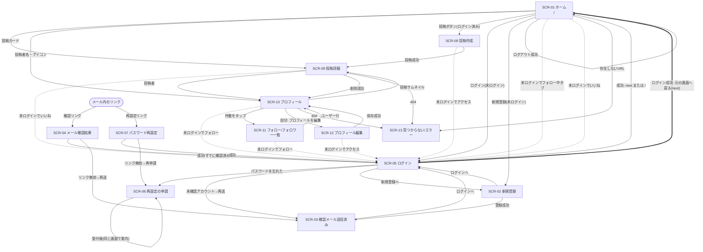

# 画面設計書

## 1. 概要

### 1.1 対象範囲

[要件定義書](../requirements.md) の 2.1「MVP に含める」機能と、5 章の画面一覧に載った全画面を対象とする。2.2 に挙げた機能（コメント、通知、検索、ハッシュタグ、投稿の編集、退会、メールアドレス変更など）の画面や導線は設けない。

API は [API 設計](api.md) で設計済みである。各画面の「使用する API」は、api.md の API ID（API-01〜API-24）・メソッド・パスで書く。API ID の番号は、初版で画面側から出した要求 ID（R-01〜R-24）と同じである。要求の記録は「付録 A」に残した。エンドポイントやオブジェクトの項目に食い違いがあるときは、api.md を正とする。

### 1.2 前提

- フロントエンドは React・TypeScript・Tailwind CSS・Vite による SPA である。画面遷移はクライアント側ルーティングで行い、配信構成は [ADR 001](../adr/001_delivery-architecture.md) に従う。API は `/api/...` の相対パス、画像は `/images/{オブジェクトキー}` で取得する。
- **モバイル幅（幅 360px 前後）を基準**に設計する。ブレークポイントは 1 つとし、幅 768px 未満を「モバイル」、768px 以上を「PC」と呼ぶ。PC で変わる点は各画面の文章で補足する。
- 画面は無彩色（白・黒・灰色）で構成する。サービスの趣旨に合わせるためである。そのため、成功・失敗などの状態は色ではなく **アイコンと文言** で伝える（色覚の違いにも対応できる）。
- 認証はセッション + Cookie である。ブラウザ側は認証情報（Cookie）を JavaScript で読まず、アプリ起動時に「現在のユーザー」を API-01 で取得して判定する。API-01 とログイン（API-06）の応答には CSRF トークンが含まれ、画面はメモリ上に保持して変更系リクエストに付ける（3.6.5）。
- 日時は API から ISO 8601（UTC）で受け取り、ブラウザのローカル時刻で表示する。
- ユーザーが入力した文字列（キャプション、表示名、自己紹介）は、常にテキストとして表示する（HTML として解釈しない）。URL の自動リンク化もしない。改行は保持する。
- 画像の `alt` は、投稿画像が「{表示名} さんの投稿画像」、アイコンが「{表示名} さんのアイコン」とする。
- 文字数は、Unicode のコードポイント数で数える（絵文字 1 つは 1 文字）。サーバー側も同じ数え方である（api.md 1.2、1.9）。
- 画面の分岐は HTTP ステータスではなく、エラー応答の `code` で行う（3.6.5）。

### 1.3 要件の対応表

| 要件 ID | 対応する画面・箇所 |
| --- | --- |
| ACC-01 | SCR-02 |
| ACC-02 | SCR-02（送信）、SCR-03、SCR-04 |
| ACC-03 | SCR-03・SCR-04・SCR-05 の確認メール再送（共通部品 C-13） |
| ACC-04 | SCR-05（未確認時の案内と再送） |
| ACC-05 | SCR-03 の注意書き（破棄自体はバックエンド） |
| ACC-06 | SCR-05 |
| ACC-07 | ヘッダーのメニュー（C-01） |
| ACC-08 | SCR-06、SCR-07 |
| ACC-09 | SCR-06 の文言、SCR-07 の文言、SCR-03 の文言、SCR-02 でメールの重複を直接は出さないこと（D-31。手口による推測は既知の問題）、API-08 の応答仕様 |
| PRF-01〜02 | SCR-10 |
| PRF-03〜04 | SCR-12 |
| PRF-05 | SCR-11（SCR-10 の件数から遷移） |
| PST-01〜03 | SCR-08（C-09 画像選択部品） |
| PST-04 | SCR-08・SCR-12 の C-09（変換とプレビュー） |
| PST-05 | SCR-08・SCR-12 の拒否時メッセージ（検査自体はバックエンド） |
| PST-06 | SCR-09 の削除（MinIO の削除はバックエンド） |
| PST-07 | SCR-09 |
| PST-08 | 画面の作業なし（バックエンド）。なお、フロントの変換で再エンコードするため EXIF は通常残らないが、これに依存しない |
| LIK-01〜03 | C-03 いいねボタン（SCR-01・SCR-09） |
| FOL-01〜03 | C-04 フォローボタン（SCR-10・SCR-11）。自分自身にはボタンを出さない。承認の画面は無い |
| TML-01〜04 | SCR-01 |
| TML-05 | C-05 無限スクロール（SCR-01・SCR-10・SCR-11） |
| TML-06 | 一覧はサムネイル（C-02・SCR-10）、SCR-09 は元画像 |
| 3 章（権限） | 要ログインは SCR-08・SCR-12・SCR-01 のフォロー中タブ、いいね・フォロー・投稿削除の操作。ガードの方針は 3.4 |
| 6.1 レスポンシブ | 1.2 の前提と各画面のワイヤーフレーム |
| 6.2 セキュリティ | CSRF トークンの送信（3.6.5）、トークンの URL からの除去（SCR-04・SCR-07）、ACC-09 の文言 |
| 6.3 性能 | C-09、C-05、SCR-08 |
| 6.4 エラー表示 | 3.6 の共通エラー方針と各画面のメッセージ |

## 2. 画面一覧と遷移

### 2.1 画面一覧

| 画面 ID | 画面名 | パス | ログイン | 関連要件 ID |
| --- | --- | --- | --- | --- |
| SCR-01 | ホーム（タイムライン） | `/`（フォロー中タブ: `/?tab=following`） | 不要（フォロー中タブは要） | TML-01〜06, LIK-01〜03 |
| SCR-02 | 新規登録 | `/signup` | 不要（ログイン済みなら `/` へ） | ACC-01, ACC-02, ACC-05 |
| SCR-03 | 確認メール送信済み案内 | `/signup/sent` | 不要 | ACC-02, ACC-03, ACC-05 |
| SCR-04 | メール確認結果 | `/verify?token=...` | 不要 | ACC-02, ACC-03 |
| SCR-05 | ログイン | `/login` | 不要（ログイン済みなら `/` へ） | ACC-04, ACC-06 |
| SCR-06 | パスワード再設定の申請 | `/password/forgot` | 不要（ログイン済みなら `/` へ） | ACC-08, ACC-09 |
| SCR-07 | パスワード再設定 | `/password/reset?token=...` | 不要 | ACC-08, ACC-09 |
| SCR-08 | 投稿作成 | `/posts/new` | 要 | PST-01〜05 |
| SCR-09 | 投稿詳細 | `/posts/{投稿ID}` | 不要 | PST-06, PST-07, LIK-01〜03, TML-06 |
| SCR-10 | プロフィール | `/users/{ユーザー名}` | 不要 | PRF-01, PRF-02, FOL-01〜03, TML-05, TML-06 |
| SCR-11 | フォロー／フォロワー一覧 | `/users/{ユーザー名}/following` ・ `/users/{ユーザー名}/followers` | 不要 | PRF-05, FOL-01〜03, TML-05 |
| SCR-12 | プロフィール編集 | `/settings/profile` | 要 | PRF-03, PRF-04 |
| SCR-13 | 見つからない／エラー（共通） | 上記以外のすべてのパス | 不要 | 6.4 |

- SCR-13 は要件定義書の画面一覧にはないが、存在しない URL・存在しないユーザーや投稿・想定外エラーの受け皿として共通仕様（3.6）で定めるため、画面 ID を付けた。
- SCR-11 は 1 つの画面とし、`/following` と `/followers` をタブで切り替える（パスはそれぞれ別）。

### 2.2 画面遷移図



破線は、未ログインで要ログインの操作・画面に入ろうとしたとき、またはセッション切れ（401 `UNAUTHENTICATED`）を受けたときのログイン画面への誘導である。誘導時は `/login?next={元のパス}` とし、ログイン成功後に元の画面へ戻す（3.4）。

## 3. 共通レイアウト・共通仕様

### 3.1 ページ枠

| 領域 | モバイル | PC |
| --- | --- | --- |
| コンテンツ幅 | 画面幅いっぱい（左右 16px の余白） | 中央寄せ。タイムライン・フォーム類は最大 600px、プロフィールは最大 960px |
| ヘッダー | 上部に固定（ロゴと右端のメニュー） | 上部に固定（ロゴ、投稿ボタン、アイコンメニュー） |
| ボトムナビ | 下部に固定（ログイン済みのみ） | なし |

認証系の画面（SCR-02〜07）は、ロゴだけのヘッダーと、中央のカード 1 枚で構成する（ナビゲーションは出さない）。

### 3.2 共通コンポーネント

| ID | 名称 | 内容 |
| --- | --- | --- |
| C-01 | ヘッダー／ボトムナビ | 下記 3.2.1 |
| C-02 | 投稿カード | 下記 3.2.2 |
| C-03 | いいねボタン | 下記 3.2.3 |
| C-04 | フォローボタン | 下記 3.2.4 |
| C-05 | 無限スクロール一覧 | 下記 3.3 |
| C-06 | トースト | 下記 3.6.3 |
| C-07 | エラー表示（インライン・全画面・見つからない） | 下記 3.6 |
| C-08 | フォーム項目 | ラベル・入力・文字数カウンター・エラー文をまとめた部品。エラー文は `aria-describedby` で入力に結び付ける。送信時に最初のエラー項目へフォーカスする |
| C-09 | 画像選択・白黒変換部品 | SCR-08 と SCR-12 で共用。仕様は 3.5 |
| C-10 | ユーザーアイコン | 円形表示。`icon_url` が `null` なら既定アイコン（フロントに同梱した灰色の人型）を表示する。画像は中央を基準に切り抜いて表示する（`object-fit: cover`）。`icon_url` の画像は、サーバーが長辺 256px に縮小して保存したもの（縦横比は保つ。小さい画像は拡大しない）なので、一覧に並べても読み込み量は小さい。表示サイズは最大でも 128px 四方（高解像度画面の 2 倍でも 256px）に収め、`width`・`height` を明示する |
| C-11 | 確認ダイアログ | 破壊的操作の確認用。フォーカストラップ、Esc で閉じる、初期フォーカスは「キャンセル」 |
| C-12 | ユーザー行 | アイコン、表示名、`@ユーザー名`、自己紹介（1 行で省略）、フォローボタン。SCR-11 で使う |
| C-13 | 確認メール再送フォーム | メールアドレス入力と「確認メールを再送する」ボタン。SCR-03・SCR-04・SCR-05 で使う。仕様は SCR-03 |
| C-14 | 読み込み表示 | スピナー（`role="status"`、文言「読み込み中…」）。一覧の初回はスケルトン（灰色の枠）を使う |
| C-15 | ルートガード | 3.4 |

#### 3.2.1 ヘッダー（C-01）

```
モバイル（ログイン済み）                 モバイル（未ログイン）
+--------------------------------+     +--------------------------------+
| nocolor                    (o) |     | nocolor     [ログイン][登録]   |
+--------------------------------+     +--------------------------------+
|             本文               |     |             本文               |
+--------------------------------+     +--------------------------------+
| [ホーム]    [＋投稿]  [マイページ]|
+--------------------------------+

PC（ログイン済み）
+--------------------------------------------------------------+
| nocolor                              [＋ 投稿する]    (o) v  |
+--------------------------------------------------------------+
```

- ロゴ「nocolor」は `/` へのリンクである。
- ログイン済み: 右端のアイコン（(o)）を押すとメニューが開く。項目は「プロフィール」（`/users/{自分}`）、「プロフィールを編集」（`/settings/profile`）、「ログアウト」。モバイルでは「ホーム」「投稿」「マイページ（自分のプロフィール）」のボトムナビも出す。
- 未ログイン: 「ログイン」「新規登録」を出す。投稿ボタンは出さない（投稿は要ログインのため。URL を直接開いた場合は 3.4 のガードで誘導する）。
- ログアウト: 確認なしで即時に API-07（`POST /api/auth/logout`）を呼ぶ。成功（204）に加え、401 `UNAUTHENTICATED`（すでにログアウト済み）も成功扱いにする。通信断・5xx のときは、ログアウトできなかったことをトースト「ログアウトできませんでした。通信状況を確認して、もう一度お試しください。」で知らせ、ログイン状態を保つ。結果は 3.4.3 に従う。
- 現在のユーザーの取得中（API-01 の応答待ち）は、ヘッダー右側に灰色の枠を出し、ログイン／未ログインのどちらも誤って見せない。

#### 3.2.2 投稿カード（C-02）

```
+--------------------------------+
| (o) 表示名  @username   3分前  |
+--------------------------------+
|                                |
|        [ サムネイル画像 ]       |
|                                |
+--------------------------------+
| キャプション（最大 3 行、       |
| 超えたら「…」）                |
| ♡ 12                          |
+--------------------------------+
```

- サムネイルは元の縦横比のまま、幅いっぱいに表示する。API が返す `thumbnail_width`・`thumbnail_height` で `aspect-ratio` を指定し、読み込み後にレイアウトがずれないようにする。画像は `loading="lazy"` とし、読み込み前は灰色の枠を表示する。
- 画像、キャプションの領域のどこを押しても投稿詳細（SCR-09）へ遷移する。アイコン・表示名は投稿者のプロフィール（SCR-10）へ遷移する。いいねボタンは遷移せず、いいねの切替だけを行う。
- 投稿者は `author`（`username`、`display_name`、`icon_url`）から表示する。`author` に自己紹介（`bio`）は含まれない。
- 日時は相対表示（「たった今」「3分前」「5時間前」「2日前」）とし、7 日以上前は「2026年10月26日」形式の日付にする。`<time>` 要素で、正確な日時をツールチップ（`title`）と `datetime` に持たせる。
- 画像の読み込みに失敗した場合は、枠内に「画像を読み込めません」と表示し、再試行はしない（再読み込みで直る）。

#### 3.2.3 いいねボタン（C-03）

- 表示: ハートのアイコンと件数。未いいねは輪郭のみ、いいね済みは塗りつぶし（色ではなく形で区別する）。`aria-pressed` で状態を伝え、読み上げ用ラベルは「いいね（現在 12 件）」「いいねを取り消す（現在 12 件）」とする。タップ領域は 44px 四方以上。
- 自分の投稿にも押せる（LIK-01）。
- ログイン済みで押したとき: 即座に表示を切り替え（楽観的更新）、API-16（`PUT /api/posts/{id}/like`、付ける）または API-17（`DELETE /api/posts/{id}/like`、取り消す）を呼む。どちらも冪等で、応答は `{liked, like_count}` である。通信中は同じボタンを無効化し、連打で重複送信しない。成功したら応答の `liked` と `like_count` で表示を確定する。失敗したら表示を元に戻し、トーストを出す（3.6.3）。
  - 失敗時の文言: 「いいねできませんでした。通信状況を確認して、もう一度お試しください。」（取り消しは「いいねを取り消せませんでした。〜」）
  - 404 `POST_NOT_FOUND`（投稿が削除済み）: 「この投稿は削除されたため、いいねできません。」を出し、その投稿を一覧から取り除く。
  - 401 `UNAUTHENTICATED`: セッション切れとして 3.4.2 に従う。
  - 403 `CSRF_INVALID`: 3.6.5 に従う（トークンを取り直して 1 回だけ再試行）。
- 未ログインで押したとき: `/login?next={現在のパス}` へ遷移する。ログイン後は元の画面に戻るだけで、いいねは自動では実行しない（未決事項 U-06）。ログイン画面には、操作を問わず共通文言「この操作にはログインが必要です。」を出す。
- 同じ投稿を表示する複数の画面（一覧と詳細など）で状態がずれないよう、いいねの状態は投稿 ID をキーにして画面間で共有する。

#### 3.2.4 フォローボタン（C-04）

- 表示: 未フォローは「フォロー」（塗りつぶしの黒ボタン）、フォロー済みは「フォロー中」（枠のみ）。`aria-pressed` を持つ。タップ領域は 44px 以上。
- 自分自身には表示しない（FOL-01）。判定は、表示対象の `username` と API-01 の `user.username` の比較で行う。SCR-10 では代わりに「プロフィールを編集」を出し、SCR-11 の自分の行にはボタンを出さない。API が返す `is_following` は閲覧者自身の行では常に `false` であり、それだけで「自分」と判定しない。
- ログイン済みで押したとき: 即座に切り替え（楽観的更新）、API-20（`PUT /api/users/{username}/follow`、フォロー）または API-21（`DELETE /api/users/{username}/follow`、解除）を呼ぶ。どちらも冪等で、応答は `{following, follower_count}` である（`follower_count` は対象ユーザーのフォロワー数）。通信中はボタンを無効化する。成功したら応答の `following` と `follower_count` で確定する。解除に確認ダイアログは出さない（いつでも再フォローでき、相手の承認も要らない: FOL-03）。
  - 失敗時: 表示を戻し、トースト「フォローできませんでした。通信状況を確認して、もう一度お試しください。」（解除は「フォローを解除できませんでした。〜」）
  - 404 `USER_NOT_FOUND`: 「このユーザーは見つかりません。」
  - 400 `CANNOT_FOLLOW_SELF`: 「自分自身をフォローすることはできません。」（通常は到達しないが、念のため）
  - 401 `UNAUTHENTICATED`: 3.4.2。403 `CSRF_INVALID`: 3.6.5。
- 未ログインで押したとき: `/login?next={現在のパス}` へ遷移する。フォローは自動実行しない。
- フォロー状態は、ユーザー名をキーにして画面間で共有する（SCR-10 のフォロワー数も連動して更新する）。
- **件数の更新**: API-20・21 の応答には、操作した相手の `follower_count` しかない。したがって、操作した相手の SCR-10 のフォロワー数は応答の値で更新するが、**自分の `following_count`** は応答から分からない。そこで、フォロー・解除が成功するたびに、(1) **自分の API-18 のキャッシュ（保持中の自分の SCR-10・SCR-11 の件数）を破棄し**、次にその画面を表示するときに取り直す、(2) いま自分の SCR-11（フォロー一覧）や自分の SCR-10 を表示中なら、バックグラウンドで API-18 を再取得して件数だけ差し替える（一覧の内容は再取得しない）。(3) 相手の API-18 のキャッシュは、応答の `follower_count` で更新する。件数を画面側で ±1 しない（D-34）。
- **自分のフォロー一覧で解除したとき**: 行は一覧から取り除かず「フォロー」に切り替える（誤操作の取り消しができる）。一覧を取り直したときに消える。件数は上の (2) で更新する。

### 3.3 無限スクロール一覧（C-05）

SCR-01・SCR-10・SCR-11 の一覧で共用する。

- 一覧の末尾に目印の要素を置き、画面に近づいたら（下端の 400px 手前から）次のページを読み込む（`IntersectionObserver`）。API はカーソル方式（`next_cursor`）で、1 回に 20 件を返す。画面は `limit` を指定せず既定値を使う（TML-05、6.3）。`cursor` は不透明な文字列として、そのまま次のリクエストに渡す。
- 読み込み中は末尾にスピナーを出す。読み込み中に次の読み込みを重ねて呼ばない。
- 初回の読み込み中は、投稿カード形状のスケルトンを 3 件出す。
- 読み込み済みの投稿は、投稿 ID で重複を排除してから描画する（念のための二重の防御。サーバーのカーソルが重複・欠落させないことが前提）。
- 閲覧中に新しい投稿が増えても、一覧の先頭へ自動で挿入しない（読んでいる位置がずれるため）。更新したいときは、「全体」「フォロー中」のタブを現在のタブのまま押す、またはブラウザの再読み込みを使う。タブを押したときは先頭へスクロールして再取得する。
- 末尾に達した（`next_cursor` が `null`）ら、「これ以上ありません」と小さく表示する。
- 次ページの取得に失敗したら、末尾に「読み込めませんでした。」と「再試行」ボタンを出す。自動では再試行しない（無限ループを避ける）。読み込み済みの一覧は消さない。400 `INVALID_CURSOR`（カーソルの破損）のときも同じ表示とし、「再試行」は先頭ページから取り直す（保持していたカーソルを捨てる）。
- 詳細画面から戻る（ブラウザの戻る）と、読み込み済みの一覧と、スクロール位置を復元する。復元のため、一覧の内容はメモリ上に保持する（タブごと）。いいね・フォローの変更、投稿の削除は、この保持内容にも反映する。
- 画面外の大量のカードは描画を減らす（仮想化は必須としないが、`content-visibility: auto` などで描画コストを抑える）。

### 3.4 認証の状態と遷移

#### 3.4.1 現在のユーザーの判定

アプリ起動時に API-01（`GET /api/me`）を呼び、ログイン状態と CSRF トークンを確定する。確定するまでは、要ログイン画面（SCR-08・SCR-12・SCR-01 のフォロー中タブ）では画面全体に読み込み表示を出し、ログイン画面へ一瞬飛ぶことを避ける。SCR-01 の全体タブなど、ログイン不要な画面は、ユーザーの確定を待たずに一覧を取得して表示してよい（`liked_by_me` などはサーバーがセッションから判定する）。

#### 3.4.2 ルートガード（C-15）

| 状況 | 動作 |
| --- | --- |
| 未ログインで SCR-08・SCR-12 または `/?tab=following` を開いた | `/login?next={元のパスとクエリ}` へ置き換え遷移（履歴に残さない）する。ログイン画面に「この操作にはログインが必要です。」を表示する |
| ログイン済みで SCR-02・SCR-05・SCR-06 を開いた | `/` へ置き換え遷移する |
| ログイン済みで SCR-04・SCR-07 を開いた | 遷移しない（メールのリンクを別のログイン状態のブラウザで開く場合があるため） |
| 要ログインの API が 401 `UNAUTHENTICATED` を返した（セッション切れ） | 保持中のユーザー情報と CSRF トークンを破棄し、トースト「ログインの有効期限が切れました。もう一度ログインしてください。」を出し、`/login?next={現在のパス}` へ遷移する。フォームの入力内容は保持できない（画像ファイルは再選択が必要になる） |

セッションの有効期間は、ログインからの固定 30 日である（利用で延長されない）。そのため、ログインから 30 日後には、操作中でも 401 `UNAUTHENTICATED` になりうる。画面は期限を表示せず、上の動作で対応する。

401 でも `INVALID_CREDENTIALS`（SCR-05 のログイン失敗）は、セッション切れではない。`code` で区別する（3.6.5）。

#### 3.4.3 ログイン後・ログアウト後・誘導後の遷移先

| 契機 | 遷移先 |
| --- | --- |
| ログイン成功 | API-06 の応答の `user` と `csrf_token` を保持し、`next` があればその画面、なければ `/`（ホームの全体タブ）。履歴は置き換える（戻るでログイン画面に戻らない） |
| 要ログイン操作（いいね、フォロー）から誘導された | `/login?next={操作した画面のパスとクエリ}`。ログイン後はその画面へ戻る。操作は自動では再実行しない |
| 要ログイン画面（投稿作成、プロフィール編集、フォロー中タブ）から誘導された | 同上。ログイン後はその画面を開く |
| ログアウト成功 | `/`（全体タブ）へ置き換え遷移し、トースト「ログアウトしました。」を出す。保持している一覧・ユーザー情報・CSRF トークンのキャッシュはすべて破棄する。どの画面でログアウトしても `/` とする（要ログイン画面に残さないため） |
| 本登録の完了（SCR-04） | 自動ログインはせず、SCR-05 への導線を出す（トークン付き URL でセッションを作らない） |
| パスワード再設定の成功 | `/login` へ遷移し、トースト「パスワードを再設定しました。新しいパスワードでログインしてください。」を出す。`next` は引き継がない |
| 投稿成功 | その投稿の SCR-09（履歴は置き換える） |
| 投稿削除成功 | 自分の SCR-10 |
| プロフィール保存成功 | 自分の SCR-10 |

`next` の符号化: `next` の値は、元のパスとクエリ全体を `encodeURIComponent` で符号化して付ける（例: `/?tab=following` は `/login?next=%2F%3Ftab%3Dfollowing`）。読むときは復号してから、次の検査をする。本書の `/login?next=/posts/new` のような表記は、符号化前の値を読みやすく書いたものである。

`next` の検査: クライアントは、`/` で始まり、2 文字目が `/` や `\` でなく、パスが `/login`・`/signup`・`/password/`・`/verify` で始まらない値だけを受け付ける。それ以外は無視して `/` とする（外部サイトへの誘導とログインのループを防ぐため）。

### 3.5 画像選択・白黒変換部品（C-09）

SCR-08（投稿画像）と SCR-12（アイコン）で共用する。PST-02〜PST-05、6.3 を満たす。

#### 3.5.1 フロー

```
[選択] → [検査1: 種類・サイズ] → [デコード] → [検査2: アニメーション・解像度]
   → [白黒変換（Web Worker）] → [検査3: 変換後サイズ] → [プレビュー表示]
```

- 選択手段は「画像を選ぶ」ボタン（ファイル選択。モバイルではカメラロールなど）である。PC ではドラッグ＆ドロップにも対応する。`<input type="file" accept="image/jpeg,image/png,image/webp">` を使う（許可する形式は API-02 の `allowed_image_types`。取得できないときはこの 3 種類）。
- カラー画像も選択できる（PST-04）。変換は選択直後に自動で始め、利用者の操作を要しない。

#### 3.5.2 クライアント側の検査と、サーバーの拒否コードの対応

クライアント側の検査は、早期に利用者へ知らせる目的である。最終判定はサーバーであり、サーバーは同じ内容を次のコードで拒否する。画面は、クライアントの検査で落ちたときも、サーバーのコードを受けたときも、同じ行のメッセージを表示する。

| 検査 | 内容 | メッセージ | サーバーの拒否（HTTP・`code`） |
| --- | --- | --- | --- |
| 種類 | JPEG・PNG・WebP のみ。拡張子ではなく、先頭バイト（マジックナンバー）で判定する。GIF などは拒否する | 「この形式の画像は使えません。JPEG・PNG・WebP の画像を選んでください。」 | 415 `UNSUPPORTED_IMAGE_TYPE` |
| サイズ（元ファイル） | `max_image_bytes` 以下（既定 10MB。環境変数で変更されるため、画面は API-02 の値を使う。取得できないときは 10MB とする）。「{上限}MB」は、バイト数を 1,048,576 で割り、小数を切り捨てて表示する | 「画像のサイズが大きすぎます。{上限}MB 以下の画像を選んでください。」 | 413 `IMAGE_TOO_LARGE`（サーバーが受け取るのは変換後のファイルなので、この画面では下の「サイズ（変換後）」の文言を使う） |
| デコード | ブラウザで画像として開けること | 「画像を読み込めませんでした。ファイルが壊れている可能性があります。別の画像を選んでください。」 | 400 `INVALID_IMAGE` |
| アニメーション | アニメーション PNG（`acTL` チャンクあり）、アニメーション WebP（`VP8X` のアニメーションフラグあり）を拒否する（PST-03）。canvas に描くと最初の 1 コマだけになり、サーバーの拒否をすり抜けて黙って静止画に変わってしまうため、クライアントで明示的に検出する | 「アニメーション画像は使えません。静止画を選んでください。」 | 400 `ANIMATED_IMAGE` |
| 解像度 | ①固定の安全弁: 各辺 65535px 以下、かつ総画素数 1 億以下（サーバーと同じ値。下記）。②API-02 の `max_image_side`（長辺の上限）・`max_image_pixels`（総画素数の上限）。値が `null` のときの扱いは下記。デコード前にヘッダーから寸法を読めるときは先に検査する | 「画像の解像度が大きすぎます。{上限}以下の画像を選んでください。」（{上限}は、①に落ちたときは辺が超過なら「各辺 65535px」、画素数が超過なら「1 億画素」。②では、`max_image_side` があれば「長辺 {値}px」、なければ「約 {値÷10000 を四捨五入}万画素」） | 400 `IMAGE_RESOLUTION_TOO_LARGE`（①の安全弁は、U-02 の決定前でもサーバーに固定で入っているため、発生しうる。②は U-02 の決定後） |
| サイズ（変換後） | 変換後のファイルが `max_image_bytes` 以下であること。形式によっては元より大きくなりうる（U-01） | 「白黒に変換した画像のサイズが大きすぎます。解像度の低い画像を選んでください。」 | 413 `IMAGE_TOO_LARGE` |
| 白黒かどうか | クライアントでは検査しない（変換で白黒にする）。変換後に色が残った場合の受け皿として、サーバーの判定を待つ | 3.5.5 | 400 `NOT_GRAYSCALE` |

検査に落ちたときは、選択を取り消して（直前の画像があれば残す）部品の下にエラー文を表示する。

**解像度の上限が `null` の間の扱い**

要件定義書 8 章の未決（U-02）が決まるまで、API-02 の `max_image_side` と `max_image_pixels` は `null`（上限なし）で返る。この間、クライアントは次のように扱う。

- 上限値による拒否・縮小は行わない（未確定の値を画面側で決め打ちしない）。U-02 の推奨値（長辺 4096px への縮小など）は使わない。
- ただし、サーバーには **固定の安全弁**（各辺 65535px 以下、かつ総画素数 1 億以下。超えると 400 `IMAGE_RESOLUTION_TOO_LARGE`）があり、U-02 の上限とは別の値である。画面も同じ値を持ち、ヘッダーから読める寸法が **いずれかの辺で 65535px を超える、または総画素数が 1 億を超える** 画像は、デコードを始めずに上の「解像度」のメッセージで拒否する。サーバーと画面の値は一致させる（画面で通った画像がサーバーの安全弁で落ちることを避けるため）。画面側の目的は、6.3（固まらない）のためにデコード前に拒否することである。この値は API-02 では返らないため、画面に固定で持つ（サーバーの値を変える場合は api.md と合わせて直す）。
- 値が `null` でなくなったら、その値で上の表のとおり検査する。片方だけが `null` のときは、非 `null` の方だけを検査する。
- API-02 を取得できなかったときも、`null` の場合と同じ扱いにする。

#### 3.5.3 白黒変換（フリーズさせない配慮）

- 変換は **Web Worker 内** で行う。メインスレッドでピクセルを走査しない。画像のデコードは `createImageBitmap`（EXIF の向きを反映する指定）、描画は `OffscreenCanvas` を使う。`OffscreenCanvas` が使えないブラウザでは、メインスレッドで行うが、行単位に分割して処理の間にイベントループへ制御を戻す。
- 変換中は、プレビュー枠にスピナーと「白黒に変換しています…」を表示し、「投稿する」「保存」ボタンを無効化する。画面のスクロールや、キャプションの入力はできるままにする。
- 変換中に別の画像を選んだ、または画面を離れたときは、進行中の変換を中止し、古い結果は捨てる。
- 透明部分は白い背景に合成してから変換する（サーバーは完全に透明なピクセルを判定から除くが、フロントで不透明にしておけば判定上の曖昧さがなくなる）。
- 変換式と出力形式は未決事項（U-01）。画面は「変換後のファイル（Blob）」を受け取って扱うだけにし、式や形式に依存しない。
- 巨大な画像（長辺が非常に大きい画像）は、デコードのメモリが膨らむ。3.5.2 のとおり、常に固定の安全弁（各辺 65535px・1 億画素。サーバーと同じ値）で抑え、U-02 が決まった後はその上限でも抑える。上限を超えるときは、変換を始めずに拒否する。
- 変換が失敗したとき（メモリ不足など）: 「画像を白黒に変換できませんでした。サイズの小さい画像でもう一度お試しください。」

#### 3.5.4 プレビュー

- 変換後の画像を、枠内に縦横比を保って表示する（`URL.createObjectURL`。差し替え時・画面を離れるときに `revokeObjectURL` で解放する）。
- プレビューの下に注記「カラー画像は白黒に変換されます。この画像が投稿されます。」を常に表示する（SCR-12 では「この画像がアイコンになります。サイズは自動的に小さくなります。」）。アイコンの縮小（長辺 256px）はサーバーが保存時に行うため、クライアントは縮小せず、変換後の画像をそのまま送る（送信するサイズの検査は 3.5.2 のとおり変換後ファイルで行う）。プレビューは円形に中央を切り抜いた表示で、縮小前の画像を使う（保存後の見た目と実質変わらない）。
- 「別の画像を選ぶ」ボタンで差し替える。SCR-12 では「削除」ボタンも出す。

#### 3.5.5 サーバーによる拒否（PST-05）

画像を送る API-13・API-24 が拒否したときは、`code` に応じて次のメッセージを表示する。クライアントの変換が正しければ通常は起きないが、変換後に色が残った場合（JPEG の再圧縮など）や、クライアントの検査をすり抜けた場合の受け皿である。

| `code`（HTTP） | 表示 |
| --- | --- |
| `NOT_GRAYSCALE`（400） | 画面ごとの文言（SCR-08・SCR-12）。「白黒画像のみ〜」を含む |
| `UNSUPPORTED_IMAGE_TYPE`（415） | 3.5.2「種類」の文言 |
| `INVALID_IMAGE`（400） | 3.5.2「デコード」の文言 |
| `ANIMATED_IMAGE`（400） | 3.5.2「アニメーション」の文言 |
| `IMAGE_RESOLUTION_TOO_LARGE`（400） | 3.5.2「解像度」の文言（上限は API-02 の値。`null` のとき、またはどちらの上限か分からないときは「画像の解像度が大きすぎます。解像度の低い画像を選んでください。」。固定の安全弁による拒否も、通常はクライアントの検査で先に落ちるため、ここに来るのはこの場合である） |
| `IMAGE_TOO_LARGE`（413） | 3.5.2「サイズ（変換後）」の文言 |

いずれも、フォームの内容は保持する。プレビューは `NOT_GRAYSCALE` のときは残し、それ以外は選択を取り消して部品の下にエラー文を出す。

### 3.6 エラー・メッセージの共通方針

#### 3.6.1 エラーの種類と表示方法

| 種類 | 例 | 表示方法 |
| --- | --- | --- |
| 入力エラー（クライアント検査） | 文字数超過、形式不正 | 項目の直下に表示する。入力欄から離れた時（blur）と送信時に検査する。入力中のカウンターは常時表示する |
| 入力エラー（サーバーの 400 `VALIDATION_ERROR`／409） | ユーザー名の重複 | レスポンスの `fields` の項目別コードを、対応する項目の直下に表示する。表示する文言はフロントが持ち、サーバーの `message` をそのまま画面に出さない |
| 操作の失敗（一過性） | いいね失敗、削除失敗 | トースト |
| 画面の読み込み失敗 | 一覧が取れない | 画面内に「エラー表示」（C-07 のインライン型）を出し、「もう一度読み込む」ボタンを置く |
| 見つからない（404） | 存在しないユーザー・投稿・URL | 3.6.2 |
| 想定外のエラー | 5xx、通信断、想定外の応答形式、描画時の例外 | 3.6.2 |
| 認証切れ（401 `UNAUTHENTICATED`） | セッション期限切れ | 3.4.2 |

#### 3.6.2 404 と想定外エラー

**404（存在しない URL・ユーザー・投稿）**

- ヘッダーなどの枠は残し、本文領域にメッセージを表示する。画面全体を差し替えない。
- 本文の構成: アイコン、見出し、説明、「ホームへ戻る」ボタン。
- 文言:
  - 存在しない URL（SCR-13）: 見出し「ページが見つかりません」、説明「URL が間違っているか、ページが移動または削除された可能性があります。」
  - 存在しないユーザー（`/users/{ユーザー名}` 系。404 `USER_NOT_FOUND`）: 見出し「ユーザーが見つかりません」、説明「ユーザー名を確認してください。」
  - 存在しない投稿（`/posts/{ID}`。404 `POST_NOT_FOUND`）: 見出し「投稿が見つかりません」、説明「この投稿は削除されたか、URL が間違っている可能性があります。」
- ユーザー名が形式（`^[a-z0-9_]{3,20}$`）に合わない場合と、投稿 ID が ULID の形式（26 文字、`^[0-7][0-9A-HJKMNP-TV-Z]{25}$`。小文字は大文字として受け付ける）に合わない場合は、API を呼ばずに同じ 404 表示にする。
- プロフィール・投稿は公開情報であり、存在の有無を区別して表示してよい（ACC-09 の対象外）。

**想定外のエラー**

- 5xx（`INTERNAL_ERROR`、`SERVICE_UNAVAILABLE`）、通信できない、応答が想定外の形式（JSON でない、必須項目がない）、画面が想定していない `code`（`BAD_REQUEST`、`REQUEST_TOO_LARGE`、`UNSUPPORTED_MEDIA_TYPE`、未知のコード）の場合は、同じ文言で扱う。
  - 通信断（`fetch` が失敗、オフライン）: 「通信できませんでした。ネットワーク接続を確認して、もう一度お試しください。」
  - 5xx・想定外: 「問題が発生しました。時間をおいてもう一度お試しください。解消しない場合は管理者に連絡してください。」。エラー応答の `request_id` がある場合は、「エラー番号: xxxx」を小さく添える（問い合わせ用）。
- 画面を読み込めない場合は、画面内のエラー表示（「もう一度読み込む」ボタン付き）にする。ボタンで同じ API を再実行する。
- 描画中の予期しない例外は、アプリ全体の **エラーバウンダリ** で受ける。全画面に「問題が発生しました」と「ページを再読み込みする」「ホームへ戻る」を表示する。例外の詳細（スタックトレースなど）は画面に出さない。
- 429 `RATE_LIMITED`（試行回数の制限）: 「操作の回数が多すぎます。しばらく待ってからもう一度お試しください。」。`Retry-After`（秒数）があれば「約 N 分後に」と具体化し、該当ボタンをその間無効にする。画面ごとに文言を定めた場合（SCR-05、SCR-06、SCR-08、SCR-12）はそちらを使う。
- 403 `CSRF_INVALID`: 3.6.5 に従う。再試行しても解消しないときの文言は「画面の有効期限が切れました。ページを再読み込みしてから、もう一度お試しください。」

#### 3.6.3 トースト（C-06）

- 画面下部（モバイルではボトムナビの上）に表示する。最大 3 件まで積む。
- 成功・情報は 4 秒、失敗は 8 秒で消える。失敗は閉じるボタン（×）でも消せる。マウスを乗せている間・フォーカス中は消さない。
- 成功・情報は `role="status"`（`aria-live="polite"`）、失敗は `role="alert"` で読み上げる。種類はアイコン（チェック、情報、警告）と文言で区別する。
- 画面遷移をまたいで表示できる（「投稿しました」を遷移先で見せるため）。

#### 3.6.4 フォームの共通動作

- 送信中は送信ボタンを無効化し、スピナーとラベル（「送信中…」など）に変える。二重送信を防ぐ。
- 通信失敗時、入力内容は保持する（パスワードも保持する）。
- 項目別のエラーがあるときは、送信を止めて最初のエラー項目へフォーカスする。
- メールアドレス、ユーザー名の入力値は、送信前に前後の空白を除く。パスワードは除かない。
- ユーザー名・メールアドレス欄には `autocapitalize="none"`、`autocorrect="off"`、`spellcheck="false"` を付ける。パスワード欄には「表示する」切替を付ける。`autocomplete` は、`username`、`email`、`current-password`、`new-password` を適切に付ける。

#### 3.6.5 エラーコードによる分岐と CSRF トークン

**分岐の原則**: エラー応答の本文 `{ "error": { "code", "message", "fields", "request_id" } }` のうち、画面は `code` と `fields` で分岐する。HTTP ステータスだけでは分岐しない。同じステータスに複数の意味があるためである。

| HTTP | `code` | 画面での扱い |
| --- | --- | --- |
| 401 | `UNAUTHENTICATED` | セッション切れ。3.4.2 |
| 401 | `INVALID_CREDENTIALS` | SCR-05 のログイン失敗。SCR-05 の文言 |
| 403 | `CSRF_INVALID` | 下記の再試行、それでも失敗なら 3.6.2 の文言 |
| 403 | `EMAIL_NOT_VERIFIED` | SCR-05 の未確認の案内 |
| 403 | `FORBIDDEN` | SCR-09 の削除権限なし |
| 400 | `VALIDATION_ERROR` | `fields` の項目別コードを項目の直下に表示 |
| 400 | `TOKEN_INVALID` | SCR-04・SCR-07 の「リンクが無効」表示 |
| 409 | `ALREADY_VERIFIED` | SCR-04 の「すでに確認済み」表示 |
| 429 | `RATE_LIMITED` | 3.6.2 の文言（`Retry-After` を使う） |
| 上記のほか | 各画面に記載 | 各画面の「操作とその結果」に従う |
| 上記・各画面にないもの | - | 想定外のエラー（3.6.2） |

**項目別コード（`fields` の値）と文言**: 画面が持つ文言は、各画面の「メッセージ」の表のとおり。項目別コードと文言の対応は次のとおり。

| 項目別コード | 文言の対応 |
| --- | --- |
| `REQUIRED` | 各項目の「未入力」の文言 |
| `TOO_SHORT`・`TOO_LONG` | 各項目の「長さ」「超過」の文言 |
| `INVALID_FORMAT` | メールアドレスの「形式不正」の文言 |
| `INVALID_CHARS` | ユーザー名は「文字種」の文言。表示名・自己紹介・キャプションは「使えない文字（制御文字）が含まれています。」 |
| `NEED_LETTER_AND_DIGIT` | パスワードの「文字種」の文言 |
| `TAKEN` | ユーザー名の「重複」の文言（メールアドレスの重複は返らない: D-31） |
| `INVALID_VALUE`・`UNEXPECTED` | 画面からは通常発生しない（想定外のエラーとして扱う） |

**CSRF トークンの運用**（api.md 1.4）

- 対象は、ログイン必須の変更系 API である API-07、13、15、16、17、20、21、24。ログイン不要の変更系 API（API-03〜06、08〜10）には付けない。
- トークンは API-01 の応答の `csrf_token`、およびログイン（API-06）の応答の `csrf_token` から受け取り、メモリ上に保持する（ストレージには保存しない）。対象の API には、ヘッダー `X-CSRF-Token: {csrf_token}` を付ける。JSON でも multipart でも同じである。
- ログアウト、セッション切れ（401 `UNAUTHENTICATED`）、パスワード再設定の成功のときは、保持中のトークンを破棄する。
- 403 `CSRF_INVALID` を受けたら、API-01 を取り直してトークンを更新し、**同じリクエストを 1 回だけ**再試行する。multipart（API-13、API-24）の再試行では、メモリ上の変換後の画像をそのまま再送する（利用者に再選択させない）。取り直した結果が未ログイン（`user: null`）なら 3.4.2 のセッション切れとして扱う。再試行でも 403 `CSRF_INVALID` なら、3.6.2 の文言を表示する。再試行を重ねない。
- ログイン不要の API が 403 `CSRF_INVALID` を返した場合（Origin の検査の失敗）は、再試行せず 3.6.2 の文言を表示する。

## 4. 各画面の詳細

以降、「API-xx」は [api.md](api.md) の API ID を指す。

---

### SCR-01 ホーム（タイムライン）

**パス**: `/`、`/?tab=following`　**ログイン**: 不要（フォロー中タブは要）　**関連要件**: TML-01〜06、LIK-01〜03

#### 目的

投稿を新着順に閲覧する入口。「全体」「フォロー中」のタブで切り替える。

#### ワイヤーフレーム

```
ログイン済み（モバイル）                  未ログイン（モバイル）
+--------------------------------+      +--------------------------------+
| nocolor                    (o) |      | nocolor     [ログイン][登録]   |
+--------------------------------+      +--------------------------------+
| [ 全体 ] | [フォロー中]         |      | ログインすると、フォロー中の   |
|  =====                          |      | 投稿も見られます。 [ログイン]  |
+--------------------------------+      +--------------------------------+
| (o) 表示名 @user         3分前  |      | (o) 表示名 @user         3分前  |
| +----------------------------+ |      | +----------------------------+ |
| |        サムネイル          | |      | |        サムネイル          | |
| +----------------------------+ |      | +----------------------------+ |
| キャプション…                  |      | キャプション…                  |
| ♡ 12                          |      | ♡ 12                          |
+--------------------------------+      +--------------------------------+
| (投稿カードが続く）            |      |                                |
|   読み込み中…                  |      |                                |
+--------------------------------+      +--------------------------------+
| [ホーム]    [＋投稿]  [マイページ]|
+--------------------------------+
```

PC では、コンテンツを最大 600px で中央寄せにする（1 列）。ボトムナビは無く、ヘッダーに「＋ 投稿する」を出す。

#### 表示項目

| 項目 | データの出どころ | 備考 |
| --- | --- | --- |
| タブ（全体／フォロー中） | 固定。ログイン状態は API-01 | 未ログイン時は「フォロー中」タブを出さない（TML-04）。タブの状態は URL の `tab` で持つ（再読み込み・戻るで保たれる） |
| 未ログイン時の案内 | 固定 | 全体タブの上に「ログインすると、フォロー中の投稿も見られます。」とログインボタン |
| 投稿カード（C-02） | API-11（全体）、API-12（フォロー中）の `items`（Post） | サムネイル、投稿者、日時、キャプション、いいね数、いいね済みか |

- 既定のタブは「全体」とする。最後に開いたタブは記憶しない。
- 「フォロー中」タブには、フォローしているユーザーと自分の投稿が並ぶ（TML-03）。

#### 入力項目とバリデーション

なし（タブの選択のみ）。`tab` に想定外の値が入っているときは `tab=global` として扱う。

#### 操作とその結果

| 操作 | 呼ぶ API | 成功時 | 失敗時 |
| --- | --- | --- | --- |
| 画面を開く／タブを切り替える | API-11 または API-12（先頭ページ） | 一覧を表示 | 画面内エラー（再読み込みボタン付き）。API-12 が 401 `UNAUTHENTICATED` ならログイン画面へ誘導（3.4.2） |
| 下までスクロール | 同上（`cursor` 付き） | 末尾に追加（C-05） | 末尾の再試行表示 |
| 現在のタブを再度押す | 同上（先頭ページ） | 先頭へスクロールし、一覧を更新 | 同上 |
| 「フォロー中」タブを押す（未ログイン） | なし | `/login?next=/?tab=following` へ。なお、未ログインではこのタブ自体が表示されないため、URL の直接入力・ブックマークの場合に限る | - |
| いいね（C-03） | API-16 / API-17 | 表示確定 | 3.2.3 |
| 投稿カードを押す | なし | SCR-09 へ | - |
| 投稿者を押す | なし | SCR-10 へ | - |
| ログイン／新規登録／投稿 | なし | SCR-05／SCR-02／SCR-08 へ | - |
| ログアウト | API-07 | 3.4.3 | 3.2.1 |

#### 状態ごとの表示

| 状態 | 表示 |
| --- | --- |
| 初回読み込み中 | スケルトンのカード 3 件 |
| 空（全体） | 「まだ投稿がありません。最初の投稿をしてみましょう。」（ログイン済みなら「投稿する」ボタン、未ログインなら「ログインして投稿する」ボタン） |
| 空（フォロー中） | 「まだ投稿がありません。ユーザーをフォローすると、その人の投稿がここに表示されます。」と、「全体を見る」ボタン |
| エラー | 3.6 の画面内エラー表示 |
| 未ログイン | 3.2.1 のヘッダー、案内帯、全体タブのみ |
| 自分の投稿 | 通常のカードと同じ（いいねも可）。自分のものだと分かる特別な表示はしない |

#### 使用する API

- API-01 `GET /api/me`（ヘッダーとタブの出し分け、CSRF トークン）
- API-11 `GET /api/timelines/global?cursor=`（全体タイムライン）
- API-12 `GET /api/timelines/following?cursor=`（フォロー中タイムライン。要ログイン）
- API-16 `PUT /api/posts/{id}/like` / API-17 `DELETE /api/posts/{id}/like`（いいねの付与・取り消し）
- API-07 `POST /api/auth/logout`（ログアウト）

#### 表示するメッセージ

3.2.3、3.3、3.6 の共通文言と、上記「状態ごとの表示」の文言を使う。

---

### SCR-02 新規登録

**パス**: `/signup`　**ログイン**: 不要（ログイン済みなら `/` へ）　**関連要件**: ACC-01、ACC-02、ACC-05

#### 目的

メールアドレス・ユーザー名・パスワードでアカウントを仮登録する。

#### ワイヤーフレーム

```
+--------------------------------+
| nocolor                        |
+--------------------------------+
|  アカウントを作成              |
|                                |
|  メールアドレス                |
|  [                          ]  |
|                                |
|  ユーザー名                    |
|  [                          ]  |
|  3〜20文字。英小文字・数字・_  |
|  登録後は変更できません        |
|                                |
|  パスワード                    |
|  [                    ][表示]  |
|  8〜32文字。英字と数字を含む   |
|                                |
|  [      登録する           ]   |
|                                |
|  登録済みの方は ログイン       |
+--------------------------------+
```

PC では、カード（最大幅 400px）を中央に置く。

#### 表示項目

| 項目 | データの出どころ | 備考 |
| --- | --- | --- |
| 入力欄 3 つ、補足説明 | 固定 | ユーザー名の補足に「登録後は変更できません。プロフィールの URL に使われます。」 |
| ログインへのリンク | 固定 | `/login` |

#### 入力項目とバリデーション

要件定義書 4.1 の入力規則と一致させる。

| 項目 | 規則（要件定義書） | クライアントで検査 | サーバーに任せる検査 |
| --- | --- | --- | --- |
| メールアドレス | 形式チェックを行う。一意 | 必須、形式（`@` の前後に空でない文字列があり、ドメイン部に `.` がある、程度の簡易検査） | 厳密な形式、254 文字以内、前後の空白の扱い、大文字小文字の正規化。一意性は画面に出さない（登録済みでも通常の成功と同じ応答。D-31） |
| ユーザー名 | 3〜20 文字、英小文字・数字・`_` のみ。一意。登録後は変更不可 | 必須、3〜20 文字、`^[a-z0-9_]+$`。大文字は自動変換せずエラーにする | 同じ規則の再検査、一意性（ユーザー名の重複は 409 `USERNAME_TAKEN`） |
| パスワード | 8〜32 文字。英字と数字をそれぞれ 1 文字以上含む | 必須、8〜32 文字、英字（A-Z, a-z）を 1 文字以上、数字（0-9）を 1 文字以上 | 同じ規則の再検査 |

パスワードの確認入力欄（再入力）は設けない。「表示する」切替で入力ミスを防ぐ（設計判断 D-05）。

**メッセージ**

| 条件 | 文言 |
| --- | --- |
| メール未入力（`fields.email` = `REQUIRED`） | 「メールアドレスを入力してください。」 |
| メール形式不正（`INVALID_FORMAT`） | 「メールアドレスの形式が正しくありません。」 |
| メールが長すぎる（`TOO_LONG`） | 「メールアドレスは 254 文字以内で入力してください。」 |
| ユーザー名未入力（`REQUIRED`） | 「ユーザー名を入力してください。」 |
| ユーザー名の長さ（`TOO_SHORT`・`TOO_LONG`） | 「ユーザー名は 3〜20 文字で入力してください。」 |
| ユーザー名の文字種（`INVALID_CHARS`） | 「ユーザー名には、英小文字・数字・_（アンダースコア）だけが使えます。」 |
| ユーザー名の重複（409 `USERNAME_TAKEN`、`fields.username` = `TAKEN`） | 「このユーザー名はすでに使われています。別のユーザー名を入力してください。」 |
| パスワード未入力（`REQUIRED`） | 「パスワードを入力してください。」 |
| パスワードの長さ（`TOO_SHORT`・`TOO_LONG`） | 「パスワードは 8〜32 文字で入力してください。」 |
| パスワードの文字種（`NEED_LETTER_AND_DIGIT`） | 「パスワードには、英字と数字をそれぞれ 1 文字以上含めてください。」 |

**メールアドレスの重複は画面に出さない**（設計判断 D-31）。メールアドレスが登録済み・仮登録中でも、API-03 は通常の成功と同じ応答（201 `{email, username}`）を返すため、画面は SCR-03 へ進む。メールアドレスの重複を表すエラーコード・文言はない。登録済みのアドレスには、サーバーが案内メールを送る。ユーザー名だけは重複を告げる（公開情報のため）。ただし、ユーザー名が確保されないことを使えば、メールアドレスの登録有無を調べる手口が成り立つ。これは既知の問題として受け入れている（理由・緩和策は D-31、詳細は api.md D-25）。

#### 操作とその結果

| 操作 | 呼ぶ API | 成功時 | 失敗時 |
| --- | --- | --- | --- |
| 「登録する」 | API-03 | 201。`/signup/sent` へ遷移（応答の `email`（正規化後）をルーターの状態で渡す。URL には入れない）。履歴は置き換える | 400 `VALIDATION_ERROR`: 項目別エラー。409 `USERNAME_TAKEN`: ユーザー名の重複文言。429: 3.6.2 の文言。503・通信断・5xx: 3.6.2 の文言（入力は保持） |
| ログインへのリンク | なし | SCR-05 | - |

#### 状態ごとの表示

| 状態 | 表示 |
| --- | --- |
| 送信中 | ボタンが「送信中…」で無効 |
| エラー | 項目別の文言、またはフォーム上部の文言（429・通信断・5xx） |
| ログイン済み | 表示せず `/` へ置き換え遷移 |

#### 使用する API

API-03 `POST /api/auth/signup`（仮登録。リクエストは `email`・`username`・`password`、成功は 201 `{email, username}`）、API-01 `GET /api/me`（ログイン済み判定）

---

### SCR-03 確認メール送信済み案内

**パス**: `/signup/sent`　**ログイン**: 不要　**関連要件**: ACC-02、ACC-03、ACC-05

#### 目的

登録のご案内（確認メール）を送ったことを知らせ、メールのリンクを開くよう案内する。メールが届かない場合は再送できる。

#### ワイヤーフレーム

```
+--------------------------------+
| nocolor                        |
+--------------------------------+
|  メールをご確認ください        |
|                                |
|  a***@example.com 宛に、       |
|  登録のご案内をお送りしました。|
|  メール内のリンクを開いて、    |
|  登録を完了してください。      |
|                                |
|  ・リンクの有効期限は24時間    |
|  ・7日以内に本登録しないと、   |
|    登録内容は破棄されます      |
|  ・迷惑メールフォルダーも      |
|    確認してください            |
|                                |
|  メールが届かない場合          |
|  すでに登録済みのアドレスの場合|
|  は、ログイン方法の案内を      |
|  お送りしています。            |
|  [ 確認メールを再送する ]      |
|                                |
|  [ ログイン画面へ ]            |
+--------------------------------+
```

#### 表示項目

| 項目 | データの出どころ | 備考 |
| --- | --- | --- |
| 送信先メールアドレス | ルーターの状態（SCR-02 から渡された、API-03 の応答の `email`） | 画面に出すときは全文を表示する（入力した本人に確認してもらうため）。ただし URL・履歴・ストレージには残さない |
| 案内文 | 固定 | 見出し「メールをご確認ください」、本文「{メールアドレス} 宛に、登録のご案内をお送りしました。メール内のリンクを開いて、登録を完了してください。」。有効期限 24 時間（ACC-03）、7 日で破棄（ACC-05）。「メールが届かない場合」の見出しの下に「すでに登録済みのアドレスの場合は、ログイン方法の案内をお送りしています。」を添える。登録済みかどうかで文言を変えない（D-31。ただし新規登録経由での推測は既知の問題として残る） |
| 再送ボタン | - | 下記 |

直接 `/signup/sent` を開いた、または再読み込みで状態を失った場合は、送信先アドレスの行を出さず、案内文「確認メールを送信済みの方は、メール内のリンクを開いてください。」と、メールアドレス入力欄つきの再送フォーム（C-13）を表示する。

ワイヤーフレームの「a***@example.com」は伏せ字の例である。実装では上記のとおり全文を表示する（ワイヤーフレームの表記は採用しない）。

#### 入力項目とバリデーション

再送フォーム（C-13）。送信先がルーター状態にあればボタンだけ、なければ入力欄を表示する。

| 項目 | 規則 | クライアント | サーバー |
| --- | --- | --- | --- |
| メールアドレス | 形式チェック（4.1） | 必須、簡易な形式検査 | 形式（400 `VALIDATION_ERROR`、`fields.email`）。存在や確認済みかは応答で区別しない |

メッセージは SCR-02 のメールアドレスと同じ。

#### 操作とその結果

| 操作 | 呼ぶ API | 成功時 | 失敗時 |
| --- | --- | --- | --- |
| 「確認メールを再送する」 | API-05 | 202 `{accepted: true}`。トースト「確認メールの再送を受け付けました。届くまで数分かかることがあります。」。ボタンを 60 秒間無効にし、残り秒数を表示する | 400: 項目エラー。429: 3.6.2 の文言。503・通信断・5xx: 3.6.2 の文言 |
| 「ログイン画面へ」 | なし | SCR-05 | - |

- 再送の応答は、そのアドレスが仮登録済み・本登録済み・未登録のいずれでも同じにする（アカウントの存在を推測させない。ACC-09 と同じ考え方）。そのため文言も「受け付けました」とし、「送信しました」と断定しない。
- 新規登録（SCR-02）でも、メールアドレスが登録済みか仮登録中の場合は、通常の成功と同じ応答で SCR-03 に進む（D-31）。このとき届くのは確認メールとは限らず、本登録済みなら「登録済み。ログイン・再設定はこちら」の案内メール、仮登録中なら確認メールの再送である。そのため、SCR-03 の案内は「確認メールを送りました」と断定せず、「届かない場合」の案内で、登録済みの場合も含めて読めるようにする（上の表示項目の案内文）。
- 60 秒の待機はクライアント側の連打防止であり、真の制限はサーバーの試行回数制限（6.2）が担う。

#### 状態ごとの表示

| 状態 | 表示 |
| --- | --- |
| 再送中 | ボタンがスピナー付きで無効 |
| 再送後の待機 | 「あと 45 秒で再送できます」 |
| 状態を失った | 上記のとおり、入力欄つき再送フォーム |

#### 使用する API

API-05 `POST /api/auth/verify/resend`（確認メールの再送。リクエストは `email`、成功は 202 `{accepted: true}`）

---

### SCR-04 メール確認結果

**パス**: `/verify?token=...`　**ログイン**: 不要　**関連要件**: ACC-02、ACC-03

#### 目的

確認メールのリンクから開かれ、本登録を完了して結果を知らせる。

#### ワイヤーフレーム

```
成功                              リンクが使えない
+----------------------------+   +----------------------------+
| nocolor                    |   | nocolor                    |
+----------------------------+   +----------------------------+
|  (v) 本登録が完了しました  |   |  (!) 確認リンクが使えません|
|                            |   |  リンクが正しくないか、有効|
|  ログインして、nocolor を  |   |  期限（24時間）が過ぎた可能|
|  始めましょう。            |   |  性があります。             |
|                            |   |                            |
|  [   ログインする   ]      |   |  メールアドレスを入力して、|
+----------------------------+   |  確認メールを再送してくだ  |
                                 |  さい。                    |
確認中                           |  [                      ]  |
+----------------------------+   |  [ 確認メールを再送する ]  |
|  確認しています…           |   +----------------------------+
+----------------------------+
```

#### 表示項目

| 項目 | データの出どころ | 備考 |
| --- | --- | --- |
| 結果（確認中／成功／すでに確認済み／無効） | API-04 の応答 | 下の状態表を参照 |

#### 入力項目とバリデーション

「無効」状態のみ、再送フォーム（C-13: メールアドレス入力、規則は SCR-03 と同じ）を表示する。

#### 操作とその結果

| 操作 | 呼ぶ API | 成功時 | 失敗時 |
| --- | --- | --- | --- |
| 画面を開く（自動） | API-04（`token` を送る） | 200 `{verified: true}`。「本登録が完了しました」を表示 | 下の状態表 |
| 「ログインする」 | なし | SCR-05（`next` なし） | - |
| 「確認メールを再送する」 | API-05 | SCR-03 と同じ受付表示（トースト、60 秒の待機） | SCR-03 と同じ |

- メールのリンクを開いただけで確認が完了するようにするが、確認の実行は **GET ではなく POST（API-04）** で行う。メールの自動スキャンや先読みがトークンを消費しないようにするためである。
- 画面を開いたとき、API-04 は 1 回だけ呼ぶ（開発時の再実行などで二重に呼ばない）。
- トークンは API に渡したあと、アドレスバーの URL から `history.replaceState` で取り除く。また、外部へトークンが Referer で漏れないよう、`index.html` に `<meta name="referrer" content="no-referrer">` を置く。SPA ではどのパスも同じ `index.html` を返す（ADR 001）ため、画面ごとの HTTP ヘッダーは付けられず、全画面に適用される。そのため nginx の設定変更は要らない（設計判断 D-33。ADR 001 への影響なし）。外部サイトへのリンクを持たない画面なので、全画面に付いても実害はない。
- 「すでに確認済み」を出すには、API 側が確認後も確認トークンを期限まで残す必要がある（api.md D-8。決定済み）。

#### 状態ごとの表示

| 状態 | 条件 | 表示 |
| --- | --- | --- |
| 確認中 | API-04 の応答待ち | スピナーと「確認しています…」 |
| 成功 | 200 | 見出し「本登録が完了しました」、説明「ログインして、nocolor を始めましょう。」、「ログインする」ボタン |
| すでに確認済み | 409 `ALREADY_VERIFIED` | 見出し「すでに本登録が完了しています」、説明「ログインしてご利用ください。」、「ログインする」ボタン |
| 無効 | 400 `TOKEN_INVALID`、または `token` が無い（API を呼ばない） | 見出し「確認リンクが使えません」、説明「リンクが正しくないか、有効期限（24 時間）が過ぎた可能性があります。メールアドレスを入力して、確認メールを再送してください。」、再送フォーム。期限切れと不正は API も区別せず（どちらも `TOKEN_INVALID`）、利用者にも区別して見せない |
| 通信断・5xx | - | 3.6.2 の画面内エラー表示（「もう一度読み込む」ボタン付き） |
| 429 | 429 `RATE_LIMITED` | 3.6.2 の文言 |

#### 使用する API

API-04 `POST /api/auth/verify`（メール確認。リクエストは `token`）、API-05 `POST /api/auth/verify/resend`（確認メールの再送）

---

### SCR-05 ログイン

**パス**: `/login`（任意で `?next=`）　**ログイン**: 不要（ログイン済みなら `/` へ）　**関連要件**: ACC-04、ACC-06

#### 目的

ユーザー名またはメールアドレスと、パスワードでログインする。

#### ワイヤーフレーム

```
+--------------------------------+
| nocolor                        |
+--------------------------------+
| (i) この操作にはログインが     |
|     必要です。   ※next がある時|
|                                |
|  ログイン                      |
|                                |
|  ユーザー名またはメールアドレス|
|  [                          ]  |
|                                |
|  パスワード                    |
|  [                    ][表示]  |
|                                |
|  [      ログイン           ]   |
|                                |
|  パスワードをお忘れの方        |
|  アカウントをお持ちでない方    |
|  新規登録                      |
+--------------------------------+
```

#### 表示項目

| 項目 | データの出どころ | 備考 |
| --- | --- | --- |
| 誘導の案内 | URL の `next`（検査済みのとき） | 「この操作にはログインが必要です。」 |
| 入力欄、リンク | 固定 | 「パスワードをお忘れの方」→ SCR-06、「新規登録」→ SCR-02 |

#### 入力項目とバリデーション

| 項目 | 規則 | クライアント | サーバー |
| --- | --- | --- | --- |
| ユーザー名またはメールアドレス | 要件の入力規則なし（ACC-06） | 必須のみ。形式は検査しない（`@` を含めばメールアドレス、と判断するのはサーバー） | 照合 |
| パスワード | 要件の入力規則なし | 必須のみ。文字数・文字種は検査しない（規則変更前のパスワードや、規則を教えることを避けるため） | 照合 |

**メッセージ**

| 条件 | 文言 |
| --- | --- |
| 識別子の未入力 | 「ユーザー名またはメールアドレスを入力してください。」 |
| パスワードの未入力 | 「パスワードを入力してください。」 |
| 認証失敗（401 `INVALID_CREDENTIALS`） | 「ユーザー名（メールアドレス）またはパスワードが正しくありません。」（ユーザーの有無を区別しない。フォーム上部に表示し、パスワード欄は空にして、そこへフォーカスする） |
| 未確認（403 `EMAIL_NOT_VERIFIED`） | 「メールアドレスの確認が完了していません。確認メールのリンクを開いてください。メールが見当たらない場合は、下から再送できます。」＋再送フォーム（C-13）。識別子にメールアドレス（`@` を含む値）が入っていれば、再送フォームの入力欄に自動で入れる |
| 試行回数超過（429 `RATE_LIMITED`） | 「ログインの試行回数が多すぎます。しばらく待ってからもう一度お試しください。」 |

「未確認」は、パスワードが正しいときだけ API が返す（パスワードが違うときは `INVALID_CREDENTIALS` を返す）。これにより、他人がアカウントの存在や確認状態を推測できなくなる（api.md API-06、D-10）。また期限切れ（作成から 7 日超）の仮登録は `INVALID_CREDENTIALS` になる。

#### 操作とその結果

| 操作 | 呼ぶ API | 成功時 | 失敗時 |
| --- | --- | --- | --- |
| 「ログイン」 | API-06 | 200 `{user, csrf_token}`。`user` と `csrf_token` を保持し、`next` があればその画面、なければ `/` へ（履歴は置き換え）。保持中の一覧キャッシュは破棄する | 上の文言。通信断・5xx は 3.6.2 |
| 確認メールの再送 | API-05 | SCR-03 と同じ受付表示 | SCR-03 と同じ |
| リンク | なし | SCR-06、SCR-02。`next` は引き継がない | - |

#### 状態ごとの表示

| 状態 | 表示 |
| --- | --- |
| 送信中 | ボタンが「ログイン中…」で無効 |
| 誘導されて来た | 案内帯を表示 |
| ログイン済み | 表示せず `/` へ置き換え遷移 |

#### 使用する API

API-06 `POST /api/auth/login`（リクエストは `identifier`・`password`）、API-05 `POST /api/auth/verify/resend`（確認メールの再送）、API-01 `GET /api/me`（ログイン済み判定）

---

### SCR-06 パスワード再設定の申請

**パス**: `/password/forgot`　**ログイン**: 不要（ログイン済みなら `/` へ）　**関連要件**: ACC-08、ACC-09

#### 目的

メールアドレスを入力して、パスワード再設定用リンクを受け取る。

#### ワイヤーフレーム

```
入力                              受付後
+----------------------------+   +----------------------------+
| nocolor                    |   | nocolor                    |
+----------------------------+   +----------------------------+
|  パスワードの再設定        |   |  メールをご確認ください    |
|                            |   |                            |
|  登録したメールアドレスを   |   |  入力されたメールアドレスが |
|  入力してください。         |   |  登録されている場合、再設定 |
|  再設定用のリンクを送ります |   |  用のリンクを送りました。   |
|  メールアドレス            |   |  リンクの有効期限は1時間で、|
|  [                      ]  |   |  一度しか使えません。       |
|                            |   |                            |
|  [ 再設定メールを送る ]    |   |  届かない場合は、迷惑メール |
|                            |   |  フォルダーを確認するか、   |
|  ログインに戻る            |   |  アドレスを確認してもう一度 |
+----------------------------+   |  お試しください。           |
                                 |  [ ログインに戻る ]         |
                                 +----------------------------+
```

#### 表示項目

固定の案内文と入力欄のみ。

#### 入力項目とバリデーション

| 項目 | 規則 | クライアント | サーバー |
| --- | --- | --- | --- |
| メールアドレス | 形式チェック（4.1） | 必須、簡易な形式検査 | 形式検査（400 `VALIDATION_ERROR`）。**登録の有無は検査結果として返さない** |

| 条件 | 文言 |
| --- | --- |
| 未入力 | 「メールアドレスを入力してください。」 |
| 形式不正 | 「メールアドレスの形式が正しくありません。」 |
| 長すぎる（`TOO_LONG`） | 「メールアドレスは 254 文字以内で入力してください。」 |

#### 操作とその結果

| 操作 | 呼ぶ API | 成功時 | 失敗時 |
| --- | --- | --- | --- |
| 「再設定メールを送る」 | API-08 | 202 `{accepted: true}`。画面を「受付後」の表示に切り替える（遷移しない）。表示は **アドレスの登録有無・確認済みか否かにかかわらず同一** | 400（形式不正）: 項目エラー。429: 「再設定メールの申請回数が多すぎます。しばらく待ってからもう一度お試しください。」。503・通信断・5xx: 3.6.2 |
| 「ログインに戻る」 | なし | SCR-05 | - |

**ACC-09 の遵守**

- 受付後の文言は「入力されたメールアドレスが登録されている場合、再設定用のリンクを送りました。」とし、「送信しました」「登録されていません」のどちらも断定しない。
- 受付後の画面に、入力したメールアドレスを表示しない（タイプミスの確認はできなくなるが、第三者が画面を見ても何も分からないため）。ただし再試行のため、「別のメールアドレスで試す」リンクで入力画面に戻れるようにする。
- 応答時間の差で存在を推測されないよう、API 側は存在の有無にかかわらず同じ経路で応答する（API-08。アドレスの検索とメール送信は応答後の非同期処理）。
- 429 は、メールアドレスの登録の有無と無関係に数える制限（アドレス単位・リクエスト元単位）として返される。したがって 429 の有無から登録の有無は推測できない。

#### 状態ごとの表示

| 状態 | 表示 |
| --- | --- |
| 送信中 | ボタンが「送信中…」で無効 |
| 受付後 | 上のワイヤーフレームの右。「別のメールアドレスで試す」リンクで入力に戻れる |

#### 使用する API

API-08 `POST /api/auth/password/forgot`（再設定メールの申請。リクエストは `email`、成功は 202 `{accepted: true}`）

---

### SCR-07 パスワード再設定

**パス**: `/password/reset?token=...`　**ログイン**: 不要　**関連要件**: ACC-08、ACC-09

#### 目的

メールのリンクから開き、新しいパスワードを設定する。

#### ワイヤーフレーム

```
入力                              リンクが無効
+----------------------------+   +----------------------------+
| nocolor                    |   | nocolor                    |
+----------------------------+   +----------------------------+
|  新しいパスワードを設定    |   |  (!) リンクが使えません    |
|                            |   |  リンクの有効期限（1時間）  |
|  新しいパスワード          |   |  が切れているか、すでに使わ |
|  [                  ][表示]|   |  れています。もう一度、再設 |
|  8〜32文字。英字と数字を含む|   |  定メールを申請してください。|
|                            |   |  [ 再設定を申請する ]      |
|  [   パスワードを設定  ]   |   +----------------------------+
+----------------------------+
```

#### 表示項目

固定の案内文と入力欄。リンクの検査中は読み込み表示。

#### 入力項目とバリデーション

| 項目 | 規則（要件定義書 4.1 のパスワード） | クライアント | サーバー |
| --- | --- | --- | --- |
| 新しいパスワード | 8〜32 文字。英字と数字をそれぞれ 1 文字以上含む | SCR-02 のパスワードと同じ検査・同じ文言 | 同じ規則の再検査（400 `VALIDATION_ERROR`、`fields.password`）、トークンの有効性 |

#### 操作とその結果

| 操作 | 呼ぶ API | 成功時 | 失敗時 |
| --- | --- | --- | --- |
| 画面を開く（自動） | API-09（`token` を送る） | 200 `{valid: true}`。入力フォームを表示 | 400 `TOKEN_INVALID` は「リンクが無効」表示。429・通信断・5xx は画面内エラー表示 |
| 「パスワードを設定」 | API-10 | 204。`/login` へ遷移し、トースト「パスワードを再設定しました。新しいパスワードでログインしてください。」 | 400 `VALIDATION_ERROR`: 項目エラー（トークンは消費されないので入力し直せる）。400 `TOKEN_INVALID`: 「リンクが無効」表示へ切替。429/通信断/5xx: 3.6.2 |
| 「再設定を申請する」 | なし | SCR-06 | - |

- 入力前にトークンの有効性を確認する（API-09）。入力したあとに期限切れが分かる不親切を避けるためである。検査は読み取りのみでトークンを消費しない。
- URL からのトークン除去と、`<meta name="referrer" content="no-referrer">`（`index.html` に置く。画面ごとのヘッダーではない）は SCR-04 と同じ（D-33）。
- 再設定が成功すると、サーバーは当該ユーザーのセッションをすべて破棄する（6.2）。この画面でログイン済みだった場合も、ログアウトした状態になるため、現在のユーザー情報と CSRF トークンを破棄してから `/login` へ遷移する。
- 自動ログインはしない。

#### 状態ごとの表示

| 状態 | 表示 |
| --- | --- |
| リンク確認中 | スピナーと「リンクを確認しています…」 |
| 入力 | フォーム |
| 無効・期限切れ・使用済み・`token` なし | 見出し「リンクが使えません」、説明「リンクの有効期限（1 時間）が切れているか、すでに使われています。もう一度、再設定メールを申請してください。」。期限切れと使用済みは API も区別しない（どちらも `TOKEN_INVALID`）ので、画面も区別しない |
| 送信中 | ボタンが「設定中…」で無効 |

#### 使用する API

API-09 `POST /api/auth/password/reset/check`（トークンの確認。リクエストは `token`、成功は 200 `{valid: true}`）、API-10 `POST /api/auth/password/reset`（パスワード再設定。リクエストは `token`・`password`、成功は 204）

---

### SCR-08 投稿作成

**パス**: `/posts/new`　**ログイン**: 要　**関連要件**: PST-01〜05、6.3

#### 目的

画像 1 枚と任意のキャプションで投稿する。カラー画像はフロントエンドで白黒に変換し、プレビューを見て確認してから投稿する。

#### ワイヤーフレーム

```
画像未選択                        変換中
+--------------------------------+  +--------------------------------+
| nocolor                    (o) |  | nocolor                    (o) |
+--------------------------------+  +--------------------------------+
| 新しい投稿                     |  | 新しい投稿                     |
|                                |  |                                |
| +----------------------------+ |  | +----------------------------+ |
| |                            | |  | |                            | |
| |   [ 画像を選ぶ ]           | |  | |     (スピナー)             | |
| |   JPEG・PNG・WebP          | |  | |  白黒に変換しています…     | |
| |   10MB以下 / カラーも可    | |  | |                            | |
| +----------------------------+ |  | +----------------------------+ |
|                                |  |                                |
| キャプション（任意）           |  | キャプション（任意）           |
| [                            ] |  | [                            ] |
| [                      0/500 ] |  | [                      0/500 ] |
|                                |  |                                |
| [ キャンセル ]  [ 投稿する ]   |  | [ キャンセル ] [投稿する(無効)]|
+--------------------------------+  +--------------------------------+

プレビュー表示                    投稿中
+--------------------------------+  +--------------------------------+
| +----------------------------+ |  | (プレビュー・入力は読み取り専用)|
| |   (変換後のプレビュー)     | |  |                                |
| +----------------------------+ |  | [ ===========      ] 55%       |
| カラー画像は白黒に変換されます |  | 投稿しています…               |
| 。この画像が投稿されます。     |  |                                |
| [ 別の画像を選ぶ ]             |  | [ キャンセル(無効)] [投稿中…]  |
| キャプション…  0/500           |  +--------------------------------+
| [ キャンセル ]  [ 投稿する ]   |
+--------------------------------+
```

PC では、フォームを最大 600px で中央寄せにする。画像未選択の枠は、ドラッグ＆ドロップを受け付け、「ここに画像をドロップ」と案内する。

#### 表示項目

| 項目 | データの出どころ | 備考 |
| --- | --- | --- |
| 画像選択部品 | C-09（3.5） | 上限サイズの表示は API-02 の `max_image_bytes`（既定 10MB）。「10MB以下」の文言も同じ値で組み立てる |
| 文字数カウンター | 入力値 | 「0/500」。上限超過時は、数値を太字にして警告アイコンを添える |

#### 入力項目とバリデーション

| 項目 | 規則（要件定義書） | クライアントで検査 | サーバーに任せる検査 |
| --- | --- | --- | --- |
| 画像 | 必須（PST-01）。JPEG・PNG・WebP、10MB 以下（PST-02）。アニメーション不可（PST-03）。白黒に変換して送る（PST-04） | 3.5.2 の検査（種類、サイズ、デコード、アニメーション、解像度、変換後サイズ）。未選択のまま送信を押せないよう、ボタンは無効にする | 内容による形式判定、サイズ、アニメーション、全ピクセルの白黒判定（PST-05）、EXIF 除去（PST-08） |
| キャプション | 任意、0〜500 文字（PST-01） | 500 文字以内（コードポイント数）。入力は止めず、超過時はエラー表示して送信を無効にする（貼り付けで超えたときに内容が切れないため） | 同じ規則の再検査（`fields.caption` = `TOO_LONG`・`INVALID_CHARS`） |

**メッセージ**

| 条件 | 文言 |
| --- | --- |
| 画像未選択（Enter 送信など。サーバーの `fields.image` = `REQUIRED` も同じ） | 「画像を選んでください。」 |
| 画像の検査・サーバーの拒否 | 3.5.2・3.5.5 の各文言（下の対応表） |
| キャプション超過 | 「キャプションは 500 文字以内で入力してください。（現在 {n} 文字）」 |
| キャプションの文字（`INVALID_CHARS`） | 「キャプションに使えない文字（制御文字）が含まれています。」 |
| 白黒でない（400 `NOT_GRAYSCALE`） | 「白黒画像のみ投稿できます。別の画像を選ぶか、もう一度お試しください。」 |
| 投稿数などの制限（429 `RATE_LIMITED`） | 「投稿の回数が多すぎます。しばらく待ってからもう一度お試しください。」 |

**画像の拒否の対応（クライアントの検査 ⇔ サーバーのコード）**

| 種類 | クライアントの検査 | サーバーの応答（API-13） |
| --- | --- | --- |
| 形式 | 種類 | 415 `UNSUPPORTED_IMAGE_TYPE` |
| 壊れている | デコード | 400 `INVALID_IMAGE` |
| アニメーション | アニメーション | 400 `ANIMATED_IMAGE` |
| サイズ | サイズ（元ファイル・変換後） | 413 `IMAGE_TOO_LARGE` |
| 解像度 | 解像度 | 400 `IMAGE_RESOLUTION_TOO_LARGE` |
| 白黒でない | なし（変換で白黒にする） | 400 `NOT_GRAYSCALE` |

文言は 3.5.2・3.5.5 のとおり、クライアントで検査したときとサーバーから受けたときで同じ行を使う。

#### 操作とその結果

| 操作 | 呼ぶ API | 成功時 | 失敗時 |
| --- | --- | --- | --- |
| 画面を開く | API-01、API-02 | フォームを表示 | API-02 が失敗しても既定値（10MB、JPEG・PNG・WebP、解像度の上限なし）で続行 |
| 画像を選ぶ／ドロップ | なし（ブラウザ内で変換） | プレビュー表示 | 3.5.2 / 3.5.3 のエラー |
| 「投稿する」 | API-13（変換後の画像 `image` とキャプション `caption` を multipart で送る。`X-CSRF-Token` を付ける） | 201（Post）。`/posts/{応答の id}` へ遷移（履歴は置き換え）し、トースト「投稿しました。」 | 下の失敗時の扱い |
| 「キャンセル」 | なし | 入力があれば確認ダイアログ（「入力内容は破棄されます。投稿を中止しますか？」［中止する］［続ける］）、なければ前の画面（履歴がなければ `/`） | - |

**失敗時の扱い**

- フォームの内容（選んだ画像の変換結果、キャプション）は保持する。画像を再選択させない。
- 400 `NOT_GRAYSCALE`: 上の文言をフォーム上部に表示する。プレビューは残す。
- 画像のその他の拒否（415 `UNSUPPORTED_IMAGE_TYPE`、400 `INVALID_IMAGE`・`ANIMATED_IMAGE`・`IMAGE_RESOLUTION_TOO_LARGE`、413 `IMAGE_TOO_LARGE`）: 3.5.5 のとおり、選択を取り消して画像部品の下にエラー文を出す。キャプションは保持する。
- 400 `VALIDATION_ERROR`: `fields.caption` はキャプション欄の直下、`fields.image` は画像部品の下に表示する。
- 401 `UNAUTHENTICATED`: セッション切れ（3.4.2）。入力を保持できないことを承知で `/login?next=/posts/new` へ。
- 403 `CSRF_INVALID`: 3.6.5（トークンを取り直して同じ画像を 1 回だけ再送）。
- 429 `RATE_LIMITED`: 上の文言。
- 503 `SERVICE_UNAVAILABLE`・通信断・5xx: 3.6.2 の文言を、フォーム上部に「もう一度投稿する」ボタン付きで表示する。
- 二重投稿の防止: 「投稿する」は押した時点で無効にし、応答を受けるまで再度押せない。通信断で結果が不明のときは、再投稿する前に「自分のプロフィールで投稿済みでないか確認してください」と案内を添える（応答が来る前に切断された場合、サーバー側では作成済みの可能性があるため。api.md D-14 のとおり、サーバーに二重送信の防止（`Idempotency-Key`）は無い）。

**投稿中の進捗**

- 進捗バーを表示する（`XMLHttpRequest` の upload の進捗、または同等の手段）。10MB をモバイル回線で送る場合に、止まって見えないようにするためである。
- 投稿中は入力欄・画像変更を無効にする。

**離脱の確認**

- 画像を選択済み、またはキャプションに入力がある状態で、アプリ内の他画面へ移る、タブを閉じる、再読み込みするときは、確認を出す（ブラウザ標準の `beforeunload` と、アプリ内ナビゲーションの確認ダイアログ）。投稿成功後は出さない。

#### 状態ごとの表示

| 状態 | 表示 |
| --- | --- |
| 現在のユーザー確定待ち | 画面全体に読み込み表示 |
| 未ログイン | `/login?next=/posts/new` へ置き換え遷移 |
| 画像未選択 | 「画像を選ぶ」枠。投稿ボタンは無効 |
| 変換中 | スピナー付きの枠。投稿ボタンは無効 |
| プレビュー | 変換後の画像、注記。投稿ボタンは有効（キャプション超過時は無効） |
| 検査エラー | 枠の下にエラー文。直前の選択があれば残す |
| 投稿中 | 進捗バー、入力無効 |
| 投稿失敗 | フォーム上部にエラー。内容は保持 |

#### 使用する API

- API-01 `GET /api/me`（ログイン判定、CSRF トークン）
- API-02 `GET /api/config`（`max_image_bytes`、`allowed_image_types`、`max_image_side`、`max_image_pixels`）
- API-13 `POST /api/posts`（投稿の作成、multipart、`X-CSRF-Token` 付き）

---

### SCR-09 投稿詳細

**パス**: `/posts/{投稿ID}`　**ログイン**: 不要　**関連要件**: PST-06、PST-07、LIK-01〜03、TML-06

#### 目的

1 件の投稿を元のサイズの画像で閲覧する。自分の投稿は削除できる。

#### ワイヤーフレーム

```
他人の投稿                        自分の投稿
+--------------------------------+  +--------------------------------+
| nocolor                    (o) |  | nocolor                    (o) |
+--------------------------------+  +--------------------------------+
| < 戻る                         |  | < 戻る                         |
| (o) 表示名                     |  | (o) 表示名                [...]|
|     @username                  |  |     @username                  |
+--------------------------------+  +--------------------------------+
|                                |  |                                |
|        [ 元の画像 ]            |  |        [ 元の画像 ]            |
|                                |  |                                |
+--------------------------------+  +--------------------------------+
| ♡ 12                          |  | ♡ 12                          |
|                                |  |                                |
| キャプション全文               |  | キャプション全文               |
| （改行を保持）                 |  |                                |
|                                |  | 2026年10月26日 14:30           |
| 2026年10月26日 14:30           |  +--------------------------------+
+--------------------------------+  [...] を押すと「削除」メニュー
```

PC では、画像の幅を最大 600px とし、画像の高さが画面を超えるときは画面内に収まるよう縮小して表示する（縦長画像の全体が 1 画面で見える）。

#### 表示項目

| 項目 | データの出どころ | 備考 |
| --- | --- | --- |
| 元サイズの画像 | API-14 の `image_url` | 縦横比を保ち幅いっぱいに表示。`image_width`・`image_height` の値で `aspect-ratio` を先に確保する |
| 投稿者（アイコン、表示名、`@ユーザー名`） | API-14 の `author`（`username`、`display_name`、`icon_url`） | 押すと SCR-10 へ |
| いいね数・いいね済みか | API-14 の `like_count`、`liked_by_me` | C-03 |
| キャプション | API-14 の `caption` | 全文。空文字のときは行ごと出さない。改行を保持し、長い単語は折り返す |
| 投稿日時 | API-14 の `created_at` | 「2026年10月26日 14:30」の絶対表示 |
| 削除メニュー | API-01 のユーザーと `author.username` の比較 | 自分の投稿のときのみ「…」を出す |

画像の拡大表示（ズーム）や、ダウンロード・共有は MVP では設けない。

#### 入力項目とバリデーション

なし。

#### 操作とその結果

| 操作 | 呼ぶ API | 成功時 | 失敗時 |
| --- | --- | --- | --- |
| 画面を開く | API-14 | 表示 | 404 `POST_NOT_FOUND`: 3.6.2 の「投稿が見つかりません」。通信断・5xx: 画面内エラー表示 |
| いいね（C-03） | API-16 / API-17 | 表示確定 | 3.2.3 |
| 投稿者を押す | なし | SCR-10 | - |
| 「戻る」 | なし | ブラウザの履歴を 1 つ戻る。履歴がなければ `/` | - |
| 「…」→「削除」 | なし | 確認ダイアログを開く | - |
| 確認ダイアログの「削除する」 | API-15（`X-CSRF-Token` を付ける） | 204。自分の SCR-10 へ遷移（履歴は置き換え）、トースト「投稿を削除しました。」。保持中の一覧から投稿を除く | 下記 |

**削除の確認ダイアログ**: 見出し「この投稿を削除しますか？」、本文「削除すると元に戻せません。画像も削除されます。」、ボタン「キャンセル」（初期フォーカス）と「削除する」。削除中はボタンを無効化し、スピナーを出す。

**削除の失敗時**

| 条件 | 扱い |
| --- | --- |
| 404 `POST_NOT_FOUND`（すでに削除済み） | トースト「この投稿はすでに削除されています。」、自分の SCR-10 へ遷移 |
| 403 `FORBIDDEN` | トースト「この投稿を削除する権限がありません。」、ダイアログを閉じる |
| 403 `CSRF_INVALID` | 3.6.5（トークンを取り直して 1 回だけ再試行） |
| 401 `UNAUTHENTICATED` | セッション切れ（3.4.2） |
| 通信断・5xx | ダイアログ内に 3.6.2 の文言と「もう一度削除する」ボタン |

#### 状態ごとの表示

| 状態 | 表示 |
| --- | --- |
| 読み込み中 | 画像枠の大きさに近いスケルトン |
| 404 | 3.6.2 |
| エラー | 画面内エラー表示 |
| 未ログイン | いいねを押すとログインへ誘導。削除メニューは出ない |
| 自分の投稿 | 「…」メニューを出す。いいねは押せる |
| 他人の投稿 | 「…」メニューを出さない |

#### 使用する API

API-14 `GET /api/posts/{post_id}`（投稿の取得）、API-15 `DELETE /api/posts/{post_id}`（投稿の削除）、API-16 `PUT /api/posts/{post_id}/like` / API-17 `DELETE /api/posts/{post_id}/like`（いいね）、API-01 `GET /api/me`

---

### SCR-10 プロフィール

**パス**: `/users/{ユーザー名}`　**ログイン**: 不要　**関連要件**: PRF-01、PRF-02、FOL-01〜03、TML-05、TML-06

#### 目的

ユーザーの情報と投稿一覧を見る。他人ならフォロー／解除、自分なら編集へ進む。

#### ワイヤーフレーム

```
他人のプロフィール                自分のプロフィール
+--------------------------------+  +--------------------------------+
| nocolor                    (o) |  | nocolor                    (o) |
+--------------------------------+  +--------------------------------+
| ( アイコン )  表示名           |  | ( アイコン )  表示名           |
|               @username        |  |               @username        |
|                                |  |                                |
| 自己紹介テキスト…              |  | 自己紹介テキスト…              |
|                                |  |                                |
| 12 投稿  34 フォロー  56 フォロワー|  | 12 投稿  34 フォロー  56 フォロワー|
|                                |  |                                |
| [        フォロー        ]     |  | [ プロフィールを編集 ]         |
+--------------------------------+  +--------------------------------+
| +------+ +------+ +------+     |  | +------+ +------+ +------+     |
| | 画像 | | 画像 | | 画像 |     |  | | 画像 | | 画像 | | 画像 |     |
| +------+ +------+ +------+     |  | +------+ +------+ +------+     |
| +------+ +------+ +------+     |  | ...                            |
|   読み込み中…                  |  |                                |
+--------------------------------+  +--------------------------------+
```

PC では、コンテンツを最大 960px とし、上部の情報（アイコンを大きく、横並び）と投稿グリッドを中央寄せで配置する。グリッドはモバイルでも PC でも 3 列とし、PC では余白を広げる。

#### 表示項目

| 項目 | データの出どころ | 備考 |
| --- | --- | --- |
| アイコン | API-18 の `icon_url` | `null` なら既定アイコン |
| 表示名、`@ユーザー名` | API-18 の `display_name`、`username` | 長い表示名は折り返す |
| 自己紹介 | API-18 の `bio` | 空文字なら行ごと出さない。改行を保持 |
| 投稿数 | API-18 の `post_count` | リンクではない |
| フォロー数、フォロワー数 | API-18 の `following_count`、`follower_count` | それぞれ SCR-11 の該当タブへのリンク |
| フォローボタン／編集ボタン | API-18 の `is_following`、API-01 の `user.username` との比較 | 自分なら「プロフィールを編集」（SCR-12 へ）、他人なら C-04 |
| 投稿一覧 | API-19 の `items`（Post） | 正方形のサムネイル（`thumbnail_url` を中央で切り抜いて表示。縦横比は詳細で見られる）。新着順。押すと SCR-09 へ。いいねボタンは置かない |

「相手が自分をフォローしているか」（`follows_me`）は、API-18 は返さない（api.md D-24）。MVP の画面でも使わない（要件に「フォローされています」の表示がないため。設計判断 D-26）。

#### 入力項目とバリデーション

なし。

#### 操作とその結果

| 操作 | 呼ぶ API | 成功時 | 失敗時 |
| --- | --- | --- | --- |
| 画面を開く | API-18、API-19（先頭） | 表示 | 404 `USER_NOT_FOUND`: 3.6.2 の「ユーザーが見つかりません」。通信断・5xx: 画面内エラー表示（情報部と一覧は別々にエラーを持つ） |
| 下までスクロール | API-19（`cursor` 付き） | 追加（C-05） | 末尾の再試行表示 |
| フォロー／解除（C-04） | API-20 / API-21 | ボタンとフォロワー数を応答の値で更新。自分の `following_count` のキャッシュは破棄する（3.2.4） | 3.2.4 |
| フォロー数／フォロワー数を押す | なし | SCR-11 | - |
| 「プロフィールを編集」 | なし | SCR-12 | - |
| サムネイルを押す | なし | SCR-09 | - |

#### 状態ごとの表示

| 状態 | 表示 |
| --- | --- |
| 読み込み中 | 情報部は灰色の枠、グリッドは灰色の正方形 9 つ |
| 投稿が 0 件（他人） | 「まだ投稿がありません。」 |
| 投稿が 0 件（自分） | 「まだ投稿がありません。最初の1枚を投稿してみましょう。」＋「投稿する」ボタン |
| 404 | 3.6.2 |
| エラー | 画面内エラー表示 |
| 未ログイン | フォローボタンを押すとログインへ誘導 |
| 自分 | 「プロフィールを編集」を表示。フォローボタンは出さない |
| 他人 | フォローボタンを表示 |

#### 使用する API

API-18 `GET /api/users/{username}`（プロフィールの取得）、API-19 `GET /api/users/{username}/posts?cursor=`（ユーザーの投稿一覧）、API-20 `PUT /api/users/{username}/follow` / API-21 `DELETE /api/users/{username}/follow`（フォロー・解除）、API-01 `GET /api/me`

---

### SCR-11 フォロー／フォロワー一覧

**パス**: `/users/{ユーザー名}/following`、`/users/{ユーザー名}/followers`　**ログイン**: 不要　**関連要件**: PRF-05、FOL-01〜03、TML-05

#### 目的

そのユーザーがフォローしているユーザー、またはフォローされているユーザーを一覧する。

#### ワイヤーフレーム

```
+--------------------------------+
| nocolor                    (o) |
+--------------------------------+
| < 表示名 (@username)           |
+--------------------------------+
| [ フォロー 34 ] | [フォロワー 56]|
|   ===========                  |
+--------------------------------+
| (o) 表示名          [フォロー中]|
|     @user                      |
|     自己紹介の1行目…          |
+--------------------------------+
| (o) 表示名            [フォロー]|
|     @user                      |
+--------------------------------+
|   読み込み中…                  |
+--------------------------------+
```

PC では、コンテンツを最大 600px で中央寄せにする。

#### 表示項目

| 項目 | データの出どころ | 備考 |
| --- | --- | --- |
| 見出し（表示名、`@ユーザー名`） | API-18 | 押すと SCR-10 へ戻る。「< 」も SCR-10 へのリンク |
| タブ（フォロー／フォロワー）と件数 | API-18 の `following_count`、`follower_count` | パスで切替。表示は API-18 の値を使う。自分の一覧でフォロー・解除したときは自分の `following_count` が変わるが、API-20・21 の応答には含まれないので、自分の API-18 のキャッシュを破棄し、表示中なら API-18 を取り直して件数を差し替える（3.2.4）。他人の一覧で行をフォロー・解除したときは、見ているユーザーの件数は変わらず、自分の SCR-10 のキャッシュだけ破棄する |
| ユーザー行（C-12） | API-22（フォロー）、API-23（フォロワー）の `items`（UserSummary: `username`、`display_name`、`icon_url`、`bio`、`is_following`） | アイコン、表示名、`@ユーザー名`、自己紹介（1 行で省略）、フォローボタン（`is_following`） |

行を押すとそのユーザーの SCR-10 へ遷移する。フォローボタンは遷移しない。自分自身の行（`username` が API-01 の `user.username` と同じ）にはフォローボタンを出さない。

#### 入力項目とバリデーション

なし。

#### 操作とその結果

| 操作 | 呼ぶ API | 成功時 | 失敗時 |
| --- | --- | --- | --- |
| 画面を開く | API-18（見出し・件数）、API-22 または API-23（先頭） | 表示 | 404 `USER_NOT_FOUND`: 「ユーザーが見つかりません」。通信断・5xx: 画面内エラー表示 |
| 下までスクロール | 同上（`cursor` 付き） | 追加（C-05） | 末尾の再試行表示 |
| タブを切り替える | API-22 / API-23 | パスを切り替え、該当の一覧を表示 | 同上 |
| フォロー／解除（C-04） | API-20 / API-21 | 行のボタンを更新。自分の API-18 のキャッシュを破棄し、表示中の件数（タブの件数）を API-18 の再取得で差し替える（3.2.4） | 3.2.4 |
| 行を押す | なし | SCR-10 | - |

#### 状態ごとの表示

| 状態 | 表示 |
| --- | --- |
| 読み込み中 | ユーザー行形状のスケルトン 5 件 |
| 空（フォロー） | 自分: 「まだ誰もフォローしていません。」、他人: 「フォローしているユーザーはいません。」 |
| 空（フォロワー） | 自分: 「まだフォロワーはいません。」、他人: 「フォロワーはいません。」 |
| 404 | 3.6.2 |
| エラー | 画面内エラー表示 |
| 未ログイン | 閲覧可。フォローボタンを押すとログインへ誘導 |

#### 使用する API

API-18 `GET /api/users/{username}`、API-22 `GET /api/users/{username}/following?cursor=`（フォロー一覧）、API-23 `GET /api/users/{username}/followers?cursor=`（フォロワー一覧）、API-20 `PUT` / API-21 `DELETE /api/users/{username}/follow`

---

### SCR-12 プロフィール編集

**パス**: `/settings/profile`　**ログイン**: 要　**関連要件**: PRF-03、PRF-04

#### 目的

自分の表示名・自己紹介・アイコンを変更する。

#### ワイヤーフレーム

```
+--------------------------------+
| nocolor                    (o) |
+--------------------------------+
| プロフィールを編集             |
|                                |
|        ( アイコン )            |
|  [ 画像を変更 ] [ 削除 ]       |
|  カラー画像は白黒に変換されます|
|                                |
|  ユーザー名                    |
|  @username  （変更できません） |
|                                |
|  表示名                        |
|  [                          ]  |
|                        0/30   |
|                                |
|  自己紹介（任意）              |
|  [                          ]  |
|  [                          ]  |
|                       0/160    |
|                                |
|  [ キャンセル ]  [ 保存する ]  |
+--------------------------------+
```

PC では、フォームを最大 600px で中央寄せにする。アイコンの変更は変換中の状態（スピナー）を円形の枠内に表示する。

#### 表示項目

| 項目 | データの出どころ | 備考 |
| --- | --- | --- |
| 現在の値（アイコン、表示名、自己紹介） | API-18（自分のユーザー名で取得）の `icon_url`、`display_name`、`bio` | 入力欄の初期値 |
| ユーザー名 | API-01 の `user.username` | 読み取り専用で表示。「ユーザー名は変更できません。」 |
| 画像選択部品 | C-09（3.5） | アイコン用。円形のプレビュー |

#### 入力項目とバリデーション

| 項目 | 規則（要件定義書） | クライアントで検査 | サーバーに任せる検査 |
| --- | --- | --- | --- |
| 表示名 | 1〜30 文字（PRF-03） | 必須、前後の空白を除いて 1〜30 文字（コードポイント数）。空白だけは不可 | 同じ規則の再検査、制御文字の拒否（`fields.display_name` = `REQUIRED`・`TOO_LONG`・`INVALID_CHARS`） |
| 自己紹介 | 0〜160 文字（PRF-03） | 160 文字以内（コードポイント数）。入力は止めず、超過時はエラー表示して保存を無効にする | 同じ規則の再検査（`fields.bio` = `TOO_LONG`・`INVALID_CHARS`） |
| アイコン | 任意。設定・変更・削除できる。投稿と同じく、フロントで白黒に変換してプレビューし、サーバーで白黒を検査する（PRF-04） | 3.5.2 の検査と 3.5.3 の変換。形式・サイズの上限は投稿と同じとする（U-05） | 3.5.2 のサーバー側の拒否コード、全ピクセルの白黒判定 |

**メッセージ**

| 条件 | 文言 |
| --- | --- |
| 表示名の未入力・空白のみ | 「表示名を入力してください。」 |
| 表示名の超過 | 「表示名は 30 文字以内で入力してください。（現在 {n} 文字）」 |
| 表示名の文字（`INVALID_CHARS`） | 「表示名に使えない文字（制御文字）が含まれています。」 |
| 自己紹介の超過 | 「自己紹介は 160 文字以内で入力してください。（現在 {n} 文字）」 |
| 自己紹介の文字（`INVALID_CHARS`） | 「自己紹介に使えない文字（制御文字）が含まれています。」 |
| アイコンの検査・サーバーの拒否 | 3.5.2・3.5.5 の各文言（コードの対応は SCR-08 の表と同じ） |
| 白黒でない（400 `NOT_GRAYSCALE`） | 「白黒画像のみ設定できます。別の画像を選ぶか、もう一度お試しください。」 |
| 保存回数の制限（429 `RATE_LIMITED`） | 「プロフィールの更新回数が多すぎます。しばらく待ってからもう一度お試しください。」 |

#### 操作とその結果

| 操作 | 呼ぶ API | 成功時 | 失敗時 |
| --- | --- | --- | --- |
| 画面を開く | API-01、API-18、API-02 | 現在の値をフォームに表示 | 通信断・5xx: 画面内エラー表示。API-02 が失敗しても既定値で続行 |
| アイコンの「画像を変更」 | なし（ブラウザ内で変換） | 円形のプレビューに表示。保存するまで反映されない | 3.5 のエラー |
| アイコンの「削除」 | なし | プレビューを既定アイコンに戻す。保存するまで反映されない。アイコンが未設定のときは出さない | - |
| 「保存する」 | API-24（`display_name`、`bio`、`icon_action`、必要なら `icon` を multipart で 1 回に送る。`X-CSRF-Token` を付ける） | 200（更新後の Profile）。自分の SCR-10 へ遷移（履歴は置き換え）、トースト「プロフィールを更新しました。」。ヘッダーのアイコン・表示名と保持中のユーザー情報も応答の値で更新する | 下記 |
| 「キャンセル」 | なし | 変更があれば確認ダイアログ（「変更は保存されません。編集を中止しますか？」［中止する］［続ける］）、なければ自分の SCR-10 | - |

**保存時の扱い**

- 表示名・自己紹介・アイコンの変更は 1 つの保存操作で扱う。API-24 は 1 回の呼び出しで原子的に処理されるため、途中まで成功した状態は生じない。
- 送る内容: `display_name` と `bio` は、変更の有無にかかわらず **常に現在のフォームの値を送る**（API-24 は置換のため。`bio` の空文字は「空にする」の意味になる）。アイコンだけは `icon_action` で指定する。
  - 変更なし: `icon_action=keep`（`icon` は付けない）
  - 新しい画像: `icon_action=replace` と `icon`（変換後の画像）
  - 削除: `icon_action=remove`（`icon` は付けない）
- 何も変更していない（表示名・自己紹介が初期値と同じで、アイコンも変更なし）とき、「保存する」は無効にする。
- 400 `VALIDATION_ERROR`: 項目別エラー。`NOT_GRAYSCALE` などの画像の拒否は 3.5.5（`NOT_GRAYSCALE` はフォーム上部）。
- 401 `UNAUTHENTICATED`: 3.4.2。403 `CSRF_INVALID`: 3.6.5。429: 上の文言。503・通信断・5xx: 3.6.2（入力は保持）。
- 変換中は「保存する」を無効にする。
- 離脱の確認は SCR-08 と同じ（変更がある場合）。

#### 状態ごとの表示

| 状態 | 表示 |
| --- | --- |
| 現在のユーザー確定待ち／初期値の読み込み中 | 読み込み表示 |
| 未ログイン | `/login?next=/settings/profile` へ置き換え遷移 |
| 変更なし | 「保存する」は無効 |
| アイコン変換中 | 円形枠にスピナー、「保存する」は無効 |
| 保存中 | 「保存中…」で入力を無効化 |
| エラー | 項目別またはフォーム上部 |
| 自分 | この画面は自分のプロフィールのみ編集できる（他人のものを編集するパスはない） |

#### 使用する API

API-01 `GET /api/me`、API-02 `GET /api/config`、API-18 `GET /api/users/{username}`（現在の値の取得）、API-24 `PUT /api/me/profile`（プロフィールの更新、multipart）

---

### SCR-13 見つからない／エラー（共通）

**パス**: 上記に該当しないすべてのパス　**ログイン**: 不要　**関連要件**: 6.4

#### 目的

存在しない URL を開いたときの受け皿。あわせて、存在しないユーザー・投稿（404）と想定外エラーの表示形式の基準を示す。

#### ワイヤーフレーム

```
+--------------------------------+
| nocolor                    (o) |
+--------------------------------+
|                                |
|           ( ? )                |
|   ページが見つかりません       |
|                                |
|   URL が間違っているか、       |
|   ページが移動または削除された |
|   可能性があります。           |
|                                |
|     [ ホームへ戻る ]           |
+--------------------------------+
```

- 表示項目、文言、動作は 3.6.2 に従う。API は呼ばない。
- 想定外のエラー（エラーバウンダリ）の全画面表示も、この形式（アイコン、見出し、説明、ボタン）で作る。

#### 使用する API

なし（API-01 によるヘッダーの表示のみ）

## 5. 設計判断

| ID | 判断 | 理由 | 検討した別案 |
| --- | --- | --- | --- |
| D-01 | タブの状態を URL の `?tab=following` で持つ | 再読み込み・戻る・ブックマークで状態が保たれ、未ログイン時のガードもパスで判定できる | タブをアプリ内の状態だけで持つ案。戻ると全体タブに戻ってしまうため採用しない |
| D-02 | 未ログインでは「フォロー中」タブを出さない。URL 直接入力はログインへ誘導 | TML-04 に従う。灰色表示で出す案もあるが、使えない選択肢を見せるよりログインの案内を別に出すほうが分かりやすい | 無効状態のタブを出す案 |
| D-03 | 要ログイン操作から誘導されたログイン後は、元の画面に戻るだけで操作を自動実行しない | 自動実行は、利用者が意図しない時点で、いいね・フォローが成立するおそれがある。実装も単純 | 操作を保存して自動実行する案（U-06） |
| D-04 | `next` は検査済みの内部パスだけ受け付ける | オープンリダイレクトとログインのループを防ぐ | 検査なし |
| D-05 | パスワードの再入力欄を設けない。「表示する」切替を付ける | 入力の手間が減る。モバイルで再入力は入力ミスを増やしやすい。要件にも再入力はない | 再入力欄を付ける案 |
| D-06 | メール確認の実行を POST（API-04）にし、画面を開いたときに自動で呼ぶ | メールの先読みで消費されないようにするため。利用者のクリックを増やさない | ボタンを押して確認する案（1 手間増える）、GET で確認する案（先読みの危険） |
| D-07 | パスワード再設定の画面を開いたときにトークンを確認する（API-09） | 入力後に期限切れが分かるのを避ける。読み取りのみで消費しない | 送信時にだけ検査する案 |
| D-08 | 受付後の表示で、再設定の申請メールアドレスを画面に出さない | ACC-09 のため。画面を見た第三者にも情報を与えない | メールアドレスを表示して確認させる案（登録の有無は変わらないが、誤入力の気づきにはなる） |
| D-09 | 確認メールの再送は、未ログインでも使える共通フォーム（C-13）にし、応答はアカウントの有無で変えない | ACC-03/04 を満たしつつ、メールアドレスの存在を推測させないため | ログイン画面で識別子から再送する案（ユーザー名では送信先が分からず、存在確認にもなりうる） |
| D-10 | ログインの「未確認」エラーは、パスワードが正しいときだけ出す | ACC-04 の案内を出しつつ、他人が確認状態を調べられないようにする | パスワードに関係なく未確認を返す案（存在が推測される） |
| D-11 | 一覧は新しい投稿を自動で先頭に挿入しない | 閲覧中に位置がずれ、カーソル方式で重複・欠落を避ける意図と食い違う | ポーリングで挿入する案、「新しい投稿があります」の帯を出す案（MVP の範囲外とする） |
| D-12 | タイムラインは 1 列（元の縦横比）、プロフィールは正方形の 3 列グリッド | 写真作品を見せる用途では、タイムラインは構図を損なわない表示が望ましい。プロフィールは一覧性を優先する | タイムラインもグリッドにする案。縦横比の異なる画像が切り抜かれ、構図が崩れる |
| D-13 | 白黒変換は Web Worker で行い、元ファイルと変換後ファイルの両方のサイズを検査する | 6.3（10MB でも固まらない）のため。変換後のファイルが元より大きくなって、サーバーに拒否される事態を前もって防ぐ | メインスレッドで変換する案（固まる） |
| D-14 | アニメーション画像をクライアントでも検出して拒否する | canvas に描くと 1 コマの静止画になり、サーバーの PST-03 の拒否をすり抜けて黙って変換されてしまう。利用者に分かるよう明示する | 最初のコマを使って黙って変換する案 |
| D-15 | 透明部分は白に合成してから変換する | 透明部分の色が不定になるのを避ける | 黒に合成する案、透明を保つ案（サーバーの判定が複雑になる） |
| D-16 | 変換後の画像と注記をプレビューで必ず見せる | PST-04 の意図（利用者が変換結果を確認してから投稿する） | 変換前後の比較表示（MVP では不要） |
| D-17 | プロフィール編集は 1 回の保存（API-24）でテキストとアイコンをまとめて更新する。表示名・自己紹介は常に送り、アイコンだけ `icon_action` で指定する | 途中まで成功した状態が生じず、利用者にも分かりやすい。API-24 が置換（PUT）であり、「省略」と「空にする」を区別する必要がない | 項目ごとに保存する案、アイコンを選択した時点で即時保存する案、変更した項目だけ送る案（初版。API 側が PATCH を使わない方針のため取りやめた） |
| D-18 | アイコンは切り抜き操作を設けず、表示側で円形に中央切り抜き | MVP の範囲を抑える。投稿と同じ変換部品を使い回せる | 切り抜き UI を設ける案（U-05） |
| D-19 | ログアウトは確認なしで即時実行し、遷移先は常に `/` | 取り消しの不利益が小さい。要ログイン画面に残らないようにする | 確認ダイアログを出す案 |
| D-20 | 5xx・通信断・想定外の応答形式は同じ扱いにし、画面内のエラー表示に「もう一度読み込む」を置く | 利用者の次の行動（再試行）が明確になる。エラー番号を添えて問い合わせに使えるようにする | 原因別に細かく文言を変える案（利用者が取れる行動は変わらない） |
| D-21 | サーバーのエラーメッセージ文（`message`）は画面に出さず、フロントが `code` と `fields` から文言を作る | 文言を日本語で一元管理でき、内部情報が漏れない | サーバーの文言を表示する案 |
| D-22 | 画面は無彩色とし、状態はアイコンと文言で伝える | サービスの趣旨に合う。色覚にかかわらず伝わる | 状態に色を使う案 |
| D-23 | 日時は一覧で相対表示、詳細で絶対表示 | 一覧は新しさが重要、詳細は正確な日時が重要 | 常に絶対表示にする案 |
| D-24 | 文字数はコードポイントで数える | 絵文字などで見た目と数が食い違うのを減らす。Go の `rune` と揃えやすい | UTF-16 の長さで数える案（絵文字が 2 文字扱いになる） |
| D-25 | プロフィールやフォロー一覧のユーザー名、投稿詳細の投稿 ID が形式に合わないときは、API を呼ばずに 404 とする | 無駄な通信を避ける。API も同じ形式違反を 404 にする | そのまま API に問い合わせる案 |
| D-26 | 「相手が自分をフォローしているか」（`follows_me`）を画面で使わない。API-18 も返さない（api.md D-24） | 「フォローされている」ことの表示は要件（PRF・FOL）にない。表示を足すと 2.2 の範囲外の機能になりかねない。API が返さないので画面側の無視も要らない | 「フォローされています」のバッジを SCR-10 に出す案（要件に追加するなら検討） |
| D-27 | 画面の分岐は HTTP ステータスではなく `code` で行う | 403（`CSRF_INVALID`／`EMAIL_NOT_VERIFIED`／`FORBIDDEN`）と 401（`UNAUTHENTICATED`／`INVALID_CREDENTIALS`）は、同じステータスで意味が異なり、画面の動作も違うため。ステータスで分岐するとログイン失敗をセッション切れと取り違える | ステータスで分岐する案 |
| D-28 | 403 `CSRF_INVALID` は API-01 でトークンを取り直して 1 回だけ再試行する | 別タブでのログイン・ログアウトなどで、保持中のトークンが古くなることがある。利用者に再読み込みを強いず、投稿の画像も保持できる。回数を 1 回に限ることで、ループを避ける | 即座にエラーを出して再読み込みさせる案（入力と変換結果が失われる）、無制限に再試行する案 |
| D-29 | 解像度の上限が `null` の間は、設定値による拒否・縮小をせず、サーバーと同じ固定の安全弁（各辺 65535px 以下、総画素数 1 億以下）だけを画面でも持ち、デコード前に拒否する | 上限が未決（U-02）のため、推奨値を画面側で先取りして確定させない。一方で 6.3（固まらない）のため、極端に大きい画像はデコード前に防ぐ。サーバーと値を一致させ、画面で通った画像が安全弁で落ちる不整合を避ける | 検査をしない案（デコードでメモリ不足になりうる）、U-02 の推奨値（長辺 4096px への縮小）を先に使う案（未決事項の先取り） |
| D-30 | アニメーション画像のメッセージを「投稿できません」でなく「使えません」とする | 投稿画像とアイコンの両方（SCR-08・SCR-12）で共用するため | 画面ごとに文言を分ける案 |
| D-31 | 新規登録でメールアドレスの重複を画面に出さない。API-03 は、登録済み・仮登録中でも通常の成功と同じ応答（201 `{email, username}`）を返し、画面は常に SCR-03 へ進める（旧 U-04。確定）。ユーザー名の重複だけは 409 `USERNAME_TAKEN` を表示する。**ただし、メールアドレスの登録有無は第三者に調べられうる。これは既知の問題として受け入れる（下記）** | 重複を画面で直接告げると、アカウントの存在がそのまま分かるため、画面での告知はやめる。登録済みの本人には、サーバーが案内メール（本登録済みなら「登録済み、ログイン・再設定はこちら」、仮登録中なら確認メールの再送）を送って伝える。ユーザー名は公開情報（プロフィールの URL）なので、重複を告げてよい。**既知の問題**: 重複したメールアドレスの登録ではユーザー名が確保されない。そのため、(1) 未使用のユーザー名 X と調べたいアドレスで登録し、(2) 同じ X と自分のアドレスで登録する、という手順で、(2) が 201 なら (1) のアドレスは登録済みと分かる（(2) が `USERNAME_TAKEN` なら未登録で、X は (1) で確保済み）。**受け入れた理由**: ACC-09 が直接求めるのは、パスワード再設定の画面（SCR-06・SCR-07）で存在を推測させないことであり、登録画面は含まない。MVP でこの手口まで塞ぐ複雑さ（メール確認後にユーザー名を確定する方式への変更など）が見合わない。**緩和策**: 登録 API に IP 単位のレート制限を設け、大量の調査だけを抑える。詳細は api.md D-25 を参照 | 重複を画面で告知する案（`EMAIL_TAKEN`。アカウントの存在が直接分かり、手口も不要になる）、重複時もユーザー名を確保して塞ぐ案（仮登録の行が増え、ユーザー名の枯渇・占有に悪用される） |
| D-32 | `next` を付けるときは `encodeURIComponent` で符号化し、読むときは復号してから 3.4.3 の検査をする | `next` の値に `?` や `&`（例: `/?tab=following`）が含まれ、`next` 自体のクエリと混ざるのを防ぐ | 符号化しない案（`/login?next=/?tab=following` の `tab` が切り落とされうる） |
| D-33 | SPA のため画面ごとの HTTP ヘッダーは付けられないので、トークン付き URL の画面（SCR-04・SCR-07）の Referrer 対策は、`index.html` の `<meta name="referrer" content="no-referrer">` で全画面に付ける。あわせて、トークンの送信後に URL から除去する | どのパスも同じ `index.html` を返す（ADR 001）ため、パス別のヘッダーは nginx の `location` が要るが、`<meta>` ならサーバー設定を変えずに済む。全画面に付いても、外部サイトへのリンクは持たず（自動リンク化もしない）、画像・API は同一オリジンなので実害がない | nginx の `location = /verify`・`location = /password/reset` に `add_header Referrer-Policy no-referrer` を付ける案（ADR 001 の nginx 設定の変更が要るが、画面側の変更は不要。併用してもよい） |
| D-34 | フォロー／解除の成功後、自分の API-18 のキャッシュを破棄し、保持中の SCR-10・SCR-11 の件数は次の表示で取り直す | API-20・21 は相手の `follower_count` しか返さず、自分の `following_count` が分からないため（3.2.4） | 件数を画面側で ±1 する案（二重操作や別端末の変更でずれる） |

## 6. 未決事項

要件定義書 8 章の未決事項のうち、画面に影響するものは U-01〜U-03 に載せた。許容値の既定値（8 章の 1 つ目）は画面に影響しないため載せない。

| ID | 内容 | 画面への影響 | 推奨案 |
| --- | --- | --- | --- |
| U-01 | **変換後の画像形式と白黒変換の計算式**（要件定義書 8 章） | 3.5.3 の変換処理、変換後サイズの検査、プレビュー、アップロードするファイルの形式 | 形式: JPEG 入力は JPEG（品質 0.92）、PNG・WebP 入力は PNG で出力する。変換後のサイズが上限を超える場合は、JPEG で出力し直す。理由: Safari は canvas から WebP を出力できず、PNG は写真だと元の JPEG より大きくなりうる（10MB の JPEG が上限を超える）ため。式: ITU-R BT.709 の係数（0.2126R + 0.7152G + 0.0722B）を、ガンマ補正された値にそのまま掛ける（CSS の `grayscale(1)` と同じ係数。`ctx.filter` は Safari が未対応なので、Worker 内でピクセルを処理する）。api.md Q-1 も同じ案を前提にしている |
| U-02 | **画像の最大解像度の上限**（要件定義書 8 章） | 3.5.2 の解像度検査、メモリ消費（巨大画像で固まる/落ちる可能性）、メッセージの値。API-02 の `max_image_side`・`max_image_pixels` は決まるまで `null` で、その間の画面の扱いは 3.5.2 のとおり（検査しない、固定の安全弁のみ） | 上限を設ける。長辺 4096px を超える画像は、フロントで縮小してから変換する（拒否はしない）。サーバーは念のため長辺 8192px、総画素数 約 5000 万を超えるものを拒否する（API-02 の値に設定する）。決定後は、画面が API-02 の値を使い、縮小は決定した値に従って 3.5.3 に追記する。なお、U-02 とは別に、サーバーの固定の安全弁（各辺 65535px 以下、総画素数 1 億以下。超えると 400 `IMAGE_RESOLUTION_TOO_LARGE`）が確定しており、画面も同じ値でデコード前に拒否する（D-29） |
| U-03 | **サムネイルのサイズと形式**（要件定義書 8 章） | C-02 の表示（縦横比・読み込み量）、SCR-10 のグリッド。**db.md の Q-1 の推奨と食い違っている**（下記） | 縦横比を保ち、長辺 1080px、WebP（または JPEG）。切り抜きはサーバーで行わない（タイムラインで構図を保つため）。API はサムネイルの幅・高さを返す。プロフィールの正方形表示は CSS の切り抜き。**食い違い**: 画面設計（この案）は長辺 1080px だが、db.md Q-1 は長辺 600px 程度の WebP を推奨している（api.md の例は 600px）。API の項目は寸法を返すのでどちらでも変わらず、画面は `thumbnail_width`・`thumbnail_height` の値で表示するため、画面への影響は読み込み量と、PC 幅（最大 600px 表示）での画質だけである。モバイルの高解像度画面で 600px だとやや粗く見えうる。要件側で決める（決定まで、要件 8 章の未決のまま） |
| U-04 | （確定済み。設計判断 D-31 へ移した） | - | - |
| U-05 | **アイコンの画像規則**（形式・サイズ・解像度の上限、切り抜き UI の有無） | SCR-12、C-09 | 形式・サイズは投稿と同じ。解像度は U-02 の上限を共通とする。切り抜き UI は設けない（円形に中央を切り抜いて表示する）。なお、保存時にサーバーが長辺 256px に縮小することは確定済み（C-10） |
| U-06 | **要ログイン操作から誘導されてログインしたあと、その操作を自動で実行するか** | 3.2.3、3.2.4、3.4.3 | 自動実行しない（ログイン後は元の画面に戻るだけ。利用者が改めて押す）。操作を自動実行する案は、意図しないフォローやいいねが成立するおそれがあるため |
| U-07 | **パスワードに使える文字種**（記号・全角・空白など） | SCR-02、SCR-07 のクライアント検査と文言 | 要件に従い 8〜32 文字で英字・数字を含む規則だけを検査し、他の文字種は制限しない（api.md 1.9 も同じ。72 バイトを超えても受け付ける）。ASCII の印字可能文字のみに制限する場合は、規則文と文言を追加する。サーバーと同じ数え方（バイトでなく文字数）にする |
| U-08 | **送信先アドレスの扱い（確認メール再送）** | SCR-03 は、仮登録直後の送信先アドレスを画面内の状態として一時的に保持する。再読み込みで失われる | 現状の案（失われたら入力欄を出す）で十分。セッションストレージに保存する案もあるが、個人情報を残さないため採用しない |

## 付録 A. API 設計への要求の記録

画面設計の初版が API 担当に出した要求（R-01〜R-24）と、api.md での反映結果を残す。本文の「使用する API」は api.md の API ID で書いており、この付録は経緯の記録である。食い違いがあるときは api.md を正とする。

### A.1 共通要求と api.md での反映

| 項目 | 画面側の要求 | api.md での反映 |
| --- | --- | --- |
| 日時 | ISO 8601（UTC） | RFC 3339 の UTC、ミリ秒付き、末尾 `Z`（api.md 1.2） |
| 画像の URL | `/images/{オブジェクトキー}` の形。アイコン未設定は `null` | 同じ（相対パス） |
| カーソル一覧の形式 | `{ items, next_cursor }`。1 回 20 件程度。重複・欠落なし | 同じ。`limit`（1〜50、既定 20）を指定できるが、画面は既定値を使う。カーソルは暗号化された不透明な文字列（api.md 1.7） |
| エラー形式 | `error.code`・`fields`・`request_id` | `error.code`・`message`・`fields`・`request_id`。`message` は画面に出さない（D-21）。エラーコードは api.md 1.6 |
| CSRF | トークンの取得・送信方法を API 側で決める。不正時は 403 `CSRF_INVALID` | ログイン必須の変更系 API（API-07、13、15、16、17、20、21、24）に `X-CSRF-Token` を付ける。トークンは API-01 とログイン（API-06）の応答の `csrf_token` から受け取る。403 `CSRF_INVALID` を受けたら API-01 を取り直して 1 回だけ再試行してよい（画面の運用は 3.6.5） |
| 試行制限 | 429 と `Retry-After`（ログイン、確認メール再送、再設定の申請、仮登録） | 429 `RATE_LIMITED` と `Retry-After`。対象は api.md 1.8。画面が想定した範囲に加え、メール確認・再設定の実行（API-04、09、10）、投稿作成（API-13）、プロフィール更新（API-24）も対象 |
| セッション切れ | ログイン必須の API は 401 `UNAUTHENTICATED` | 同じ。ログイン失敗の 401 は `INVALID_CREDENTIALS` |
| 文字数 | コードポイント数。表示名は前後の空白を除いて検査。キャプションの改行は LF に正規化 | 同じ（api.md 1.2、1.9） |
| 投稿オブジェクト（Post） | `id`、`image_url`、`image_width`、`image_height`、`thumbnail_url`、`thumbnail_width`、`thumbnail_height`、`caption`、`created_at`、`like_count`、`liked_by_me`、`author` | 同じ。`author`（UserBrief）は `username`、`display_name`、`icon_url` で、`bio` を含まない |
| ユーザー要約（UserSummary） | `username`、`display_name`、`icon_url`、`bio`、`is_following` | 同じ。`is_following` は閲覧者から見た値で、未ログインと閲覧者自身の行は `false` |
| プロフィール（Profile） | UserSummary の項目 + `post_count`、`following_count`、`follower_count` | 同じ。`follows_me`（相手が閲覧者をフォローしているか）は API が返さない（api.md D-24）。画面でも使わない（D-26） |
| ログイン応答 / API-01 の応答 | `user`、CSRF トークン | API-06: `{user, csrf_token}`。API-01: `{user\|null, csrf_token\|null}`（未ログインは両方 `null`）。`user` は UserBrief（`username`、`display_name`、`icon_url`） |

### A.2 要求と API ID の対応、反映結果

| 要求 ID | API ID | メソッド・パス | 目的（使う画面・操作） | 反映結果・画面が前提にする点 |
| --- | --- | --- | --- | --- |
| R-01 | API-01 | `GET /api/me` | 現在のユーザーの判定（全画面のヘッダー、ガード） | 200 `{user, csrf_token}`。未ログインも 200 で両方 `null` |
| R-02 | API-02 | `GET /api/config` | 画像の上限などの設定値（SCR-08、SCR-12） | `max_image_bytes`、`allowed_image_types`、`max_image_side`、`max_image_pixels`（後ろの 2 つは U-02 が決まるまで `null`。画面の扱いは 3.5.2） |
| R-03 | API-03 | `POST /api/auth/signup` | 仮登録（SCR-02） | 201 `{email, username}`。400 `VALIDATION_ERROR`（`fields`）、409 `USERNAME_TAKEN`・`EMAIL_TAKEN`、429（初版の要求。`EMAIL_TAKEN` は廃止、D-31） |
| R-04 | API-04 | `POST /api/auth/verify` | メール確認（SCR-04）。GET にしない | 200 `{verified: true}`。400 `TOKEN_INVALID`（期限切れも同じコード。`TOKEN_EXPIRED` は無い）、409 `ALREADY_VERIFIED`、429 |
| R-05 | API-05 | `POST /api/auth/verify/resend` | 確認メールの再送（SCR-03、SCR-04、SCR-05） | 202 `{accepted: true}`。アドレスの状態にかかわらず同一の応答。400、429、503 |
| R-06 | API-06 | `POST /api/auth/login` | ログイン（SCR-05） | 200 `{user, csrf_token}`。401 `INVALID_CREDENTIALS`、403 `EMAIL_NOT_VERIFIED`（パスワードが正しいときのみ）、429 |
| R-07 | API-07 | `POST /api/auth/logout` | ログアウト（ヘッダーのメニュー） | 204。`X-CSRF-Token` 要。401 でも画面は成功扱い |
| R-08 | API-08 | `POST /api/auth/password/forgot` | 再設定メールの申請（SCR-06） | 202 `{accepted: true}`。登録の有無にかかわらず同一の応答と処理経路（ACC-09）。400（形式のみ）、429、503 |
| R-09 | API-09 | `POST /api/auth/password/reset/check` | 再設定リンクの確認（SCR-07）。トークンを消費しない | 200 `{valid: true}`。400 `TOKEN_INVALID`、429 |
| R-10 | API-10 | `POST /api/auth/password/reset` | パスワードの再設定（SCR-07） | 204。400 `TOKEN_INVALID`（先に判定）、400 `VALIDATION_ERROR`（`fields.password`）、429。成功時に全セッション破棄 |
| R-11 | API-11 | `GET /api/timelines/global` | 全体タイムライン（SCR-01）。初版の仮案 `/api/timeline/global` から変更 | カーソル一覧（Post）。未ログインでも可 |
| R-12 | API-12 | `GET /api/timelines/following` | フォロー中タイムライン（SCR-01）。初版の仮案 `/api/timeline/following` から変更 | カーソル一覧（Post）。401 `UNAUTHENTICATED` |
| R-13 | API-13 | `POST /api/posts` | 投稿の作成（SCR-08） | 201（Post）。400 `NOT_GRAYSCALE`・`INVALID_IMAGE`・`ANIMATED_IMAGE`・`IMAGE_RESOLUTION_TOO_LARGE`・`VALIDATION_ERROR`、413 `IMAGE_TOO_LARGE`、415 `UNSUPPORTED_IMAGE_TYPE`、429、503。`X-CSRF-Token` 要 |
| R-14 | API-14 | `GET /api/posts/{post_id}` | 投稿詳細（SCR-09） | Post。404 `POST_NOT_FOUND` |
| R-15 | API-15 | `DELETE /api/posts/{post_id}` | 投稿の削除（SCR-09） | 204。403 `FORBIDDEN`、404 `POST_NOT_FOUND`。2 回目は 404（冪等でない） |
| R-16 | API-16 | `PUT /api/posts/{post_id}/like` | いいねを付ける（SCR-01、SCR-09） | 200 `{liked, like_count}`。冪等 |
| R-17 | API-17 | `DELETE /api/posts/{post_id}/like` | いいねを取り消す（SCR-01、SCR-09） | 200 `{liked, like_count}`。冪等 |
| R-18 | API-18 | `GET /api/users/{username}` | プロフィール（SCR-10、SCR-11 の見出し、SCR-12 の初期値） | Profile。404 `USER_NOT_FOUND`（仮登録のユーザーも 404） |
| R-19 | API-19 | `GET /api/users/{username}/posts` | ユーザーの投稿一覧（SCR-10） | カーソル一覧（Post） |
| R-20 | API-20 | `PUT /api/users/{username}/follow` | フォロー（SCR-10、SCR-11） | 200 `{following, follower_count}`。冪等。400 `CANNOT_FOLLOW_SELF` |
| R-21 | API-21 | `DELETE /api/users/{username}/follow` | フォロー解除（SCR-10、SCR-11） | 200 `{following, follower_count}`。冪等 |
| R-22 | API-22 | `GET /api/users/{username}/following` | フォロー一覧（SCR-11） | カーソル一覧（UserSummary） |
| R-23 | API-23 | `GET /api/users/{username}/followers` | フォロワー一覧（SCR-11） | カーソル一覧（UserSummary） |
| R-24 | API-24 | `PUT /api/me/profile` | プロフィールの更新（SCR-12）。原子的に更新 | multipart。`display_name` と `bio` は常に送る。アイコンだけ `icon_action`（`keep` / `replace` / `remove`）と `icon`。200（Profile）。400・413・415・429・503。`X-CSRF-Token` 要 |

### A.3 画面別の API の対応（操作ごと）

| 画面 | 操作 | 呼ぶ API |
| --- | --- | --- |
| 全画面 | 起動時のユーザー判定、CSRF トークンの取得 | API-01 |
| 全画面 | ログアウト | API-07 |
| SCR-01 | 全体タブの読み込み・追加読み込み | API-11 |
| SCR-01 | フォロー中タブの読み込み・追加読み込み | API-12 |
| SCR-01 / SCR-09 | いいね・取り消し | API-16 / API-17 |
| SCR-02 | 登録 | API-03 |
| SCR-03 | 確認メールの再送 | API-05 |
| SCR-04 | リンクの確認 | API-04 |
| SCR-04 | 確認メールの再送 | API-05 |
| SCR-05 | ログイン | API-06 |
| SCR-05 | 確認メールの再送 | API-05 |
| SCR-06 | 再設定メールの申請 | API-08 |
| SCR-07 | リンクの確認 | API-09 |
| SCR-07 | パスワードの再設定 | API-10 |
| SCR-08 | 設定値の取得 | API-02 |
| SCR-08 | 投稿 | API-13 |
| SCR-09 | 投稿の取得 | API-14 |
| SCR-09 | 削除 | API-15 |
| SCR-10 | プロフィールの取得 | API-18 |
| SCR-10 | 投稿一覧の読み込み・追加読み込み | API-19 |
| SCR-10 / SCR-11 | フォロー・解除 | API-20 / API-21 |
| SCR-11 | フォロー一覧の読み込み・追加読み込み | API-22 |
| SCR-11 | フォロワー一覧の読み込み・追加読み込み | API-23 |
| SCR-12 | 現在の値の取得 | API-18、API-01 |
| SCR-12 | 設定値の取得 | API-02 |
| SCR-12 | 保存 | API-24 |

SCR-10 の投稿グリッドはいいねボタンを持たないため、SCR-10 の「いいね」の行は無い（初版にあった行を削除した）。
